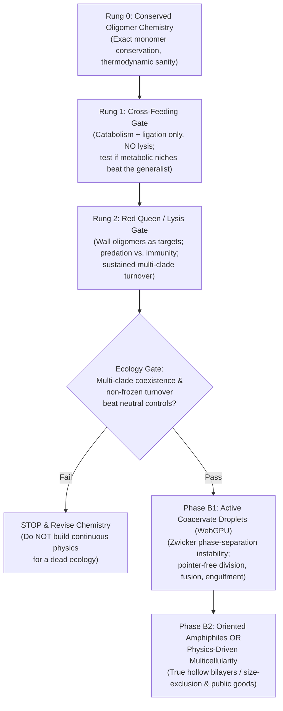

# Plan: Combinatorial Chemistry → Self-Assembling Protocells (Direction 3 → Direction 2)

> [!NOTE]
> **Why this is perpendicular to every branch so far**
> - **Main CA (`RULE_VERSION 1`), `bodies-loose`, and `vesicle-thread`** all shared two quiet assumptions: (1) a **scalar economy** (`food`, `waste`, `lipid`) tuned by **named gene bytes** (`share`, `harvest`, `digest`, `glue`), and (2) **declared topology** (grid mats or explicit `next`/`prev` linked-list rings with special-case pinch surgery).
> - In `vesicle-thread`, dividing compartments persisted for 1.5M steps, yet Stage 2 collapsed to **one generalist** in 8 of 8 worlds and Stage 4 (`ties`/`glue`) was **indistinguishable from neutral drift**.
> - This plan flips **both** assumptions — and flips the **build order**:
>   1. **Phase A (Direction 3 — Ecology First):** Put **combinatorial lock-and-key oligomer chemistry** into the cheapest possible conserved spatial compartment grid. Prove in fast runs that the chemistry *refuses* to collapse to one generalist (cross-feeding + Red Queen surface-motif arms races).
>   2. **Phase B (Direction 2 — Self-Assembling Walls):** Only *after* Phase A passes its ecological gates, replace the grid-slot compartments with **pointer-free, self-assembling physics** — **chemically active phase-separating droplets (Zwicker coacervates)** on WebGPU (and optionally oriented amphiphile bilayers), where walls nucleate, divide, fuse, and lyse from local physics alone.

---

## Roadmap Overview

---

## Part 1: Core Chemistry (Shared by Phase A and Phase B)

### 1.1 Matter: Conserved Binary Oligomers (No Scalar `food` / `waste`)

Every unit of matter is a conserved monomer of $K = 2$ types: `0` and `1`.

- **Molecular species:** Ordered bitstrings (oligomers) of length $L \in \{1, 2, 3, 4\}$:
  - Length 1 (monomers / ash): 2 species (`0`, `1`), 0 bonds.
  - Length 2 (dimers): 4 species (`00`..`11`), 1 bond.
  - Length 3 (trimers): 8 species, 2 bonds.
  - Length 4 (tetramers): 16 species, 3 bonds.
  - **Total: 30 distinct species**, stored as a flat `Int32Array(30)` per spatial unit.
- **Exact conservation law:** Each species $s$ has fixed composition $(n_0(s), n_1(s))$. Both global totals
  $$\sum n_0 = \text{const}, \qquad \sum n_1 = \text{const}$$
  must hold with **residual = 0** at every step. No reaction creates or destroys a monomer.

### 1.2 Energy: Bond Accounting (Open in Energy, Closed in Matter)

Energy is never stored as a magical scalar "food" — it lives in **chemical bonds** (and a local transient energy currency `ATP` / `E` with fast spontaneous dissipation to heat so energy cannot be hoarded infinitely):

| Process | Reaction | Energy ($\Delta E$) | Notes |
|---|---|---|---|
| **Abiotic photochemistry (light)** | $4\text{ monomers} \to s_{\text{feed}}$ (e.g., `0101` or `1010`) | Input from light | Only in lit tiles; consumes local `0`/`1` monomers; zero matter created. |
| **Spontaneous hydrolysis** | $A \cdot B \to A + B$ | Lost as heat | Slow background decay ($k_{\text{hyd}}$); prevents dead pools from freezing forever. |
| **Catalyzed cleavage (catabolism)** | $A \cdot B \xrightarrow{\text{cat}} A + B$ | $+e_{\text{bond}}$ | Releases usable chemical energy $E$ into the local compartment. |
| **Catalyzed ligation (anabolism)** | $A + B + E \xrightarrow{\text{cat}} A \cdot B$ | $-e_{\text{lig}}$ ($e_{\text{lig}} > e_{\text{bond}}$) | Strictly dissipative ($e_{\text{lig}} > e_{\text{bond}}$ prevents perpetual-motion loops!). Builds new oligomers light never makes. |

> [!IMPORTANT]
> **Thermodynamic anti-cheat invariant:** $e_{\text{lig}} > e_{\text{bond}}$ strictly. A futile cycle $A+B \to AB \to A+B$ must always *lose* energy to heat. Without light, every world must relax monotonically to monomers.

### 1.3 Catalysts: Lock-and-Key Operators (Not Named Gene Dials)

A heritable genome is a fixed-budget set of $G$ catalyst slots (start with $G = 4$ or $6$; each active slot pays a small per-step upkeep in $E$ or mass). Each catalyst is a compact bit-tuple `(op, pattern, mask, splitPos)`:

- **`op`** (2 bits):
  1. `CLEAVE_INT`: cleave matching internal oligomer $X \to A + B$ at `splitPos`, gaining $+e_{\text{bond}}$.
  2. `LIGATE_INT`: join $A + B \to X$ internally, spending $-e_{\text{lig}}$.
  3. `IMPORT` (or `CLEAVE_EXT`): import matching oligomer from external medium (or cleave extracellularly, spilling fragments locally).
  4. `LYSE_WALL` *(disabled in Rung 1, enabled in Rung 2)*: cleave a matching **wall oligomer** on a neighboring compartment, releasing its monomers/fragments into the local medium and damaging that neighbor's wall.
- **`pattern` + `mask`** (lock-and-key specificity):
  - Matches species $s$ if `(s & mask) == (pattern & mask)` and `len(s) == targetLen`.
  - Let $w \in \{0, 1, 2, 3\}$ be the number of wildcard bits (`mask` bit = 0).
- **Convex specificity–efficiency tradeoff (the anti-generalist physics):**
  $$k_{\text{cat}}(w) = \frac{k_0}{4^w}$$
  A 0-wildcard specialist (`w = 0`, matches 1 species) runs at full speed $k_0$. A 1-wildcard catalyst (`w = 1`, matches 2 species) runs at $k_0 / 4$ — **half the total catalytic capacity per target** compared to splitting two specialists. This enforces a real physical tradeoff between specialist efficiency and generalist breadth, unlike `vesicle` Stage 2 where a tiny digest byte cleared the pool.

### 1.4 Wall / Droplet Identity (Chemistry IS the Wall)

Not all 30 species behave identically in water:
- **Amphiphilic / wall-forming class $\mathcal{W}$:** Tetramers with balanced composition ($n_0 = 2, n_1 = 2$, i.e., **6 distinct wall-forming species**: `0011`, `0101`, `0110`, `1001`, `1010`, `1100` — or expand to $L_{\max}=5$ for 20 balanced wall species later).
  - Light supplies only **1 or 2** abiotic feedstocks (e.g., `0000` + `1111`, or `0101` only), so **alternative wall species must be synthesized via cleavage + ligation**!
- **Why this matters:** A cell's wall is made of *actual conserved molecules* from $\mathcal{W}$. Changing your wall composition is a real metabolic shift (you must ligate a different tetramer), and **every wall species is a potential cleavage target** for a neighbor's `LYSE_WALL` catalyst.

---

## Part 2: Phase A (Direction 3) — Fast Ecology-First Spatial Substrate

Before touching continuous physics or WebGPU shaders, build a minimal, exact-integer, CPU-fast spatial simulator (`apps/lab/src/oligomer/` or `experiments/oligomer/`) that runs 200,000 steps in seconds.

### 2.1 Spatial World Mechanics
- **Grid:** $64 \times 64$ torus (scalable to $128 \times 128$).
- **External medium:** Every tile holds `ext[0..29]` (integer counts), diffusing to 4-neighbors with unbiased stochastic rounding (exact conservation).
- **Compartment (at most 1 per tile in Phase A):**
  - Holds `int[0..29]`, `wall[w]` for $w \in \mathcal{W}$, transient energy `E`, and `genome` ($G$ catalysts).
  - **Passive permeability:** Monomers (`0`, `1`) diffuse freely across the wall; dimers (`L=2`) leak slowly; trimers and tetramers (`L=3, 4`) are retained unless moved by an `IMPORT` catalyst or released by lysis.
  - **Wall assembly & turnover:** Internal molecules in $\mathcal{W}$ spontaneously partition into the compartment's `wall` pool; wall molecules slowly desorb/hydrolyze back into `ext`.
  - **Division (physical threshold, no fitness function):** When total wall mass $\sum \text{wall}[w] \ge W_{\text{div}}$ and total internal mass $\ge M_{\text{div}}$, and an adjacent tile has no compartment, the compartment splits: `wall`, `int`, and `E` are partitioned stochastically (exact integer conservation) between the two tiles, and `genome` is copied with per-slot point mutation (flip a bit in `pattern`/`mask`/`op`/`splitPos`, or duplicate/replace a slot).
  - **Lysis (death):** If total wall mass falls below $W_{\min}$ (from starvation/hydrolysis or a neighbor's `LYSE_WALL` attack), the compartment dissolves instantaneously: every molecule in `int` and `wall` is dumped into the tile's `ext` pool (exact conservation).
- **PRNG & Reproducibility:** Counter-based integer PRNG (`splitmix32` / `philox`-style keyed on `(seed, step, tile)`), exact integer arithmetic throughout. Every run hashes deterministically.

### 2.2 Pure Observers (Never Read by Physics)
All ecological categories are inferred purely from state/event logs:
- **Clade / Genotype diversity:** Effective number of catalyst profiles (Hill number $D_1 = \exp(H)$), founder-lineage survival, and genome turnover rate.
- **Metabolic flux matrix:** Per-tile/per-compartment counts of each reaction $s \to a + b$ and $a + b \to s$, to measure **trophic specialization** (e.g., primary degraders vs. secondary cross-feeders) by *what cells actually do*, not just their bytes.
- **Wall-motif spectrum:** Population share of each wall species $w \in \mathcal{W}$ over time, plus **dominant-motif persistence time** and **motif-switch count** (Red Queen oscillation / turnover).
- **Lysis ledger:** Fraction of compartment deaths caused by starvation vs. neighbor `LYSE_WALL`, and predator–prey cross-correlation.

---

## Part 3: Phase A Falsification Gates & Controls

Every rung has pre-declared pass/fail criteria and matched controls (minimum 4–8 seeds per arm, 200k–500k steps).

### Rung 0: Conservation & Thermodynamic Sanity
- **Checks:**
  1. Global `0`-monomer and `1`-monomer residuals are strictly `0` at every step across all reactions, diffusion, division, and lysis.
  2. **Dark test (light = 0):** All worlds decay monotonically to monomers; zero compartments survive; energy $E \to 0$.
  3. **Digest determinism:** Re-running with observers on/off produces bit-identical final state hashes.

### Rung 1: Cross-Feeding & Niche Construction (No Lysis Yet)
*Question: Does combinatorial oligomer chemistry + convex specificity tradeoff alone break `vesicle` Stage 2's single-generalist collapse?*

- **Setup:** Light synthesizes only 1–2 feedstock tetramers (e.g., `0101` and `1010`). `LYSE_WALL` is **OFF**. Start from uniform generalist founders (or random viable founders).
- **Arms:**
  - `TREAT`: Convex tradeoff $k_{\text{cat}}(w) = k_0 / 4^w$.
  - `FLAT`: Flat tradeoff $k_{\text{cat}}(w) = k_0$ (control: should collapse to generalists).
  - `NEUTRAL`: Genome mutates and copies identically, but chemistry executes a fixed baseline reaction set (drift control).
- **Pass criterion:**
  - In $\ge 75\%$ of `TREAT` seeds, at least **2 functionally distinct metabolic classes** (measured by actual reaction-flux vectors, e.g., primary feedstock cleavers vs. intermediate cross-feeders) each hold $\ge 15\%$ of live compartments throughout the last 100k steps, AND functional divergence significantly exceeds both `FLAT` and `NEUTRAL`.
- **Diagnostic outcome:**
  - Even if Rung 1 only yields weak coexistence (e.g., spatial stratification), **proceed to Rung 2** — this cleanly tells us whether metabolism alone suffices or whether frequency-dependent lysis is the real engine.

### Rung 2: Red Queen Surface-Motif Arms Race (Lysis ON)
*Question: When walls are chemically diverse and neighbors can evolve lysins against specific wall motifs, do we get sustained, non-frozen evolutionary turnover?*

- **Setup:** Enable `LYSE_WALL`. Wall-forming class $\mathcal{W}$ has 6 (or 20 for $L_{\max}=5$) distinct balanced oligomers. Cells can switch wall composition via ligation catalysts.
- **Arms:**
  - `LYSE`: Full rules (`LYSE_WALL` on, convex tradeoff).
  - `NO_LYSE`: Identical rules with `LYSE_WALL` disabled (isolates predation/lysis).
  - `SINGLE_WALL`: Only 1 wall species allowed (tests whether chemical wall diversity is required; predicts boom-bust or collapse, no Red Queen).
  - `NEUTRAL_WALL`: Wall species mutates/synthesizes, but `LYSE_WALL` ignores motif matching and fires at matched mean rate (isolates motif-specific Red Queen from generic disturbance).
- **Pass criteria (ALL required to unlock Phase B):**
  1. **Persistence:** World stays populated ($\ge 20\%$ carrying capacity) for 500k steps in $\ge 75\%$ of `LYSE` seeds.
  2. **No single-generalist takeover:** No single wall motif or catalyst profile holds $> 65\%$ of live compartments continuously over the last 200k steps.
  3. **Active, non-frozen turnover:** Dominant wall motif changes $\ge 5$ times over the last 300k steps (separating Red Queen dynamics from `bodies-loose`'s frozen mosaic), with motif-turnover rate and diversity ($D_1$) strictly exceeding `NO_LYSE`, `SINGLE_WALL`, and `NEUTRAL_WALL`.
  4. **Causal arms race:** A newly rising wall motif is followed (lagged cross-correlation) by a rise in `LYSE_WALL` catalysts targeting that specific motif.

> [!CAUTION]
> **Hard Stop Condition before Phase B**
> If Rung 2 fails to produce sustained multi-clade turnover after testing the clean parameter regimes (e.g., $L_{\max} \in \{4, 5\}$, $G \in \{4, 6, 8\}$, tradeoff exponent), **do not proceed to Phase B.** Diagnose why (e.g., catalyst budget too small to switch walls, diffusion too fast/slow, lysis too lethal) in the fast Phase A harness first. Never build continuous physics around an ecology that collapses to one clade.

---

## Part 4: Phase B (Direction 2) — Pointer-Free Self-Assembling Walls

Once Phase A's chemistry passes Rung 2, we remove the artificial "1 compartment per grid tile" scaffolding and replace it with real physical self-assembly.

### 4.1 Phase B1: Chemically Active Phase-Separating Droplets (Zwicker Protocells, WebGPU-Native)

This is the cleanest bridge to `browser-life`'s WebGPU architecture (exact integer/fixed-point arithmetic, CPU reference in `packages/sim-ref`, bit-exact WGSL twin in `packages/sim-gpu`):

- **How walls/compartments form without pointers:**
  - Molecules in the wall/droplet-forming class $\mathcal{W}$ experience **local Cahn-Hilliard / Ising-like phase separation** (short-range mutual attraction on a $256 \times 256$ lattice: uphill diffusion toward higher local $\mathcal{W}$-density, balanced by a surface-tension / curvature penalty).
  - **No `Compartment` struct, no `split()` function, no `next`/`prev` pointers.**
- **How division emerges from physics alone (Zwicker instability):**
  - Inside a droplet, catalysts convert diffusing feedstock into droplet-forming oligomer $w \in \mathcal{W}$, while hydrolysis turns $w$ back into soluble fragments that diffuse out.
  - Above a critical radius $R_c$ (set by surface tension vs. turnover rate), a spherical droplet becomes shape-unstable, **spontaneously elongates into a dumbbell, and pinches into two daughter droplets**.
- **What becomes possible that Phase A and `vesicle` could NEVER do:**
  - **De novo nucleation:** Spilled droplet oligomers can spontaneously nucleate a new protocell.
  - **Fusion & horizontal gene transfer:** Two droplets with compatible $\mathcal{W}$-species can coalesce, mixing their catalyst sets.
  - **Physical lysis & chemical engulfment:** A neighbor's `LYSE_WALL` catalyst cleaving $w$ at the droplet interface locally lowers surface tension and dissolves the boundary from one side — literally eating a bite out of the droplet!
  - **Multicellularity from real physics (not `pRefuge`):** Two droplets with *incompatible* $\mathcal{W}$-species (different immiscible phases, like oil-in-water-in-oil or Janus droplets) adhere at an interface without fusing, trapping shared metabolic intermediates in the boundary layer!

#### Phase B1 Verification Gates
1. **Bit-exact CPU/GPU parity:** Integer/fixed-point CPU reference matches WGSL shaders bit-for-bit (following existing `golden.ts` harness).
2. **Physics-only division test (chemistry fixed, no mutation):** A single seeded droplet grows and spontaneously splits into 2, 4, 8 droplets without any explicit division rule.
3. **Ecology transfer test:** Running the winning Rung 2 oligomer chemistry inside B1 droplets reproduces multi-clade coexistence and Red Queen motif turnover over 500k steps (with matched `NEUTRAL_WALL` control).

### 4.2 Phase B2 (Optional Stretch): Oriented Amphiphile Bilayers
If Phase B1 succeeds and we want **hollow vesicles** (aqueous interior separated from exterior by a 1-molecule-thick hydrophobic bilayer) rather than dense coacervate droplets:
- Represent $\mathcal{W}$-molecules as particles with position $\mathbf{x}$ and orientation $\hat{u}$ (head–tail dipole) interacting via a short-range anisotropic potential (e.g., 2D Cooke–Deserno / Drouffe potential).
- Bilayer sheets curve and close into vesicles with zero ring topology; `LYSE_WALL` creates real pores that leak internal oligomers before full rupture.
- *Decision point:* Only pursue B2 if B1's dense coacervates hit a clear scientific ceiling (e.g., inability to maintain internal aqueous gradients or selective transmembrane transport).

---

## Part 5: Concrete First Implementation Slice (Phase A, Rung 0–1)

To get signal in **days, not weeks**, start on a fresh branch/worktree (leaving `claude/vesicle-thread` untouched) with a self-contained sandbox:

1. **Files to create (minimal footprint):**
   - `apps/lab/src/oligomer/chem.ts` — 30-species table (`L = 1..4`), composition `(n0, n1)`, bond counts, lock-and-key matcher, exact-conservation reaction primitives.
   - `apps/lab/src/oligomer/model.ts` — $64 \times 64$ integer spatial compartment world, unbiased conserved diffusion, division/lysis, counter-based PRNG, state digest.
   - `apps/lab/src/oligomer/observe.ts` — Pure observers (monomer ledger, flux-based trophic classes, wall-motif spectrum, Hill diversity $D_1$, motif-switch tracker).
   - `experiments/oligomer/run.ts` — Fast Deno/Node CLI to run Rungs 0, 1, and 2 with all matched controls (`TREAT`, `FLAT`, `NEUTRAL`, `LYSE`, `NO_LYSE`, `SINGLE_WALL`, `NEUTRAL_WALL`) and write compact summary tables.
   - `apps/lab/test/oligomer.test.ts` — Unit tests pinning exact monomer conservation (0 residual), dark-world decay, observer purity (same digest on/off), and determinism.
2. **First milestone (1–2 sessions):** Pass Rung 0, run Rung 1 (`TREAT` vs. `FLAT` vs. `NEUTRAL`, 4 seeds × 200k steps), and inspect whether metabolic cross-feeding alone breaks the generalist attractor — then immediately turn on Rung 2 (`LYSE_WALL`) and test the Red Queen gate.
