# Prototype status, 2 November 2026

What each app in this repo does today, how to try it on your own machine, what is not built, and what waits on you. It
supersedes [the 18 October status](prototypes-2026-10-18.md) and the [24 October snapshot](prototypes-2026-10-24.md). It
describes `origin/main` at `0bdd7a70` (PR [#149]) plus three small fixes made while writing it (see "Fixes made during
this walk"). Unlike the 18 October page, which was written from sources, this one comes from a **walk-through**: every
surface below was run on this machine the way a person would, at 1280 and 375 pixels, and given a verdict. The raw record
is [walkthrough.md](prototypes-2026-11-02/walkthrough.md). The page has an HTML twin:
[prototypes-2026-11-02.html](prototypes-2026-11-02.html).

## What waits on you

Every item is copied from a merged PR or a decision-log entry, with its default. Nothing on this list was touched while
writing this page.

1. **Deploy.** Nothing merged since the last recorded deploy (`b9b7bc36`, 16 Oct, per the 18 October page) has been
   deployed by this work, and this page checked no live host. Default: stay local.
2. **The proxy fix (D-17).** The Caddy `trusted_proxies` change and `BL_TRUST_FORWARDED_FOR=1` on the live host
   (`deploy/README.md`; opt-in forwarding landed in [#84]). Until then every visitor reaches the coordinator as one address.
3. **Opening the commons.** Founding parameters, the island token and when to link `/garden/` are the "Your decision" rows
   of `docs/garden-opening-2026-10-18.md`. The draft [#60] (opening-day copy, marked do not merge until opening day) is
   still open. Default: the garden stays private.
4. **Paid calls and AWS.** Bell v1 part C and the I02 model proposer need a yes, as does transition-hunt Stage 1 on AWS
   (D1 of the [2 November log](https://github.com/treetopdevs/browser-life/pull/150) lists them as held for you).
   Default: none run.
5. **The proposer bench.** Planned and never approved: `tools/bench.ts approve ...` is a person's act ([#49], D-26).
6. **Two draft PRs.** [#69] (anomaly-bell v3 first-census protocol) and [#130] (I01 behaviour atlas, whose first
   descriptor calibration failed; a replacement D1 is pending) are open as drafts and wait for your call.
7. **The gene line and playtests.** The next gene direction and the three-person playtest
   (`docs/playtest-kit-2026-10-18.md`) are yours; the 2 November log lists both as held for you.

## Before anything else

From a fresh clone:

```bash
pnpm install
(cd apps/coordinator && mix deps.get)
```

Run `pnpm install` before any `deno run` (Deno 2.9 otherwise writes `workspaces` into `package.json`). The second line is
what `bin/dev` and `bin/garden-dev` ask for when `apps/coordinator/deps` is missing. Commands below are the
port-qualified forms that were run here (lab on 5301, coordinator on 6301) so that parallel work never collided. The
default-port forms (5173 and 4000) are in the command table at the end, marked as read, not run. Use `pnpm dev --port N`
without a `--` separator: pnpm would pass the separator on and Vite would ignore the flags.

## Status at a glance

Four separate questions per surface: is it implemented, did it work when run locally (the verdict), is its data present in a
fresh clone, and is it deployed or externally verified. No row below is deployed or externally verified: nothing here touched
a live host, real phones or screen readers.

| Surface | Implemented | Verified locally (verdict) | Data in a fresh clone | Deployed or externally verified |
|---|---|---|---|---|
| Lab | yes | works (app; five library pages partly) | yes | not checked |
| Public site | yes | partly (bare `pnpm dev` logs a 502 on `/status/`) | yes | not checked |
| Archipelago | yes | works | yes | not checked |
| Shared garden | yes, private | works | yes (scratch garden) | no, held private |
| AI naturalist | yes | works | partly (notebook needs `runs/`) | not checked |
| Evolution game | yes | works | yes | not checked |
| Research instruments | yes | works | partly (large corpora are in `runs/`) | not applicable |

## 1. Lab

**What it is now.** The lab (`/lab/`) runs a world in the browser on WebGPU, with interventions (wound, feed, drain, sun),
checkpoints and replay, and a Light and a Membrane view. Since 18 October: refused Feed and Drain no longer read as
"World stopped" and the firsts log survives a reload ([#61]); the sun letter, a logged and replayable change to the light
([#62]); a dedicated Membrane view ([#76]); Try receipts matched to the action asked ([#77]); the focused-view button kept
inside the picker at 375 px ([#122]). The walk loaded the lab with no query ("Even light"), the breeder, gradient-m3 and a
pond world, and ran `/selftest.html`, which passed 30 of 30 cases against the CPU reference on this Mac's GPU.

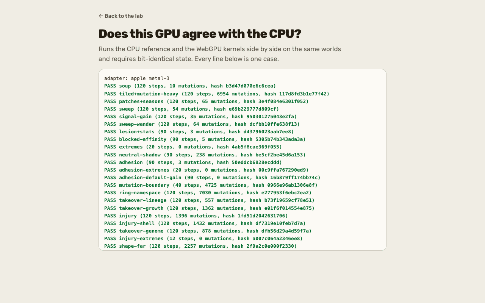
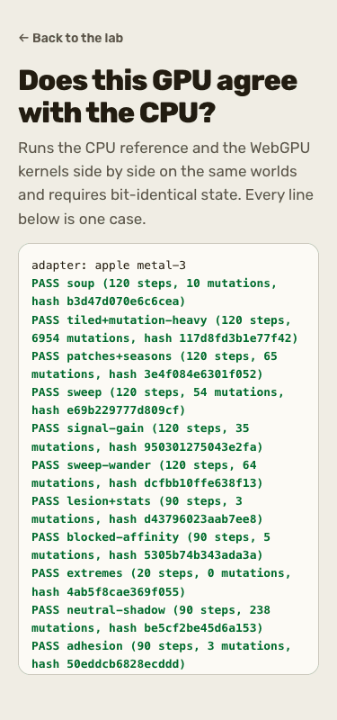

**How to try it.**

```bash
pnpm dev --port 5301 --strictPort
```

- <http://localhost:5301/lab/>: the default world.
- <http://localhost:5301/lab/?world=breeder&seed=1>: the breeder (see section 6).
- <http://localhost:5301/lab/?world=gradient-m3&seed=1>: Field notes (see section 5).
- <http://localhost:5301/selftest.html>: the CPU reference against this browser's GPU, bit for bit, in about 20 seconds.
- <http://localhost:5301/worlds/>: every world and what it asks; each card links into the lab.
- The prototype library at <http://localhost:5301/playground/> lists 15 pages ([#120] landed them): `/particles/`,
  `/particles/picker/`, `/particles/oases/`, `/particles/seasons/`, `/particles/bonds/`, `/particles/motifs/`,
  `/boundaries/`, `/hungry-shapes/`, `/development/`, `/matter/`, `/currents/`, `/spatial/`, `/ecosystem/`,
  `/ecosystem/archive/` and `/vision-screen/`. `/soup/` ([#127]) is a public page linked from Worlds.

**Not built.** Five library pages (`/playground/`, `/development/`, `/hungry-shapes/`, `/ecosystem/`,
`/ecosystem/archive/`) have no icon link, so a first load asks for `/favicon.ico` and logs a 404: their verdict is
**partly**, follow-up F1. Hail, a shell-respecting Wound and more weather controls are deferred in
[pond keeper v3](pond-keeper-v3-2026-10-22.md). The creative pages are noted in `docs/creative-prototypes/README.md` as
kept out of the production site image until separately approved.

**Waits on you.** Deploy (item 1). Approving the library pages for release.

## 2. Public site

**What it is now.** Home, Worlds, How it works, About, Participate, Privacy, Status, the research journal and the 404 page,
plus `/soup/` ([#127]). The journal was brought current twice ([#67], [#123]). Missing-page analytics and sitemap dates were
closed in [#80]; CI builds and checks the actual site image ([#89]). The walk fetched all eight pages and the 404 at both
widths: every h1 present, no horizontal scroll, no external request, and the `public-routes`, `public-site`,
`public-not-found` and `public-a11y` browser specs passed. An unknown path answers 404 with the site's own page.

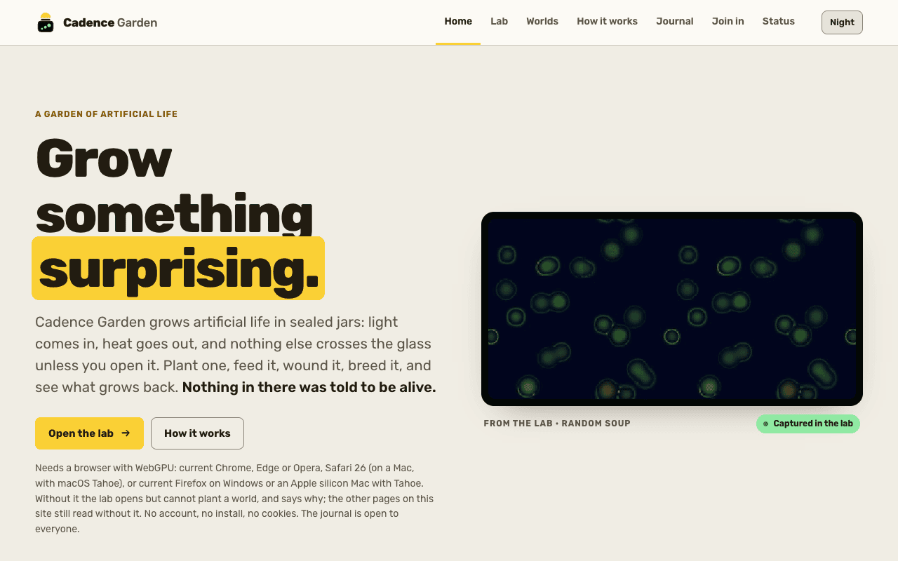
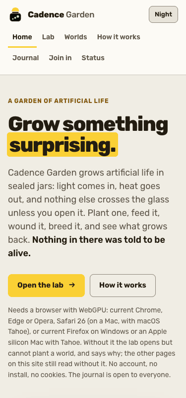

**How to try it.**

- <http://localhost:5301/>, `/research/`, `/worlds/`, `/how-it-works/`, `/about/`, `/participate/`, `/privacy/`, `/status/`
  and a missing path such as `/no-such-page/`, with the dev server from section 1.
- Under bare `pnpm dev` the dev proxy has no coordinator: `/status/` and `/garden/` log a 502 and show their unavailable
  state. Start `bin/dev` (section 3) to see them with data.

**Not built.** The build check inside `public-routes` is skipped unless `apps/lab/dist` exists; no `pnpm build` was run.
Live-domain behaviour, real devices and screen readers are not externally verified.

**Waits on you.** Deploy (item 1) and the proxy fix (item 2).

## 3. Archipelago

**What it is now.** The Phoenix coordinator (`apps/coordinator`) cuts runs into segments, hands them to islands (the
browser's `/island.html` or the headless `tools/island.ts`), has a fraction replayed by a second island and compares state
hashes. Since 18 October: islands release their leases and registration on a graceful stop ([#74]); operator counters show
refusals and pruning ([#75]); the lease length is `BL_LEASE_MS` ([#78]); islands back off on explicitly unapplied requests
([#83]); CI verifies the actual coordinator image ([#124]); production refuses to start without a discovery join token
([#125]); a shared soup runs on the archipelago ([#127]). The walk created one tiny experiment, ran one segment on a Deno
island, had a second island verify it (the segment reads "verified"), then ran a Chrome tab as an island through
`/island.html`. The browser's segment 0 digest, `06e7413bbff0dd2a`, equals the native Deno island's for the same spec.
Both islands shared one machine and one GPU type, so this is same-device-type verification.

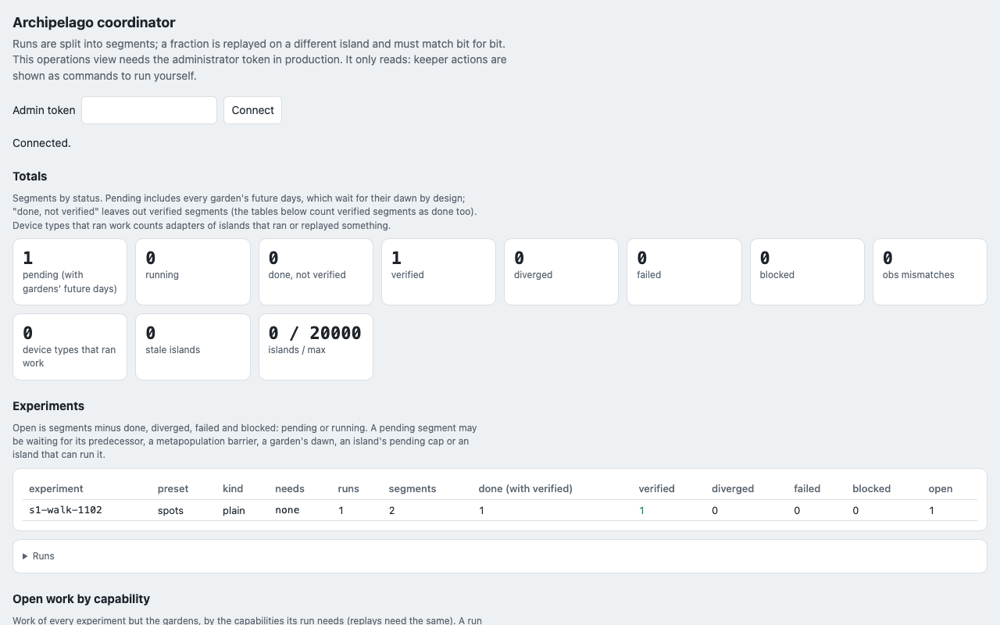
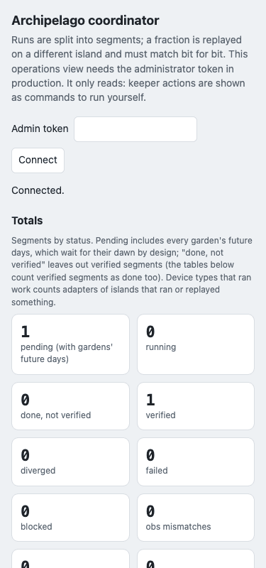

**How to try it.**

```bash
BL_DATA_DIR=/tmp/s1-coord-data LAB_PORT=5301 PORT=6301 bin/dev
curl -sS -X POST -H 'content-type: application/json' http://127.0.0.1:6301/api/experiments -d '{"experiment":"s1-walk-1102","presetId":"spots","conditions":["treatment"],"seeds":[1],"steps":40,"segmentSteps":20,"censusEvery":10,"verifyFraction":1.0}'
deno run -A --no-lock tools/island.ts --coordinator http://localhost:6301 --tasks 1
```

The curl answers `{"segments":2}`. Run the island line a second time to verify segment 0. Then open
<http://localhost:6301/index.html> (the operations page) and <http://localhost:5301/island.html> (join from a tab; it
does nothing until you press Join). `(cd apps/coordinator && mix phx.server)` runs the coordinator alone.

**Not built.** Verification across different hardware (the walk had one GPU type). Distributed branch runs and hand or
model pickers stay deferred ([archipelago breed](archipelago-breed-2026-10-18.md)). The coordinator's own test suite
(`mix precommit`) was not rerun: no coordinator code changed.

**Waits on you.** Deploy (item 1), the proxy fix (item 2), and setting the join token before any production start.

## 4. Shared garden

**What it is now.** One big storm world that volunteer islands grow a day at a time, with stones, the meteor ([#64]),
sun letters with a founding switch ([#62], [#65]), prediction receipts and, since [#81], collective food on a local garden
founded with `GARDEN_FOOD=1`. The backend is [#21]; the stone-horizon follow-up is [#59]. It is held private (the 24 October snapshot records that the release
configuration keeps its files off the public site; this walk built no release image). The walk ran `bin/garden-dev` with food on: the garden was
founded, four days were done and the tip reached day 5, run by one island and replayed by the other (day 1 was checked as "verified" by segment status), a stone sent by
curl landed in day 1, and a stone sent from the page was queued for day 16. Food has three separate states and they were
recorded separately: **food enabled** yes (the public view says so); **request accepted** yes (a hand posted by curl was
counted, 1 of 5); **collective actually fed** no, because one machine cannot make five networks. The page's own "Add my
hand" was then refused by the per-network budget, which is a rule and not a fault.

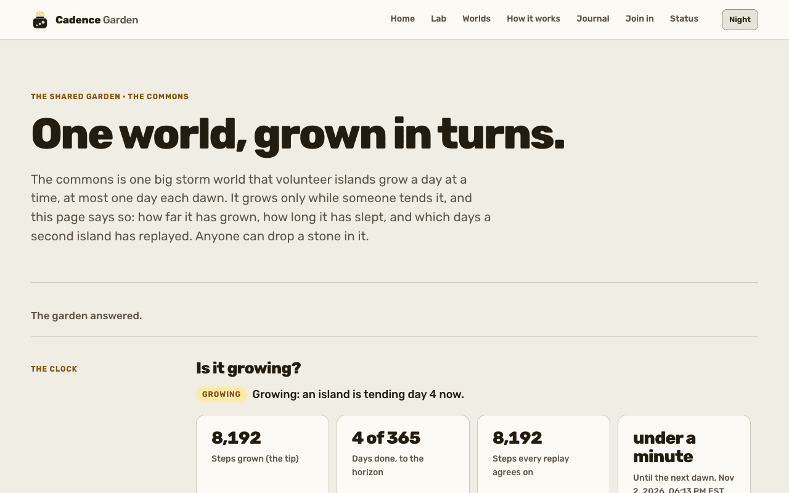
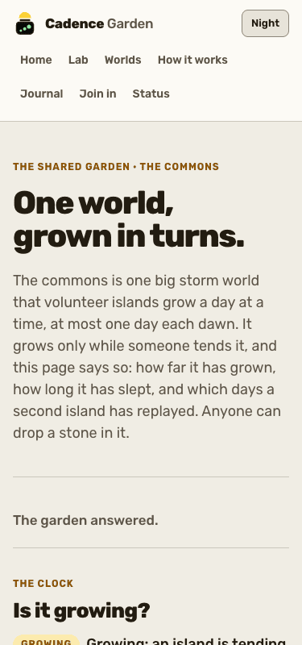

**How to try it.** Stop any other server on these ports first; the launcher starts its own lab, coordinator and two islands.

```bash
GARDEN_FOOD=1 LAB_PORT=5301 PORT=6301 GARDEN_DAWN_MS=5000 GARDEN_DATA_DIR=/tmp/s1-garden bin/garden-dev
curl -sS -X POST -H 'content-type: application/json' -d '{"kind":"stone","x":128,"y":128,"r":8}' http://127.0.0.1:6301/api/public/gardens/commons/letters
curl -sS -X POST -H 'content-type: application/json' -d '{}' http://127.0.0.1:6301/api/public/gardens/commons/food/hands
```

Then open <http://localhost:5301/garden/>. Food is read when the garden is founded, so `GARDEN_FOOD=1` must be on the
first start. Stop it with Ctrl-C from a terminal; follow-up F2 records that a `SIGINT` sent from outside left the
processes running.

**Not built.** A real collective landing (needs five networks). Public opening: the release configuration keeps the
garden private and scheduling off.

**Waits on you.** Opening the commons (item 3), including the draft [#60].

## 5. AI naturalist

**What it is now.** A rule-based bell that rings on a departure from neutral runs, the lab's Field notes panel with a
proposer's suggestion beside each note and a "Try it here" button only a person presses, and an offline notebook. Bell v2
finished with a negative readout ([#66]); the prediction envelope for a naturalist that predicts interventions ([#135])
and its fresh-family freeze ([#141]) are merged. The walk played gradient-m3 seed 1 to step 15,000 in 13 seconds: the panel
went from "Listening" to rings with one note, "Fewer living cells: 21,452 at step 10,000, against a neutral median there of
33,684", with its receipt. `tools/notebook.ts` ran on a neutral run with the full 40-run corpus present: all 40 envelope
runs reproduced their record, and the neutral run rang 0 times, as it should.

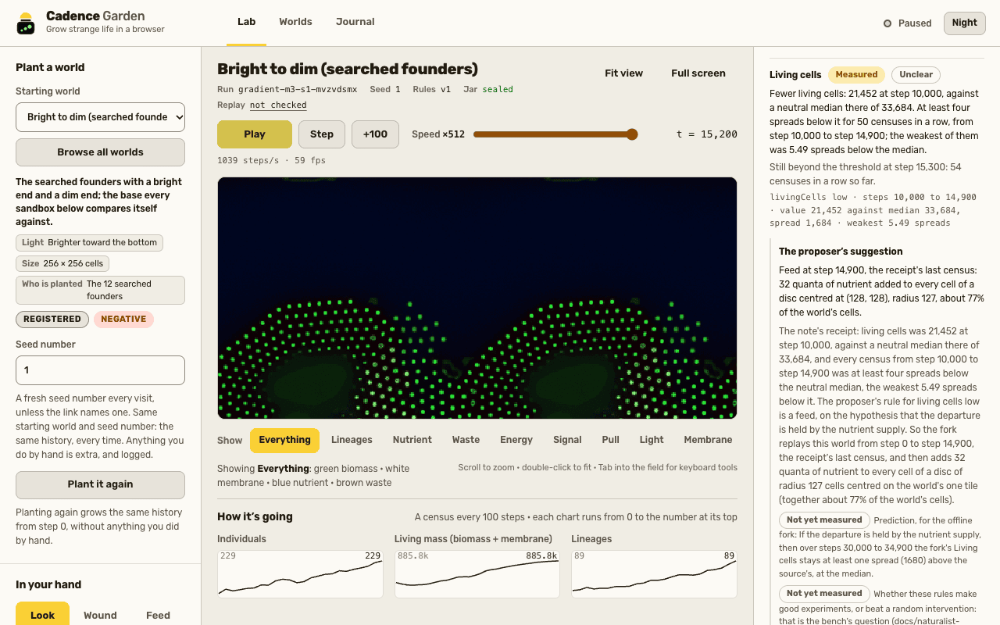
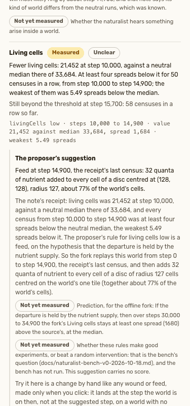

**How to try it.** With the dev server from section 1:

- <http://localhost:5301/lab/?world=gradient-m3&seed=1>, speed 9, Play until the step counter passes 15,000.
- The offline notebook needs the neutral corpus under `runs/` (in the main checkout only; absent from a fresh clone):

```bash
deno run -A --no-lock tools/notebook.ts $RUNS/replay-calib/gradient-m3/neutral/seed-1001 --base $RUNS --out /tmp/s1-notebook --date 2026-11-02
```

where `RUNS` is `~/develop/browser-life/runs`. A committed example page is at
[field-notebook-2026-10-17-gradient-m3-neutral-seed-15.html](examples/field-notebook-2026-10-17-gradient-m3-neutral-seed-15.html).

**Not built.** The proposer bench has never run ([bench](naturalist-bench-v0-2026-10-18.md)). Notes stop at the first
wound or feed, and a ring is not proof of emergence.

**Waits on you.** The bench approval (item 5), paid calls (item 4) and the draft [#69] (item 6).

## 6. Evolution game

**What it is now.** Pond keeper on the breeder and the pond worlds: a log of firsts with rules stated in advance, a family
tree, the pressure dial, Keep a lineage, weather and shells ([#71]), shell-ranked donors ([#73]) and a Membrane view
([#76]). The walk bred nothing by hand; it stepped the breeder to t = 500 (16 starting families listed, 113 individuals),
kept a lineage ("0:11"), and ran the pond cycle for eight seconds to t = 13,664 with nine firsts logged. The six pond specs
(`lab-pond-keeper`, `-v1`, `-v2`, `-v3`, `lab-naturalist-actions`, `lab-naturalist`) passed 11 checks (the 31 passed and 10 skipped in the larger run include the other files; nine skips are the not-found spec's build and Caddy checks and one is the public-routes build check, each guarded when no build or Caddy is present) by
their own guards. Gene v2 and the polymer-world screens landed in [#71]; their readouts are Unclear or no pass at their
stated scope, so they are results, not missing code.

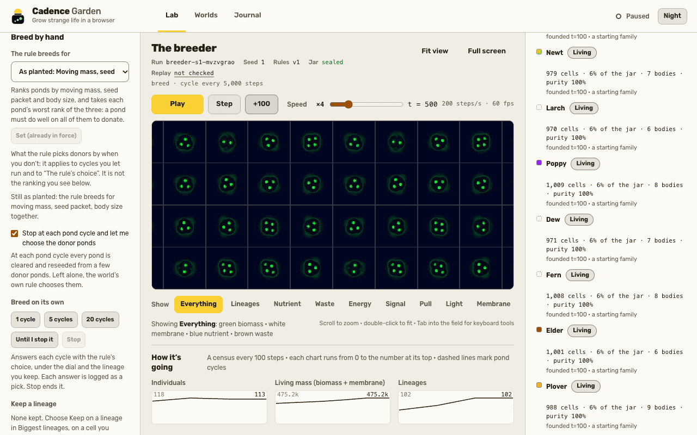
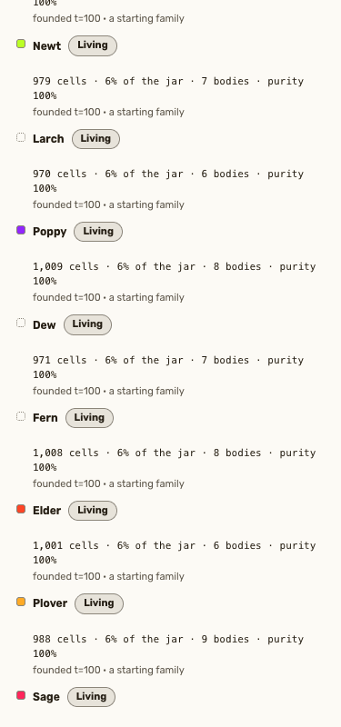
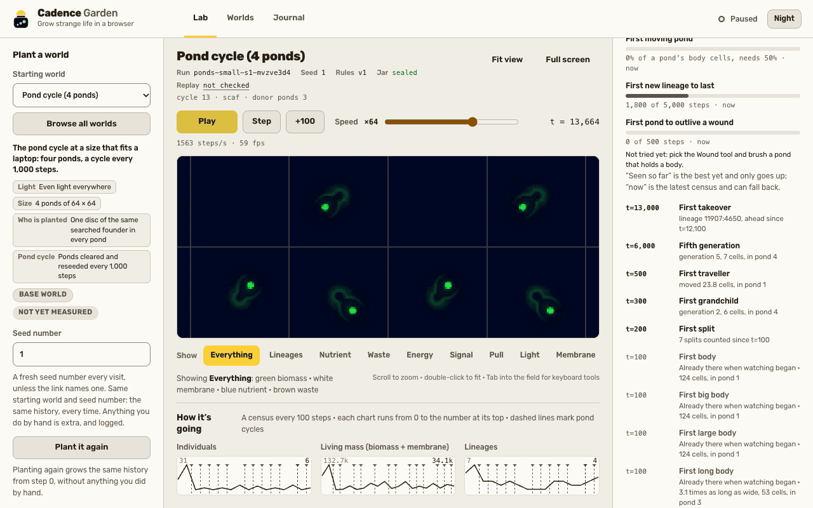
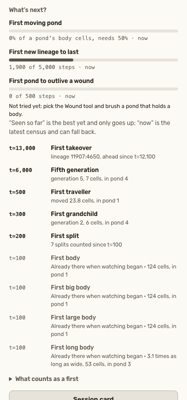

**How to try it.** With the dev server from section 1: <http://localhost:5301/lab/?world=breeder&seed=1> (tick "Stop at each
pond cycle", press +100 five times, read "Who's kin to whom?") and <http://localhost:5301/lab/?world=ponds-small&seed=1>
(Play at speed 6 and watch the log of firsts). The repeatable checks:

```bash
BL_E2E_PORT=5311 npx playwright test lab-pond-keeper.spec.ts lab-pond-keeper-v1.spec.ts lab-pond-keeper-v2.spec.ts lab-pond-keeper-v3.spec.ts lab-naturalist-actions.spec.ts lab-naturalist.spec.ts lab-worlds.spec.ts lab-lineage.spec.ts public-routes.spec.ts public-not-found.spec.ts public-site.spec.ts --project=chrome --workers=1
```

**Not built.** A family split needs 5,000 steps of censuses, so the short walk saw none; the vitest tests carry that rule.
Hail and new breeding scores are deferred ideas. Human playtests have not run.

**Waits on you.** The playtest and the next gene direction (item 7).

## 7. Research instruments

**What it is now.** Headless run, lineage and report tools on native WebGPU, plus the I-series pages and results landed on
2 November. The walk wrote a 3,000-step run bundle with `tools/run.ts` (conservation exact, 37 lineages), built a lineage
dossier for its top lineage with `tools/lineage.ts` (1 of 1 ancestors verified against the recorded genomes), and rendered
it as an HTML report with `tools/report-html.ts`. Merged since 18 October: the recovery assay evidence ([#72]), the creative
playground and food-band experiments ([#120], [#121]; [#85] and [#101] were closed unmerged and their work landed through
those), the byte-exact program soup port ([#126], [#128]), the I01 atlas slices 1 and 2 ([#132]), the predictability atlas
and observer benchmark ([#133]), the controller-locality matrix ([#136], [#145]), the historical-opponent assay first rung
([#139]), the builder to receiver transfer first rung ([#142]), the moving-light navigation benchmark ([#144]) and the
assembly-inspired observer calibration ([#148]). Their local report pages (`/predictability/`, `/assembly/`, `/niche/`,
`/moving-light/`, `/controller-locality/`, `/opponents/`) all loaded with no console error; they are static reports and no
spec covers them.

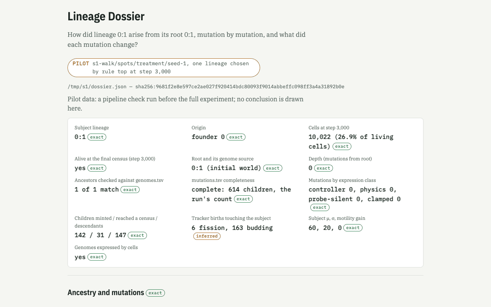
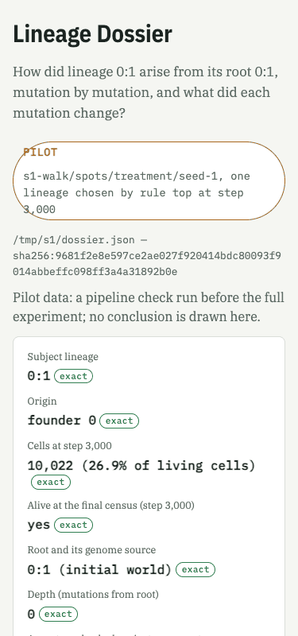

**How to try it.**

```bash
mkdir -p /tmp/s1
deno run -A --no-lock tools/run.ts --experiment s1-walk --preset spots --conditions treatment --seeds 1 --steps 3000 --census 100 --lineage-obs --out /tmp/s1-runs
deno run -A --no-lock tools/lineage.ts --dir /tmp/s1-runs/s1-walk/spots/treatment/seed-1 --rule top --out /tmp/s1/dossier.json
deno run -A --no-lock tools/report-html.ts lineage /tmp/s1/dossier.json --out /tmp/s1/lineage-report.html --status PILOT
```

Never run `tools/run.ts` bare: its defaults are 20,000 steps and the checkout's `runs/`. Open the written HTML in a browser.

**Not built.** The I03 historical-opponent tournament and the I06 comparators belong to parallel slices and are not
described here. The large scientific corpora live in `runs/` of the main checkout and are absent from a fresh clone.

**Waits on you.** The draft [#130] (item 6), AWS and paid calls (item 4).

## Follow-up slices

Larger or non-local things found by the walk, each with a repro. None was fixed here.

| ID | Surface | Repro | Observed | Expected | Suspected file |
|---|---|---|---|---|---|
| F1 | Lab library | `pnpm dev --port 5301 --strictPort`, open `/playground/` in a fresh Chrome profile with the console open; `curl -s -o /dev/null -w '%{http_code}' localhost:5301/favicon.ico` prints 404 | console error "Failed to load resource ... 404" on first load of five pages | no console error | add `<link rel="icon" href="/favicon.svg" type="image/svg+xml">` to `apps/lab/playground/index.html`, `development/`, `hungry-shapes/`, `ecosystem/` and `ecosystem/archive/` |
| F2 | Garden launcher | start `bin/garden-dev` under `nohup sh -c ... &`, then `pkill -INT -f bin/garden-dev` | launcher, coordinator, Vite and both islands kept running 8 seconds later; `pkill -TERM` stopped them | Ctrl-C stops everything | `bin/garden-dev` signal handling; not reproduced from an interactive terminal |
| F3 | Public site | bare `pnpm dev`, open `/status/` or `/garden/` | console 502 from the dev proxy; page shows its unavailable state | none under the dev server, or a documented note | `apps/lab/vite.config.ts` proxy; low priority |

## Fixes made during this walk

| Fix | Files | Regression coverage |
|---|---|---|
| The Worlds page jump list has 8 links, the test counted 7 (the soup page's "A different chemistry" entry was added by `feff1c1b`) | `tests/e2e/lab-worlds.spec.ts` | the spec itself, rerun: 6 of 6 passed |
| `/soup/` failed 4 accessibility checks: a legend `div` with an `aria-label` and no role; the skip link goes to `#soup-main` on purpose | `apps/lab/soup/index.html` (`role="group"` on both legends), `tests/e2e/public-a11y.spec.ts` (a `SKIP` entry) | `public-a11y` filtered to soup: 5 of 5 passed |

No physics, `RULE_VERSION`, golden pin or `defaultConfig()` was touched.

## Verdicts and screenshots

Rules fixed before the walk: **works** means it loads, logs no console error and its main action visibly completes;
**partly** means it loads but a named action fails, needs an unlisted step or logs an error; **broken** means it does not
load or crashes. A 200 alone is never works for a GPU page; `/selftest.html` is works only with 30 cases all passing and no
`window.__golden.error`. Shots are native 1280 or 375 pixels wide by 800 tall, no crop or scale, listed in
[shots.json](prototypes-2026-11-02/shots.json).

| Surface | Verdict | Deciding assertion | Screenshots | Walkthrough rows |
|---|---|---|---|---|
| Lab | works | scope: the lab app rows W10 to W15 (breeder, gradient-m3 and pond load, run and log no error; selftest 30 of 30); the five library pages with the favicon error are partly, listed below | [1280](prototypes-2026-11-02/shots/05-selftest-1280.png), [375](prototypes-2026-11-02/shots/05-selftest-375.png) | W10 to W15 |
| Public site | partly | 9 routes with h1, 404 body, no scroll, 0 external requests; `/status/` logs a dev-proxy 502 under bare `pnpm dev` (works with the coordinator up, W08, F3) | [1280](prototypes-2026-11-02/shots/01-site-home-1280.png), [375](prototypes-2026-11-02/shots/01-site-home-375.png) | W01 to W09 |
| Archipelago | works | segment done, then verified by a second island; browser island segment equals the native digest | [1280](prototypes-2026-11-02/shots/07-coordinator-status-1280.png), [375](prototypes-2026-11-02/shots/07-coordinator-status-375.png) | W39, W42 to W44 |
| Shared garden | works | scope: under `bin/garden-dev` (bare `pnpm dev` is W40, partly); four days done (tip at day 5), day 1 verified, stone landed, food states recorded separately | [1280](prototypes-2026-11-02/shots/06-garden-1280.png), [375](prototypes-2026-11-02/shots/06-garden-375.png) | W41 |
| AI naturalist | works | Field notes rang at step 15,000 with a receipt; notebook reproduced the 40-run envelope | [1280](prototypes-2026-11-02/shots/03-lab-gradient-m3-field-notes-1280.png), [375](prototypes-2026-11-02/shots/03-lab-gradient-m3-field-notes-375.png) | W13, W48 |
| Evolution game | works | family tree and firsts populate; six pond specs pass | [1280](prototypes-2026-11-02/shots/02-lab-breeder-families-1280.png), [375](prototypes-2026-11-02/shots/02-lab-breeder-families-375.png), [pond 1280](prototypes-2026-11-02/shots/04-lab-pond-firsts-1280.png), [pond 375](prototypes-2026-11-02/shots/04-lab-pond-firsts-375.png) | W11, W12, W14, W49 |
| Research instruments | works | run, lineage and report exit 0; static report pages load clean | [1280](prototypes-2026-11-02/shots/08-research-lineage-report-1280.png), [375](prototypes-2026-11-02/shots/08-research-lineage-report-375.png) | W33 to W38, W45 to W47 |

Library pages that are **partly** (favicon, F1): `/playground/`, `/development/`, `/hungry-shapes/`, `/ecosystem/`,
`/ecosystem/archive/`. The bare-`pnpm dev` `/garden/` is also partly (no coordinator), and works under `bin/garden-dev`.

## How this page was written

The status columns, the verdict rules and the screenshot matrix were fixed before the walk (see the plan in
`prototypes-2026-11-02/PLAN.md`). The route inventory was enumerated from `apps/lab/vite.config.ts` and
`apps/lab/src/playground/page.ts`, not from memory. Claims cite a merged PR, a doc on main or a log entry. The draft PRs
[#60], [#69] and [#130] are named as drafts; [#85] and [#101] were closed unmerged. Nothing was committed, deployed, paid for or
run on AWS.

## How each command was checked

"Ran" means executed on this checkout in this walk. "Read" means taken from the repository's own instructions and not run.
The default-port forms are a documented translation of the port-qualified commands and were not run.

| Command | Default-port form (read, not run) | Check |
|---|---|---|
| `pnpm install` | same | Ran (already up to date) |
| `(cd apps/coordinator && mix deps.get)` | same | Ran |
| `pnpm dev --port 5301 --strictPort` | `pnpm dev` (lab on 5173) | Ran |
| `BL_DATA_DIR=/tmp/s1-coord-data LAB_PORT=5301 PORT=6301 bin/dev` | `bin/dev` (5173 and 4000) | Ran |
| `curl -sS -X POST -H 'content-type: application/json' http://127.0.0.1:6301/api/experiments -d '{"experiment":"s1-walk-1102","presetId":"spots","conditions":["treatment"],"seeds":[1],"steps":40,"segmentSteps":20,"censusEvery":10,"verifyFraction":1.0}'` | same body against `localhost:4000` | Ran (HTTP 200, 2 segments) |
| `deno run -A --no-lock tools/island.ts --coordinator http://localhost:6301 --tasks 1` | `--coordinator http://localhost:4000` | Ran twice (run, then verify) |
| `GARDEN_FOOD=1 LAB_PORT=5301 PORT=6301 GARDEN_DAWN_MS=5000 GARDEN_DATA_DIR=/tmp/s1-garden bin/garden-dev` | `GARDEN_FOOD=1 bin/garden-dev` | Ran |
| `curl -sS -X POST -H 'content-type: application/json' -d '{"kind":"stone","x":128,"y":128,"r":8}' http://127.0.0.1:6301/api/public/gardens/commons/letters` | same against `:4000` | Ran (HTTP 201) |
| `curl -sS -X POST -H 'content-type: application/json' -d '{}' http://127.0.0.1:6301/api/public/gardens/commons/food/hands` | same against `:4000` | Ran (HTTP 201, counted) |
| `deno run -A --no-lock tools/notebook.ts $RUNS/replay-calib/gradient-m3/neutral/seed-1001 --base $RUNS --out /tmp/s1-notebook --date 2026-11-02` | same | Ran; needs data (the corpus in the main checkout's `runs/`) |
| `mkdir -p /tmp/s1` | same | Ran |
| `deno run -A --no-lock tools/run.ts --experiment s1-walk --preset spots --conditions treatment --seeds 1 --steps 3000 --census 100 --lineage-obs --out /tmp/s1-runs` | same | Ran |
| `deno run -A --no-lock tools/lineage.ts --dir /tmp/s1-runs/s1-walk/spots/treatment/seed-1 --rule top --out /tmp/s1/dossier.json` | same | Ran |
| `deno run -A --no-lock tools/report-html.ts lineage /tmp/s1/dossier.json --out /tmp/s1/lineage-report.html --status PILOT` | same | Ran |
| `BL_E2E_PORT=5311 npx playwright test lab-pond-keeper.spec.ts lab-pond-keeper-v1.spec.ts lab-pond-keeper-v2.spec.ts lab-pond-keeper-v3.spec.ts lab-naturalist-actions.spec.ts lab-naturalist.spec.ts lab-worlds.spec.ts lab-lineage.spec.ts public-routes.spec.ts public-not-found.spec.ts public-site.spec.ts --project=chrome --workers=1` | default port 5174 | Ran (31 passed, 10 skipped, 1 failed then fixed) |
| `(cd apps/coordinator && mix phx.server)` | same | Read |

[#21]: https://github.com/treetopdevs/browser-life/pull/21
[#49]: https://github.com/treetopdevs/browser-life/pull/49
[#59]: https://github.com/treetopdevs/browser-life/pull/59
[#60]: https://github.com/treetopdevs/browser-life/pull/60
[#61]: https://github.com/treetopdevs/browser-life/pull/61
[#62]: https://github.com/treetopdevs/browser-life/pull/62
[#64]: https://github.com/treetopdevs/browser-life/pull/64
[#65]: https://github.com/treetopdevs/browser-life/pull/65
[#66]: https://github.com/treetopdevs/browser-life/pull/66
[#67]: https://github.com/treetopdevs/browser-life/pull/67
[#69]: https://github.com/treetopdevs/browser-life/pull/69
[#71]: https://github.com/treetopdevs/browser-life/pull/71
[#72]: https://github.com/treetopdevs/browser-life/pull/72
[#73]: https://github.com/treetopdevs/browser-life/pull/73
[#74]: https://github.com/treetopdevs/browser-life/pull/74
[#75]: https://github.com/treetopdevs/browser-life/pull/75
[#76]: https://github.com/treetopdevs/browser-life/pull/76
[#77]: https://github.com/treetopdevs/browser-life/pull/77
[#78]: https://github.com/treetopdevs/browser-life/pull/78
[#80]: https://github.com/treetopdevs/browser-life/pull/80
[#81]: https://github.com/treetopdevs/browser-life/pull/81
[#83]: https://github.com/treetopdevs/browser-life/pull/83
[#84]: https://github.com/treetopdevs/browser-life/pull/84
[#85]: https://github.com/treetopdevs/browser-life/pull/85
[#89]: https://github.com/treetopdevs/browser-life/pull/89
[#101]: https://github.com/treetopdevs/browser-life/pull/101
[#120]: https://github.com/treetopdevs/browser-life/pull/120
[#121]: https://github.com/treetopdevs/browser-life/pull/121
[#122]: https://github.com/treetopdevs/browser-life/pull/122
[#123]: https://github.com/treetopdevs/browser-life/pull/123
[#124]: https://github.com/treetopdevs/browser-life/pull/124
[#125]: https://github.com/treetopdevs/browser-life/pull/125
[#126]: https://github.com/treetopdevs/browser-life/pull/126
[#127]: https://github.com/treetopdevs/browser-life/pull/127
[#128]: https://github.com/treetopdevs/browser-life/pull/128
[#130]: https://github.com/treetopdevs/browser-life/pull/130
[#132]: https://github.com/treetopdevs/browser-life/pull/132
[#133]: https://github.com/treetopdevs/browser-life/pull/133
[#135]: https://github.com/treetopdevs/browser-life/pull/135
[#136]: https://github.com/treetopdevs/browser-life/pull/136
[#139]: https://github.com/treetopdevs/browser-life/pull/139
[#141]: https://github.com/treetopdevs/browser-life/pull/141
[#142]: https://github.com/treetopdevs/browser-life/pull/142
[#144]: https://github.com/treetopdevs/browser-life/pull/144
[#145]: https://github.com/treetopdevs/browser-life/pull/145
[#148]: https://github.com/treetopdevs/browser-life/pull/148
[#149]: https://github.com/treetopdevs/browser-life/pull/149
