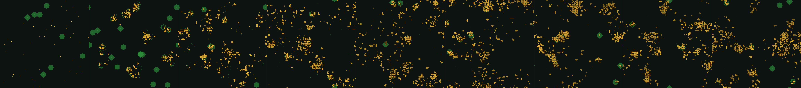

# Roam: bodies that occupy space and have to go to their food (probe, 2026-11-23)

Exploratory, one day, seeds 1 and 2 only, nothing registered. It replaces the droplet-genes compartments as the
one world the ladder is climbed in: three looks there (a bigger body, a heading, chasing fuel) all lost to a full
arena of small dots that never had to move, and the user asked for a world "where a body is a thing that occupies
space and has to go to its food".

Best case stated before building: *you will see bodies travel between food patches and leave them empty behind,
some arriving first and some starving.*

Code: `apps/lab/src/roam/` (kernel, view, page, worker), page `/roam/` (dev server only, not in the site build),
runner `experiments/roam/look.ts`, tests `apps/lab/test/roam.test.ts`.

## The rules, briefly

- A cell sits on one tile and holds matter. A bond joins a cell to a daughter it made and forms no other way, so
  bodies never fuse. **Bodies are not declared**: each step the bonded groups are found by walking the bonds. The
  rules then act on a group as a whole (shared store, one move), which is a rule about groups, not a local rule.
- A body eats the food under its cells into one shared store, pays a leak through every outward-facing side plus a
  little per cell plus the effort of moving, and when it cannot keep its cells it gives them up one at a time.
- A body moves one tile as a rigid piece and is blocked by other bodies.
- A full cell divides. While the body is under the adult size its gene asks for, the daughter stays bonded;
  after that the daughter is let go as a new one-cell body.
- Five genes per cell (whole numbers, copied with small errors): chase (speed up the food-scent slope), drive
  (speed along the heading), turn, adult size, shape (daughters placed along or across the heading).
- **Matter is closed and exact.** Food on the ground + matter in cells + one reservoir is the starting total at
  every step. Everything cells lose goes to the reservoir, which gives it back as whole patches at hash-chosen
  places. Waste never returns where the body that made it is. No parasite.

## What was seen (128 x 128, default settings)

- **Against the sentence: bodies travel and patches are eaten empty; "some starving" is true but a third of it
  is newborns.** Cells alive at both ends of a 200-step window end a mean 4 to 6 tiles away (59 to 77% of them 2
  or more tiles), against 50 at top speed, so in any short stretch most bodies are milling at a patch. Over 2,000
  steps the cells still alive (about 1,050 of 1,450) end a mean 18 to 23 tiles away, nearly all of them more than
  2. A new patch lands about every 58 steps, a patch is eaten to nothing in a few hundred steps, and about 55 to 80 bodies die per 1,000
  steps among 350 to 390 bodies of 1 to 9 cells, with as many new bodies. About a third of those deaths (19 to
  32 per 1,000 steps) are cells let go at birth that never joined or made another cell; the rest had been part of
  a larger body. This is my reading of frames and counts; the user's eye decides.
- **The arena does not fill.** About 1,450 cells on 16,384 tiles (9%), held there by the total matter. About a
  quarter of bodies are single cells at any time.
- **Eight-cell bodies against one-cell bodies** (same genes except adult size, no copy errors, 160,000 steps):
  the one-cell type booms first, then the eight-cell type overtakes it and leads. On seed 2 the one-cell type is
  extinct by step 160,000. On seed 1 it is behind and not gone, and it came back from 244 cells at step 120,000
  to 486 (against 994) at 160,000, so the two may be able to live side by side. This is the contest the droplet
  world lost. The reason is a rule we wrote (a cell leaks through every outward side), not something found.
- **Sitters and random wanderers lose to chasers** on both seeds, with no copy errors: sitters are gone by step
  8,000 and wanderers by 16,000. For sitters this is true by construction (food never comes to them).
- **With copy errors, bodies evolve to roam more.** Over 100,000 steps the mean drive gene rose from 64 to 201
  (seed 1) and 194 (seed 2), and travel per 200 steps from about 5 to 8 to 10 tiles. Drive moved furthest of the
  five genes on both seeds and in the same direction (the others: chase +29 and +1, turn +1 and -19, adult -63
  and -110, shape -3 and +62). There is no drift control, so this is consistent with selection and not a test of
  it. The adult size asked for fell from 8 cells to 7 and 6.

Review: two Codex passes (Sol 6.1, High), neither found a conservation or overlap bug. The first found that the
order bodies moved in favoured low tile numbers (now a fresh hash order each step), an axis preference when a
diagonal move is blocked (now a coin), weak tests, unchecked runner options and lost steps in the page's pacing.
The second found the same kind of tile-order favour among the cells of one body (which cell divides first, which
tip a starving body gives up, who gets the odd unit; all now by hash) and more weak tests. Every number and
picture here is from runs after all the fixes. The last fixes were not re-reviewed.

## Where this leaves the ladder

In this world, on seen seeds only: individuals that divide and die (yes), heredity (yes, genes copy with errors),
selection between individuals (chasers displace sitters and wanderers, eight-cell bodies lead one-cell ones; the drive result is suggestive). None of this is
confirmed on unseen seeds. The genes are still five dials we wrote, so rung 4 (heredity that can invent) is the
next missing rung here as it was in the droplets.

## Not done, and weak spots

- Bodies crowd into a jam on each patch, and from a distance the herd reads as one blob; whether single bodies
  read as creatures is the user's call.
- Being bigger pays against single cells (above), but within the evolving runs the adult size asked for drifted
  down from 8 to 6 or 7 cells, and nothing grew past 9 cells.
- No rotation: a long body heading sideways moves broadside.
- One arena size, one matter total, one patch size were tried.

# Second probe, same day: bodies grown by a plan, and feeding by touch

The user watched the first probe and said it was "pretty interesting ... in the direction of what I was looking
for", "only like a hint", and to keep going. This is the next rung in the same world: heredity that can invent.
Intent, as stated before building: if it works completely, you will see bodies with outlines nobody drew,
different outlines winning on different runs, and descendants that look unlike the founders.

Both additions are config switches that are absent by default; a pinned-digest test holds the first probe's
histories unchanged.

## What was added

**Growth by plan** (`plan`). Every cell carries a plan: a table of 16 modes. A cell is in one mode, and when it
holds enough to divide, its mode says where the daughter goes (in front, right, behind or left of the way the
cell faces), whether she is kept or let go as a new body, which mode a kept daughter starts in, and which mode
the cell moves to. A cell faces away from its mother. A new body starts as one cell in mode 0. A cell whose tile
is taken waits. A body at 32 cells lets go of a daughter its plan says to keep. Copy errors happen only when a
new body is let go: one entry of the plan changes (chance 0.05 per new body in these runs), and the three
movement genes change as before (0.02 each). The adult and shape genes do nothing in this mode. Six plans are
written by hand as founders: a line of 8, a 3 x 3 plate, a cross, a 2 x 4 block, a speck (always one cell) and a
bush (branches until the size limit).

**Feeding by touch** (`drain`). Where cells of two bodies touch and one body is at least twice the other's size,
2 units of matter per step pass through that side from the smaller body's cell to the larger one's. A new body is
exempt both ways for its first 100 steps and spends them moving straight away from its parent at top speed.

## What happened (seeds 1 and 2, 128 x 128, runs after all fixes)

Without touch feeding:

- All six planted shapes together, no copy errors, 100,000 steps: the compact ones win. Plates take 1,156 and
  1,002 of about 1,200 cells; lines, crosses and bushes are gone; blocks and specks hang on.
- Blocks with copy errors, 150,000 steps: nothing bigger than the block appears. About a fifth of bodies are
  full blocks at any time, and 14 to 30 plans are alive at a time, most of them giving smaller outlines (two or three cells,
  an L). The drive gene rises from 64 to 191 and 185, as in the first probe.
- All six founders with copy errors, 150,000 steps: specks take everything on both seeds (1,455 of 1,455 cells
  and 1,449 of 1,449); the largest body left is four cells. Without copy errors the specks lose to the plates
  (above), so copy errors change who wins; why was not looked into. With grazing alone, heritable outlines stay
  small or go to single cells.
- A check on the first probe's world gave the same sign: a 16-cell type planted against the 8-cell chasers was
  gone by step 100,000 on both seeds, and in three other food layouts it was gone or still falling on five of six runs. A rigid body
  only reaches fresh food along its leading edge, so a bigger blob eats less per cell.

With touch feeding:

- All six planted shapes, no copy errors: bushes (the 32-cell plan) take everything within 20,000 steps and hold
  about 1,000 to 1,100 cells.
- All six with copy errors, 150,000 steps, both seeds: 35 to 130 bodies, about 1,000 to 1,150 cells, most of them
  in 32-cell bodies with 34 to 50 different outlines alive at once (a body's outline also depends on what was in
  its way while it grew and on cells it lost when hungry). 100 to 175 body deaths per 1,000 steps, most of them
  new one-cell bodies. 2 to 12 plans alive at a time; about 1,200 plans appeared in each run. Around 20,000 units
  of matter per 1,000 steps pass by touch.
- Blocks with copy errors: on seed 1 the blocks hold for about 55,000 steps, then a plan appears that grows a
  ladder two cells wide and 16 long, and by step 80,000 the world is 20 or so ladders and their young; it stays
  that way to step 150,000. On seed 2 no such plan had appeared by step 150,000 and the world is still blocks.

## How to read this

- One clearly new form appeared and took over: the ladder. Grown alone, its plan makes a strip two cells wide and
  16 long; it is the planted block with a single entry changed. At step 150,000 on seed 1 all 1,033 cells carry
  it or a near copy that grows the same strip. That is the part of the intent that is met, once, on a seen seed.
- The spiked 32-cell bodies in the all-six runs are mostly not new. At step 150,000 every survivor on both seeds
  descends from the planted bush. Each surviving plan was grown alone and its outline set beside the bush's
  (`experiments/roam/plans.ts`): on seed 1, 1,087 of 1,090 cells are in plans that grow exactly the bush; on
  seed 2, 702 of 1,030 are, and the other 328 are in plans with one entry changed that grow something else: a
  taller, narrower bush (261 cells), a straight line 32 long (41 cells), and one 26-cell slab that never lets a
  daughter go. So new forms do arise and persist there, as a minority.
- The many outlines counted in those runs (34 to 50) come mostly from what was in a body's way while it grew and
  from cells lost when hungry, not from different plans. Colour by plan also overstates variety: a change in an
  entry a body never uses gets a new colour and grows the same thing.
- Blocks on seed 2 (no ladder): 1,086 of 1,107 cells still grow the planted block; 21 are in near-blocks of
  seven cells.
- Bodies got big only once being big was made to pay by a rule we wrote (the larger feeds on the smaller), and
  they then ran to the 32-cell limit we set. Size here is selected by our rule and capped by our number. Which
  outline a 32-cell body has is not what is being selected, as far as these runs show.
- "Different on different runs" is seen once (ladders on seed 1, blocks still on seed 2) on two seeds.
- Two versions of the touch rule were tried and dropped the same day: any larger body feeding on any smaller one
  (a few 32-cell bodies ate everything and the world froze), and a size-limit rule under which a cell moved to
  its next mode when it let a daughter go at the limit (bodies at the limit ran out of dividing cells and became
  sterile; three of four runs ended as one to three bodies that never reproduced). The numbers above are with the
  cell staying in its mode at the limit.

Review: three more Codex passes (Sol 6.1, High). The first found one bug (a new body that was blocked while running
from its parent turned round), a remaining walk-order favour in which cell of a body divides first (now a hash
per cell), an outline count that could split one outline in two on a tiny arena, and four tests weaker than their
names. The second found no bug in the rules and two small points in the reporting code. The third looked at those two
fixes and at the plan-growing tool, and found two ways the tool could mislead (stopping a slow grower early, and
calling a mode used when it can only be reached on paper); both are fixed, and the tool's fixes were not
re-reviewed. 27 tests in `apps/lab/test/roam.test.ts`.

The page (`/roam/`) now opens on the six founders with copy errors and touch feeding. To see the ladders arrive,
choose "grown: blocks", seed 1, and "as fast as it goes": the first ladders show around step 55,000.

Videos (in the worktree's `runs/roam/`, not committed): `v-grown-start-s1` (all six founders with touch feeding,
steps 0 to 20,000), `v-grown-invasion-s1` (blocks, steps 50,000 to 90,000: the ladders arrive),
`v-grown-late-s2` (all six, steps 100,000 to 103,000 at three steps a frame).

## Where this leaves the ladder

Heredity that can invent: a first version exists; it produced one clearly new form (the ladder) and one modest
one (the narrower bush) on seen seeds. Creatures that visibly differ from their ancestors and between runs: seen
once each way, on two seeds, and only with a size-pays rule and a size limit that we wrote. Not shown: that an
outline matters to the body that has it. Rungs 1 to 3 in this world are still on seen seeds only; the
unseen-seed check was put off because the rules were about to change, and is still owed.

## The garden look (2026-11-24)

On the user's ask, the page now opens in a "garden look" modelled on the main garden world's composite view: a near-black ground with a blue haze where food lies, each body drawn as one soft blob (a field summed over its cells, so cells of one body run together and two bodies pressed together keep a seam) with a pale rim, lit inside by how full its store is, tinted part-way toward its plan's colour, and a soft glow over everything. Picture only; the world's rules and digests are unchanged. Painting costs about 44 ms a frame at 128 x 128 (6 pixels a tile) against 6 ms for the flat paints. Pictures: `garden-look.png`, `garden-look-zoom.png` (seed 2, six founders, touch feeding, step 101,500). Review: Codex found only a stale food-colour legend (fixed).

## Matter that travels, cells that die, bodies that break (2026-11-24)

The user's point after the garden look: the look is better, but nothing comes and goes. Growth needs a push and a
balance that is not just a size limit. Stated before building: "bodies that grow, lose starving limbs, and pinch
into pieces that wander off and regrow; sizes and shapes that rise and fall within one run with no size limit we
set; lineages settling on different growth plans on different seeds because the shapes that survive their own
breakups differ."

What was added (config `flow`, needs `plan`; old configs hash as before, checked on six configs over 1,500 steps):

- Each cell keeps its own store, eats into it from its own tile (up to four birth stores), and pays its own leak.
  There is no shared body store any more. A share of the difference between two bonded cells' stores moves along
  their bond each step (`flow`, 1/64 on the page), settled from the stores before any moved.
- A cell whose store falls below the minimum dies on its own. Its mother goes back to the mode that made it, so
  she regrows it if she can. Its daughters start their plans again. If the dead cell was a link, the body breaks
  in two. Splits are counted.
- Wear (`life`, 2,000 on the page): each cell dies with chance 1/2,000 each step, store or not, so no body is
  forever.
- With flow there is no 32-cell limit. A kept daughter can carry a copy error in her plan, at an eighth of the
  let-go rate, so one body can hold two plans.

What was seen (seeds 1 and 2 only, 128 x 128, six grown founders, touch feeding):

- Flow without wear: bodies grow to 100 to 330 cells and stop by themselves (no limit is set). Matter cannot
  travel far enough to feed the far end. By 60,000 steps the world settles into 6 to 13 large bodies that split
  rarely: static again.
- Flow with wear 2,000: both seeds stay busy to 60,000 steps. There are 120 to 145 bodies, the largest 40 to 65
  cells. Per 1,000 steps there are about 380 splits and 1,200 cell deaths (about 450 from wear). Five to thirteen
  plans are alive out of 550 to 600 ever made. Budding (letting a single cell go) stops: bodies reproduce by
  breaking.
- Wear 500: bodies stay small (1 to 15 cells) and budding comes back.
- Fate of pieces (seed 1, steps 10,000 to 30,000, `experiments/roam/pieces.ts`; the largest piece keeps the
  body's name): with wear, 7,647 bodies were born by breaking. Most are crumbs (median one cell). Of the 1,158 born
  with 4 or more cells, 218 grew to twice their birth size, and the longest line of bodies each broken from the one
  before ran 16 generations. Without wear: 106 pieces of 4+ cells, 9 doubled, longest line 4. "Broke off pieces of
  their own" in that tool counts any piece, so a piece shedding crumbs counts the same as one that splits in half.

Against the best case: growth and breakup with no size limit, and sizes that rise and fall, happen (with wear).
Not shown: that plans or outlines change because of it, or that different seeds settle on different plans. Seen
seeds only, and these rules are mine. Video: `runs/roam/v-flow-wear-s1/` (seed 1, steps 50,000 to 53,000).

Review: two Codex passes (Sol 6.1, High). The first found that a cell dying partway through its body's turn
changed what cells after it in the same body saw: an extra exposed side, and a missing bond for mode resets. Now
all fates in a body are decided with the body whole, resets are read with every bond in place (a cell whose mother
died starts from 0; otherwise one that lost daughters goes back to the earliest mode that made them), and then the
dead are removed. The second found that a daughter kept behind her mother (the two back to back) was taken for the
mother when she died, so the mother restarted her plan instead of regrowing her. Each cell now carries one bit
saying whether the cell behind it is its mother. It also found that the fate tool gave the name to the piece with
most old cells rather than the largest one; fixed. Tests cover the two rule fixes; the tool fix has no test (it is a probe tool, not part of the world). Numbers above are from after the fixes
(both seeds, wear 2,000, 60,000 steps: about 380 splits and 1,200 cell deaths per 1,000 steps, largest bodies 45
to 53 cells). 35 tests in `apps/lab/test/roam.test.ts`.

## Genes that change again, and the dead feeding the ground (2026-11-24, later)

The user watched flow mode: "this feels much better", but everything is frenetic and the chase gene looks dominant.
The check showed the movement genes had not evolved at all. With flow, bodies reproduce almost only by breaking,
and genes only took copy errors when a single cell was let go. Every body still carried the founders' genes (chase
384, drive 64). Now, in flow mode, a kept daughter's genes take copy errors at the let-go rate. With that, seed 1
climbs to chase 470 and drive 227 by step 60,000, and distance travelled more than doubles. Seed 2 climbs less (chase
420, drive 82). Faster won: moving costs little next to reaching food first.

Added: `compost` (needs flow, on by default on the page). A dead cell's store stays on its tile as food instead of
going back to the store that drops patches. Stated before building: "at least one seed splits into two kinds
instead of all climbing together (fast foragers and slower trailers living on what they shed), and the balance
between them shifts over a run."

Seen (seeds 1 and 2, 60,000 steps, wear 2,000), compost on against off:

- Bodies calm down. Distance travelled is 3.7 and 5.3 against 11.5 and 7.8. On seed 1, drive climbs to about 110
  instead of 227. Chase still climbs on both (451 and 413).
- More matter lies on the ground (36,000 to 42,000 against about 21,000), and there are fewer cells (750 to 830
  against about 1,000). About 70,000 to 77,000 matter is left on the ground per 1,000 steps. The largest body
  reached 107 cells on seed 1.
- Two kinds: not seen. The spread of drive across bodies (10th to 90th percentile, cell-weighted) stays narrow
  (about 60 to 130 on seed 1, 0 to 190 on seed 2), as without compost. No split shows in the numbers.

So the ground change moves the balance (slower bodies) but does not, in these numbers, make a second way of
life. Seen seeds only. Video: `runs/roam/v-compost-s1/` (seed 1, steps 50,000 to 53,000).

Review: Codex (Sol 6.1, High), no findings. 37 tests.

## Kinds of cell: shells and mouths (2026-11-24, evening)

The user chose the next step: kinds of cell inside a body, chosen by the plan. Each plan entry now also says what a
kept daughter becomes (config `kinds`, needs flow, on by default on the page). A shell does not eat, pays a quarter of
the side upkeep, and cannot be fed on. A mouth is the only kind that feeds on another body by touch (still only on one
at most half its size). Plain cells eat and can be fed on. A copy error in a plan can change a daughter's kind.
Stated before building: "armoured slow bodies and fast hunters coexist on at least one seed, and the balance between
them swings over a run."

Two changes after the first look, both from the data (seeds 1 and 2, 60,000 steps):

- First version: every founder all plain, mouths also grazing. On seed 1 no mouth arose, so nothing fed by touch, and
  single cells took the arena (1,223 bodies of 1,240 cells), as in the first probes without touch feeding. On seed 2
  mouths arose and spread to half of all cells: a mouth that also grazes is a plain cell with a bonus.
- Now a mouth does not graze. A body that hunts must carry grazers, so mouths cost something. And every other founder
  of each type is a hunter (the daughter its plan's first step keeps is a mouth). This was not in the user's
  wording; it is in the page text.

Seen with both changes (seeds 1 and 2, 60,000 steps, wear 2,000, compost on):

- Touch feeding runs all the time: about 75,000 to 100,000 matter taken per 1,000 steps. A third of all cells are
  mouths (160 to 235). There are fewer cells overall (470 to 650, against 750 to 830 without kinds).
- Movement calms further. Drive falls from 64 to about 30 on both seeds, where without kinds it climbed. Chase
  falls a little (to 340 to 360). Distance travelled is 3 to 4.5.
- The picture: a few large hunters (bushes with red mouth tips, 40 to 100 cells) among many small grazing bodies and
  single cells. Video: `runs/roam/v-kinds-s1/` (seed 1, steps 30,000 to 33,000).
- Shells: almost none. At most one shell at a time at the default plan copy-error rate. With copy errors in plans 8
  times more often (planMut 0.4), at most 8 shells at a time, and none kept. So shells do not pay as set up, and
  copy errors are not what holds them back.

Against the best case: hunters and grazers coexist on both seeds, and hunting changed what movement evolves toward.
Not seen: armour. It is still one kind of hunter against unarmoured prey. Seen seeds only.

Review: Codex (Sol 6.1, High) found a page readout overwritten every frame (a duplicate id) and page text that
misdescribed which founders carry mouths; both fixed. No kernel findings; old pins hold. 42 tests.

## Armoured seeds (2026-11-24, night)

On the user's yes: a let-go cell now keeps the kind its plan gives it. Alone that did nothing (no shells on either
seed to 60,000 steps): a lone shell or mouth cannot graze, so it never grows. One more rule makes it matter: a body
of one cell eats from the ground whatever its kind (a seed feeds itself). A shell let go is then an armoured seed:
it grazes, cannot be eaten, and pays less upkeep. It stops grazing only if it grows into a body.

Seen (seeds 1 and 2, 120,000 steps):

- Seed 2: shells arrive about step 20,000 and spread to more than half of all cells (581 of 1,048 at 120,000),
  almost all as lone armoured cells. Touch feeding falls from about 92,000 to about 22,000 matter per 1,000 steps.
  Hunters shrink (largest body from about 60 to about 10 cells) but last (about 100 mouths to the end). Movement
  climbs again (drive 70 to 188, chase 395 to 489).
- Seed 1: no shell takes hold in 120,000 steps (at most 3 at a time). Hunters keep the arena: 225 to 365 cells,
  about 60,000 matter taken per 1,000 steps throughout.
- No swing back on seed 2: nothing can eat a shell, so hunters have no counter, and the shells hold.

So two seeds, two worlds from the same rules: a hunters' world and an armoured world. That is the first time in
this world that seeds settle on clearly different ways of living. Seen seeds only, rules written by me. Video:
`runs/roam/v-shells-s2/` (seed 2, steps 40,000 to 43,000).

Review: Codex (Sol 6.1, High), no findings. 42 tests.

## Shells that crack under attack (2026-11-24, night)

The user's idea: shells that degrade, over time or under attack. Built as under attack only (config `crack`, needs
kinds and touch feeding). Each step, each side where a mouth of a body at least twice as large presses on a shell is
one hit. Hits add up over the shell's life and never heal. At `crack` hits the shell becomes plain and can be fed
on. Stated before building: "on seed 2, once shells have spread, hunters with more mouths rise and predation climbs
back; then shells respond, at least one swing back in 120,000 steps."

Hits come at one per step of contact, and a hunter can sit against a lone shell for hundreds of steps. So the hit
count decides when armour can get started at all (seeds 1 and 2, 120,000 steps):

- 8, 32, 64, 255 or 1,000 hits: armour never establishes on either seed. Early shells crack before they spread
  (with 255, the first crack on seed 2 is at step 2,164).
- 4,000 hits: seed 2 goes as without cracking (shells take over), with one small dip around 70,000 to 80,000.
- 2,000 hits (the page default): seed 2 swings. Shells 328 and mouths 138 at 40,000; shells 182 and mouths 301 at
  70,000; shells 416 and mouths 161 at 90,000; shells 282 and mouths 182 at 120,000. About 20 to 30 shells crack per
  1,000 steps. On seed 1 a small group of shells (about 10) now persists beside the hunters.

Against the best case: one swing back and forth on seed 2, plus coexistence on seed 1. But the swing appears only in
a narrow band of the crack number, which I chose (about 2,000, between "never starts" and "takes over"). So the swing
is real in these runs but tuned, not robust. Seen seeds only. Video: `runs/roam/v-crack-s2/` (seed 2, steps 60,000
to 63,000, hunters on the rise).

Review: Codex (Sol 6.1, High), no functional findings; asked for stronger crack tests (size rule, tile reuse, upper
bound added). 44 tests.
