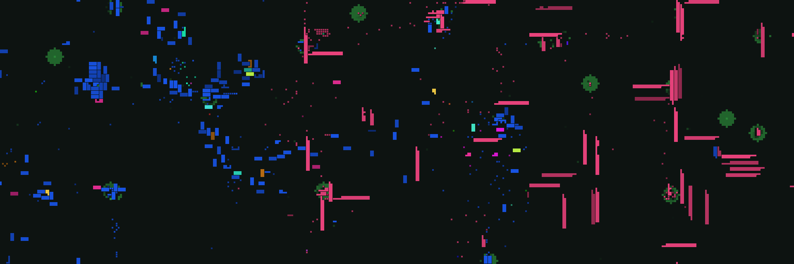
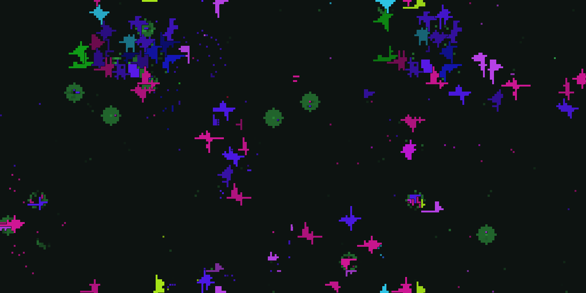

# Roam: bodies that occupy space and have to go to their food (probe, 2026-11-23)

Exploratory, one day, seeds 1 and 2 only, nothing registered. It replaces the droplet-genes compartments as the
one world the ladder is climbed in: three looks there (a bigger body, a heading, chasing fuel) all lost to a full
arena of small dots that never had to move, and the user asked for a world "where a body is a thing that occupies
space and has to go to its food".

Best case stated before building: *you will see bodies travel between food patches and leave them empty behind,
some arriving first and some starving.*

Code: `apps/lab/src/roam/` (kernel, view, page, worker), page `/roam/` (dev server only, not in the site build),
runner `experiments/roam/look.ts`, tests `apps/lab/test/roam.test.ts`.

## The rules, briefly

- A cell sits on one tile and holds matter. A bond joins a cell to a daughter it made and forms no other way, so
  bodies never fuse. **Bodies are not declared**: each step the bonded groups are found by walking the bonds. The
  rules then act on a group as a whole (shared store, one move), which is a rule about groups, not a local rule.
- A body eats the food under its cells into one shared store, pays a leak through every outward-facing side plus a
  little per cell plus the effort of moving, and when it cannot keep its cells it gives them up one at a time.
- A body moves one tile as a rigid piece and is blocked by other bodies.
- A full cell divides. While the body is under the adult size its gene asks for, the daughter stays bonded;
  after that the daughter is let go as a new one-cell body.
- Five genes per cell (whole numbers, copied with small errors): chase (speed up the food-scent slope), drive
  (speed along the heading), turn, adult size, shape (daughters placed along or across the heading).
- **Matter is closed and exact.** Food on the ground + matter in cells + one reservoir is the starting total at
  every step. Everything cells lose goes to the reservoir, which gives it back as whole patches at hash-chosen
  places. Waste never returns where the body that made it is. No parasite.

## What was seen (128 x 128, default settings)

- **Against the sentence: bodies travel and patches are eaten empty; "some starving" is true but a third of it
  is newborns.** Cells alive at both ends of a 200-step window end a mean 4 to 6 tiles away (59 to 77% of them 2
  or more tiles), against 50 at top speed, so in any short stretch most bodies are milling at a patch. Over 2,000
  steps the cells still alive (about 1,050 of 1,450) end a mean 18 to 23 tiles away, nearly all of them more than
  2. A new patch lands about every 58 steps, a patch is eaten to nothing in a few hundred steps, and about 55 to 80 bodies die per 1,000
  steps among 350 to 390 bodies of 1 to 9 cells, with as many new bodies. About a third of those deaths (19 to
  32 per 1,000 steps) are cells let go at birth that never joined or made another cell; the rest had been part of
  a larger body. This is my reading of frames and counts; the user's eye decides.
- **The arena does not fill.** About 1,450 cells on 16,384 tiles (9%), held there by the total matter. About a
  quarter of bodies are single cells at any time.
- **Eight-cell bodies against one-cell bodies** (same genes except adult size, no copy errors, 160,000 steps):
  the one-cell type booms first, then the eight-cell type overtakes it and leads. On seed 2 the one-cell type is
  extinct by step 160,000. On seed 1 it is behind and not gone, and it came back from 244 cells at step 120,000
  to 486 (against 994) at 160,000, so the two may be able to live side by side. This is the contest the droplet
  world lost. The reason is a rule we wrote (a cell leaks through every outward side), not something found.
- **Sitters and random wanderers lose to chasers** on both seeds, with no copy errors: sitters are gone by step
  8,000 and wanderers by 16,000. For sitters this is true by construction (food never comes to them).
- **With copy errors, bodies evolve to roam more.** Over 100,000 steps the mean drive gene rose from 64 to 201
  (seed 1) and 194 (seed 2), and travel per 200 steps from about 5 to 8 to 10 tiles. Drive moved furthest of the
  five genes on both seeds and in the same direction (the others: chase +29 and +1, turn +1 and -19, adult -63
  and -110, shape -3 and +62). There is no drift control, so this is consistent with selection and not a test of
  it. The adult size asked for fell from 8 cells to 7 and 6.

Review: two Codex passes (Sol 6.1, High), neither found a conservation or overlap bug. The first found that the
order bodies moved in favoured low tile numbers (now a fresh hash order each step), an axis preference when a
diagonal move is blocked (now a coin), weak tests, unchecked runner options and lost steps in the page's pacing.
The second found the same kind of tile-order favour among the cells of one body (which cell divides first, which
tip a starving body gives up, who gets the odd unit; all now by hash) and more weak tests. Every number and
picture here is from runs after all the fixes. The last fixes were not re-reviewed.

## Where this leaves the ladder

In this world, on seen seeds only: individuals that divide and die (yes), heredity (yes, genes copy with errors),
selection between individuals (chasers displace sitters and wanderers, eight-cell bodies lead one-cell ones; the drive result is suggestive). None of this is
confirmed on unseen seeds. The genes are still five dials we wrote, so rung 4 (heredity that can invent) is the
next missing rung here as it was in the droplets.

## Not done, and weak spots

- Bodies crowd into a jam on each patch, and from a distance the herd reads as one blob; whether single bodies
  read as creatures is the user's call.
- Being bigger pays against single cells (above), but within the evolving runs the adult size asked for drifted
  down from 8 to 6 or 7 cells, and nothing grew past 9 cells.
- No rotation: a long body heading sideways moves broadside.
- One arena size, one matter total, one patch size were tried.

# Second probe, same day: bodies grown by a plan, and feeding by touch

The user watched the first probe and said it was "pretty interesting ... in the direction of what I was looking
for", "only like a hint", and to keep going. This is the next rung in the same world: heredity that can invent.
Intent, as stated before building: if it works completely, you will see bodies with outlines nobody drew,
different outlines winning on different runs, and descendants that look unlike the founders.

Both additions are config switches that are absent by default; a pinned-digest test holds the first probe's
histories unchanged.

## What was added

**Growth by plan** (`plan`). Every cell carries a plan: a table of 16 modes. A cell is in one mode, and when it
holds enough to divide, its mode says where the daughter goes (in front, right, behind or left of the way the
cell faces), whether she is kept or let go as a new body, which mode a kept daughter starts in, and which mode
the cell moves to. A cell faces away from its mother. A new body starts as one cell in mode 0. A cell whose tile
is taken waits. A body at 32 cells lets go of a daughter its plan says to keep. Copy errors happen only when a
new body is let go: one entry of the plan changes (chance 0.05 per new body in these runs), and the three
movement genes change as before (0.02 each). The adult and shape genes do nothing in this mode. Six plans are
written by hand as founders: a line of 8, a 3 x 3 plate, a cross, a 2 x 4 block, a speck (always one cell) and a
bush (branches until the size limit).

**Feeding by touch** (`drain`). Where cells of two bodies touch and one body is at least twice the other's size,
2 units of matter per step pass through that side from the smaller body's cell to the larger one's. A new body is
exempt both ways for its first 100 steps and spends them moving straight away from its parent at top speed.

## What happened (seeds 1 and 2, 128 x 128, runs after all fixes)

Without touch feeding:

- All six planted shapes together, no copy errors, 100,000 steps: the compact ones win. Plates take 1,156 and
  1,002 of about 1,200 cells; lines, crosses and bushes are gone; blocks and specks hang on.
- Blocks with copy errors, 150,000 steps: nothing bigger than the block appears. About a fifth of bodies are
  full blocks at any time, and 14 to 30 plans are alive at a time, most of them giving smaller outlines (two or three cells,
  an L). The drive gene rises from 64 to 191 and 185, as in the first probe.
- All six founders with copy errors, 150,000 steps: specks take everything on both seeds (1,455 of 1,455 cells
  and 1,449 of 1,449); the largest body left is four cells. Without copy errors the specks lose to the plates
  (above), so copy errors change who wins; why was not looked into. With grazing alone, heritable outlines stay
  small or go to single cells.
- A check on the first probe's world gave the same sign: a 16-cell type planted against the 8-cell chasers was
  gone by step 100,000 on both seeds, and in three other food layouts it was gone or still falling on five of six runs. A rigid body
  only reaches fresh food along its leading edge, so a bigger blob eats less per cell.

With touch feeding:

- All six planted shapes, no copy errors: bushes (the 32-cell plan) take everything within 20,000 steps and hold
  about 1,000 to 1,100 cells.
- All six with copy errors, 150,000 steps, both seeds: 35 to 130 bodies, about 1,000 to 1,150 cells, most of them
  in 32-cell bodies with 34 to 50 different outlines alive at once (a body's outline also depends on what was in
  its way while it grew and on cells it lost when hungry). 100 to 175 body deaths per 1,000 steps, most of them
  new one-cell bodies. 2 to 12 plans alive at a time; about 1,200 plans appeared in each run. Around 20,000 units
  of matter per 1,000 steps pass by touch.
- Blocks with copy errors: on seed 1 the blocks hold for about 55,000 steps, then a plan appears that grows a
  ladder two cells wide and 16 long, and by step 80,000 the world is 20 or so ladders and their young; it stays
  that way to step 150,000. On seed 2 no such plan had appeared by step 150,000 and the world is still blocks.

## How to read this

- One clearly new form appeared and took over: the ladder. Grown alone, its plan makes a strip two cells wide and
  16 long; it is the planted block with a single entry changed. At step 150,000 on seed 1 all 1,033 cells carry
  it or a near copy that grows the same strip. That is the part of the intent that is met, once, on a seen seed.
- The spiked 32-cell bodies in the all-six runs are mostly not new. At step 150,000 every survivor on both seeds
  descends from the planted bush. Each surviving plan was grown alone and its outline set beside the bush's
  (`experiments/roam/plans.ts`): on seed 1, 1,087 of 1,090 cells are in plans that grow exactly the bush; on
  seed 2, 702 of 1,030 are, and the other 328 are in plans with one entry changed that grow something else: a
  taller, narrower bush (261 cells), a straight line 32 long (41 cells), and one 26-cell slab that never lets a
  daughter go. So new forms do arise and persist there, as a minority.
- The many outlines counted in those runs (34 to 50) come mostly from what was in a body's way while it grew and
  from cells lost when hungry, not from different plans. Colour by plan also overstates variety: a change in an
  entry a body never uses gets a new colour and grows the same thing.
- Blocks on seed 2 (no ladder): 1,086 of 1,107 cells still grow the planted block; 21 are in near-blocks of
  seven cells.
- Bodies got big only once being big was made to pay by a rule we wrote (the larger feeds on the smaller), and
  they then ran to the 32-cell limit we set. Size here is selected by our rule and capped by our number. Which
  outline a 32-cell body has is not what is being selected, as far as these runs show.
- "Different on different runs" is seen once (ladders on seed 1, blocks still on seed 2) on two seeds.
- Two versions of the touch rule were tried and dropped the same day: any larger body feeding on any smaller one
  (a few 32-cell bodies ate everything and the world froze), and a size-limit rule under which a cell moved to
  its next mode when it let a daughter go at the limit (bodies at the limit ran out of dividing cells and became
  sterile; three of four runs ended as one to three bodies that never reproduced). The numbers above are with the
  cell staying in its mode at the limit.

Review: three more Codex passes (Sol 6.1, High). The first found one bug (a new body that was blocked while running
from its parent turned round), a remaining walk-order favour in which cell of a body divides first (now a hash
per cell), an outline count that could split one outline in two on a tiny arena, and four tests weaker than their
names. The second found no bug in the rules and two small points in the reporting code. The third looked at those two
fixes and at the plan-growing tool, and found two ways the tool could mislead (stopping a slow grower early, and
calling a mode used when it can only be reached on paper); both are fixed, and the tool's fixes were not
re-reviewed. 29 tests in `apps/lab/test/roam.test.ts`.

The page (`/roam/`) now opens on the six founders with copy errors and touch feeding. To see the ladders arrive,
choose "grown: blocks", seed 1, and "as fast as it goes": the first ladders show around step 55,000.

Videos (in the worktree's `runs/roam/`, not committed): `v-grown-start-s1` (all six founders with touch feeding,
steps 0 to 20,000), `v-grown-invasion-s1` (blocks, steps 50,000 to 90,000: the ladders arrive),
`v-grown-late-s2` (all six, steps 100,000 to 103,000 at three steps a frame).

## Where this leaves the ladder

Heredity that can invent: a first version exists; it produced one clearly new form (the ladder) and one modest
one (the narrower bush) on seen seeds. Creatures that visibly differ from their ancestors and between runs: seen
once each way, on two seeds, and only with a size-pays rule and a size limit that we wrote. Not shown: that an
outline matters to the body that has it. Rungs 1 to 3 in this world are still on seen seeds only; the
unseen-seed check was put off because the rules were about to change, and is still owed.
