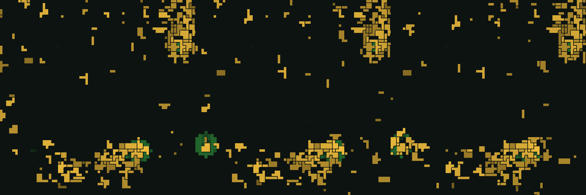

# Roam: bodies that occupy space and have to go to their food (probe, 2026-11-23)

Exploratory, one day, seeds 1 and 2 only, nothing registered. It replaces the droplet-genes compartments as the
one world the ladder is climbed in: three looks there (a bigger body, a heading, chasing fuel) all lost to a full
arena of small dots that never had to move, and the user asked for a world "where a body is a thing that occupies
space and has to go to its food".

Best case stated before building: *you will see bodies travel between food patches and leave them empty behind,
some arriving first and some starving.*

Code: `apps/lab/src/roam/` (kernel, view, page, worker), page `/roam/` (dev server only, not in the site build),
runner `experiments/roam/look.ts`, tests `apps/lab/test/roam.test.ts`.

## The rules, briefly

- A cell sits on one tile and holds matter. A bond joins a cell to a daughter it made and forms no other way, so
  bodies never fuse. **Bodies are not declared**: each step the bonded groups are found by walking the bonds. The
  rules then act on a group as a whole (shared store, one move), which is a rule about groups, not a local rule.
- A body eats the food under its cells into one shared store, pays a leak through every outward-facing side plus a
  little per cell plus the effort of moving, and when it cannot keep its cells it gives them up one at a time.
- A body moves one tile as a rigid piece and is blocked by other bodies.
- A full cell divides. While the body is under the adult size its gene asks for, the daughter stays bonded;
  after that the daughter is let go as a new one-cell body.
- Five genes per cell (whole numbers, copied with small errors): chase (speed up the food-scent slope), drive
  (speed along the heading), turn, adult size, shape (daughters placed along or across the heading).
- **Matter is closed and exact.** Food on the ground + matter in cells + one reservoir is the starting total at
  every step. Everything cells lose goes to the reservoir, which gives it back as whole patches at hash-chosen
  places. Waste never returns where the body that made it is. No parasite.

## What was seen (128 x 128, default settings)

- **Against the sentence: bodies travel and patches are eaten empty; "some starving" is true but a third of it
  is newborns.** Cells alive at both ends of a 200-step window end a mean 4 to 6 tiles away (59 to 77% of them 2
  or more tiles), against 50 at top speed, so in any short stretch most bodies are milling at a patch. Over 2,000
  steps the cells still alive (about 1,050 of 1,450) end a mean 18 to 23 tiles away, nearly all of them more than
  2. A new patch lands about every 58 steps, a patch is eaten to nothing in a few hundred steps, and about 55 to 80 bodies die per 1,000
  steps among 350 to 390 bodies of 1 to 9 cells, with as many new bodies. About a third of those deaths (19 to
  32 per 1,000 steps) are cells let go at birth that never joined or made another cell; the rest had been part of
  a larger body. This is my reading of frames and counts; the user's eye decides.
- **The arena does not fill.** About 1,450 cells on 16,384 tiles (9%), held there by the total matter. About a
  quarter of bodies are single cells at any time.
- **Eight-cell bodies against one-cell bodies** (same genes except adult size, no copy errors, 160,000 steps):
  the one-cell type booms first, then the eight-cell type overtakes it and leads. On seed 2 the one-cell type is
  extinct by step 160,000. On seed 1 it is behind and not gone, and it came back from 244 cells at step 120,000
  to 486 (against 994) at 160,000, so the two may be able to live side by side. This is the contest the droplet
  world lost. The reason is a rule we wrote (a cell leaks through every outward side), not something found.
- **Sitters and random wanderers lose to chasers** on both seeds, with no copy errors: sitters are gone by step
  8,000 and wanderers by 16,000. For sitters this is true by construction (food never comes to them).
- **With copy errors, bodies evolve to roam more.** Over 100,000 steps the mean drive gene rose from 64 to 201
  (seed 1) and 194 (seed 2), and travel per 200 steps from about 5 to 8 to 10 tiles. Drive moved furthest of the
  five genes on both seeds and in the same direction (the others: chase +29 and +1, turn +1 and -19, adult -63
  and -110, shape -3 and +62). There is no drift control, so this is consistent with selection and not a test of
  it. The adult size asked for fell from 8 cells to 7 and 6.

Review: two Codex passes (Sol 6.1, High), neither found a conservation or overlap bug. The first found that the
order bodies moved in favoured low tile numbers (now a fresh hash order each step), an axis preference when a
diagonal move is blocked (now a coin), weak tests, unchecked runner options and lost steps in the page's pacing.
The second found the same kind of tile-order favour among the cells of one body (which cell divides first, which
tip a starving body gives up, who gets the odd unit; all now by hash) and more weak tests. Every number and
picture here is from runs after all the fixes. The last fixes were not re-reviewed.

## Where this leaves the ladder

In this world, on seen seeds only: individuals that divide and die (yes), heredity (yes, genes copy with errors),
selection between individuals (chasers displace sitters and wanderers, eight-cell bodies lead one-cell ones; the drive result is suggestive). None of this is
confirmed on unseen seeds. The genes are still five dials we wrote, so rung 4 (heredity that can invent) is the
next missing rung here as it was in the droplets.

## Not done, and weak spots

- Bodies crowd into a jam on each patch, and from a distance the herd reads as one blob; whether single bodies
  read as creatures is the user's call.
- Being bigger pays against single cells (above), but within the evolving runs the adult size asked for drifted
  down from 8 to 6 or 7 cells, and nothing grew past 9 cells.
- No rotation: a long body heading sideways moves broadside.
- One arena size, one matter total, one patch size were tried.
