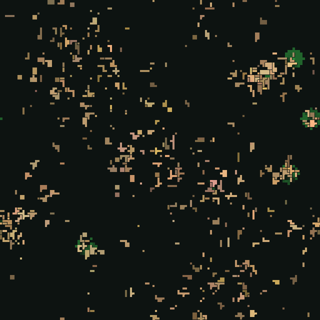
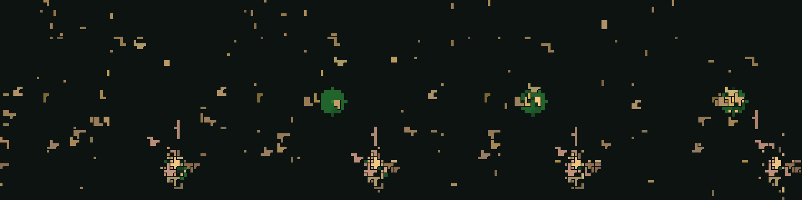

# Roam: bodies that occupy space and have to go to their food (probe, 2026-11-23)

Exploratory, one day, seeds 1 and 2 only, nothing registered. It replaces the droplet-genes compartments as the
one world the ladder is climbed in: three looks there (a bigger body, a heading, chasing fuel) all lost to a full
arena of small dots that never had to move, and the user asked for a world "where a body is a thing that occupies
space and has to go to its food".

Best case stated before building: *you will see bodies travel between food patches and leave them empty behind,
some arriving first and some starving.*

Code: `apps/lab/src/roam/` (kernel, view, page, worker), page `/roam/` (dev server only, not in the site build),
runner `experiments/roam/look.ts`, tests `apps/lab/test/roam.test.ts`.

## The rules, briefly

- A cell sits on one tile and holds matter. A bond joins a cell to a daughter it made and forms no other way, so
  bodies never fuse. **Bodies are not declared**: each step the bonded groups are found by walking the bonds. The
  rules then act on a group as a whole (shared store, one move), which is a rule about groups, not a local rule.
- A body eats the food under its cells into one shared store, pays a leak through every outward-facing side plus a
  little per cell plus the effort of moving, and when it cannot keep its cells it gives them up one at a time.
- A body moves one tile as a rigid piece and is blocked by other bodies.
- A full cell divides. While the body is under the adult size its gene asks for, the daughter stays bonded;
  after that the daughter is let go as a new one-cell body.
- Five genes per cell (whole numbers, copied with small errors): chase (speed up the food-scent slope), drive
  (speed along the heading), turn, adult size, shape (daughters placed along or across the heading).
- **Matter is closed and exact.** Food on the ground + matter in cells + one reservoir is the starting total at
  every step. Everything cells lose goes to the reservoir, which gives it back as whole patches at hash-chosen
  places. Waste never returns where the body that made it is. No parasite.

## What was seen (128 x 128, default settings)

- **Against the sentence: yes on all three parts, by my reading of frames; the user's eye decides.** Bodies travel
  (cells alive at both ends of a 200-step window end a mean 4 to 6 tiles away, 51 to 82% of them 2 or more tiles),
  a patch is eaten to nothing in a few hundred steps, and bodies die on the way (about 40 to 85 body deaths and as
  many new bodies per 1,000 steps among about 340 to 410 bodies of 1 to 9 cells).
- **The arena does not fill.** About 1,400 to 1,500 cells on 16,384 tiles (9%), held there by the total matter.
- **Sitters and random wanderers lose to chasers** on both seeds, with no copy errors: sitters are gone by step
  8,000 and wanderers by 12,000. For sitters this is true by construction (food never comes to them), so it shows
  the old flaw is absent, not that anything was discovered.
- **With copy errors, bodies evolve to roam more.** Over 100,000 steps the mean drive gene rose from 64 to 200
  (seed 1) and 214 (seed 2), and travel per 200 steps from about 5 to 9 to 10 tiles. Drive moved furthest of the
  five genes on both seeds and in the same direction (the others: chase +28 and +6, turn -52 and -17, adult -73
  and -24, shape +84 and +27). There is no drift control, so this is consistent with selection and not a test of
  it. Adult size is still 7 to 8 cells.

Review: one Codex pass (Sol 6.1, High) before the commit found no conservation or overlap bug. It found that the
order bodies moved in favoured low tile numbers (now a fresh hash order each step), an axis preference when a
diagonal move is blocked (now a coin), two tests weaker than their names, unchecked fractional runner options and
lost steps in the page's pacing. All were fixed and every number and picture here is from runs after the fixes;
the fixes were not re-reviewed.

## Where this leaves the ladder

In this world, on seen seeds only: individuals that divide and die (yes), heredity (yes, genes copy with errors),
selection between individuals (chasers displace the other types; the drive result is suggestive). None of this is
confirmed on unseen seeds. The genes are still five dials we wrote, so rung 4 (heredity that can invent) is the
next missing rung here as it was in the droplets.

## Not done, and weak spots

- Bodies crowd into a jam on each patch, and from a distance the herd reads as one blob; whether single bodies
  read as creatures is the user's call.
- Does being bigger pay? Not tested. The leak rule favours compact bodies on paper; the adult gene did not rise.
- No rotation: a long body heading sideways moves broadside.
- One arena size, one matter total, one patch size were tried.
