# Soft Roam, chunk 2: a sun and a year, leaves, senses, truce, a release cap (2026-11-26)

Exploratory, seeds 1 and 2 seen (tuned on), seeds 3 and 4 looked at once at the end, nothing registered. This adds to
the note beside it (`NOTE.md`, chunk 1). Contract: `CONTRACT-2.md`. Code: kernel at commit 0a6736c2, the page's own
start (`seasons`) and the dials in the commit after it.

Best case for this chunk: the day sweeps across the world and the year swings from lean to rich; green-leaved bodies
swell in the light and thin in winter; hunters curve toward prey they can sense and the prey veers away; bodies of
several kinds of cell (leaf rim, plain gut, shell armour, mouth front) hold together at 20 or more cells; the numbers of
each kind rise and fall with the seasons without any kind dying out.

Short version: the sun and the year are real and you can see them (a warm band sweeps the dark ground every 400 steps;
the cell count rises and falls about 1.5 to 4 times over each 12,000-step year on every seed, and the food on the ground
and the reservoir swing the other way). Leaves, sight, fear, truce, jaws and the release cap all run and do something in
the numbers. The rest of the best case is not there: bodies stay at 12 cells or fewer (almost none reach 10), leaves
are a few percent of cells, I saw no hunter curve after prey and no prey veer, and only the plain cells follow the year
cleanly.

## What was added, in the world's terms

**Sun and year.** A band of light half the world wide sweeps once round the torus every 400 steps (a day); the rest is
night. The whole world also brightens and dims once every 12,000 steps (a year), down to a tenth of midsummer light in
the deepest winter. Light is a whole number from 0 to 256 at each tile and each step.

**Patches follow the sun.** A food patch that is due only lands if a die roll beats the light where it would fall; if
it is skipped, the matter stays in the reservoir and the next try comes on the usual rhythm. This turned out to be what
makes the year show at all (see the controls).

**Leaves.** A new kind of cell, green. A leaf never eats from the ground; it earns matter from the reservoir in
proportion to light and to how many of its four sides are bare (a leaf buried in its body earns nothing; leaves
sharing a tile share what the tile gets). A leaf does not move on its own. Leaf bushes are a new founder type with a
leaf rim.

**Sight.** A mouth cell of a body that is not new looks out to 8 tiles for the nearest cell it could eat by touch, and
its chase turns directly toward it (instead of up the food scent).

**Fear.** The mirror: plain and shell cells look out 4 tiles for the nearest mouth that could eat them and steer
straight away from it.

**Truce.** Cells of the same founder family do not eat, hit, grip, see or fear each other. Mutation of a plan does not
break it, since the family copies unchanged; two different founder types are not in truce.

**Jaws.** A body that holds any mouth cell cannot be eaten, hit, gripped or seen as prey (so hunters do not eat other
hunters, and a hunter's plain cells are safe).

**Release cap.** A body sheds a daughter body only when it has at least 8 cells, and at most once in 200 steps. A cell
that is ready but held waits (the count is in the rows as `rhold`).

**New founder types.** The page's start (`seasons`) plants 120 single founders in turn: armoured grazers (plain cells that
eat, a shell rim, a 12-cell plan), leaf bushes (leaf rim, slow), hunters (mouths in front, plain behind) and the garden's
plates. The garden start is unchanged.

## How to open it and run the look

Page: `export PATH=/Users/nicholas/.nvm/versions/node/v24.2.0/bin:$PATH; cd apps/lab && pnpm vite`, then
`http://localhost:5173/softroam/` (the seasons start is the default).

Look (the page defaults, no overrides; a year is 12,000 steps, so 36,000 steps is three years):

    deno run -A --no-lock experiments/softroam/look.ts --start seasons --seed 1 --steps 36000 --report 1500 \
      --every 50 --frames 4000 --movie 1 --movieFrom 35100 --out runs/softroam/c2-final-s1 \
      --series runs/softroam/c2-final-s1/series.tsv
    ffmpeg -framerate 30 -i runs/softroam/c2-final-s1/frames/f%05d.png -c:v libx264 -pix_fmt yuv420p movie.mp4

`look.ts` defaults to `--start garden`, so `--start seasons` must be named. Plots are made with gnuplot
(`runs/softroam/c2-final/tools/plot.gp`; python matplotlib is not installed here). The controls used a runner copy,
`runs/softroam/c2-final/tools/look-off.ts`, because `--ov` cannot remove a key (null and 0 throw); the copy adds `--off
k1,k2`, which passes the key as `false` to `foundSoftRoam`, which leaves it absent from the config. With nothing off it
gives the same digest as `look.ts` (checked: `c7fcf220` both).

## The gate (verbatim)

    pnpm typecheck                              (tsc -p tsconfig.json, no errors printed)
    pnpm vitest run apps/lab/test/softroam      Test Files  10 passed (10) / Tests  272 passed (272)
    pnpm vitest run apps/lab/test/roam.test.ts  Test Files  1 passed (1) / Tests  47 passed (47)
    git diff d9a53cdd --stat -- apps/lab/src/roam packages     (prints nothing)

`softroam-pins.test.ts` is in the 10 files and passes unedited. The gate and every run below were made on the working
tree, which holds uncommitted view, page, dials, look and test edits on top of 0a6736c2, and a 5-line change in
`kernel.ts` (`leafPaid`, a per-cell record for the picture, not dynamics, not in the digest).

Determinism: seed 1, 3,000 steps, page defaults, run twice: digest `d0391403` both times. (The tuner's `d9d0668a` for the same run was
before the review fix that grew the hunter plan from 6 to 8 cells, which changed the seasons world's history.)
Alarms (stretched bonds, overlaps, speed clamp) stayed 0 in every run below; residual 0 at every report.
Speed: about 700 steps a second alone with no painting; 232 to 256 steps a second in the 36,000-step seed 1 and 2 runs
(each paints 900 movie frames, with ten runs going at once); 368 to 418 for seeds 3 and 4 (two at once, no movie).

## What seeds 1 and 2 showed (seen seeds; page defaults, 128 x 128, 36,000 steps = 3 years)

Final digests: seed 1 `c7fcf220`, seed 2 `5bef339a`. Rows every 1,500 steps (eight a year). "year%" is how far through the
year it is (midsummer at 50). Columns: step, cells, bodies, one-cell bodies, largest, plain / shells / mouths / leaves,
mouths hunting / cells targeted, drained per 1,000 steps, matter on the ground, reservoir.

Seed 1:

| step | cells | bodies | one | big | plain/shell/mouth/leaf | hunt/targ | drain/k | food | reservoir |
|---|---|---|---|---|---|---|---|---|---|
| 1500 | 186 | 94 | 45 | 6 | 158/5/16/7 | 7/5 | 515 | 7456 | 80686 |
| 4500 | 201 | 71 | 23 | 8 | 156/15/22/8 | 10/6 | 55 | 26645 | 56990 |
| 7500 | 385 | 109 | 21 | 11 | 286/38/51/10 | 28/14 | 987 | 40058 | 21498 |
| 10500 | 625 | 182 | 44 | 12 | 464/68/82/11 | 41/23 | 881 | 19135 | 23366 |
| 12000 | 570 | 203 | 67 | 9 | 426/66/67/11 | 48/20 | 484 | 11541 | 40960 |
| 15000 | 403 | 178 | 78 | 7 | 312/48/32/11 | 24/18 | 197 | 13916 | 55256 |
| 18000 | 453 | 158 | 43 | 8 | 348/40/47/18 | 33/16 | 161 | 28026 | 32093 |
| 21000 | 638 | 209 | 51 | 9 | 490/42/82/24 | 51/26 | 1508 | 28354 | 13411 |
| 22500 | 694 | 233 | 55 | 9 | 534/41/98/21 | 61/30 | 1499 | 16941 | 21946 |
| 24000 | 605 | 243 | 80 | 7 | 470/35/84/16 | 57/23 | 1181 | 10738 | 40042 |
| 27000 | 424 | 192 | 76 | 7 | 331/21/55/17 | 41/19 | 319 | 14739 | 52714 |
| 30000 | 455 | 182 | 61 | 8 | 361/16/62/16 | 37/20 | 847 | 23676 | 35675 |
| 33000 | 572 | 187 | 41 | 10 | 452/13/82/25 | 35/18 | 975 | 20770 | 30145 |
| 36000 | 438 | 184 | 64 | 9 | 350/10/54/24 | 29/15 | 599 | 8541 | 56969 |

Seed 2:

| step | cells | bodies | one | big | plain/shell/mouth/leaf | hunt/targ | drain/k | food | reservoir |
|---|---|---|---|---|---|---|---|---|---|
| 1500 | 177 | 97 | 60 | 7 | 150/3/17/7 | 13/12 | 521 | 6744 | 81490 |
| 4500 | 216 | 72 | 23 | 12 | 155/23/31/7 | 21/13 | 322 | 31236 | 50354 |
| 7500 | 531 | 154 | 36 | 9 | 386/60/75/10 | 39/17 | 324 | 38439 | 12276 |
| 10500 | 710 | 239 | 71 | 12 | 502/95/95/18 | 62/33 | 639 | 18622 | 17543 |
| 12000 | 657 | 247 | 82 | 11 | 466/90/88/13 | 58/29 | 1139 | 10587 | 33922 |
| 15000 | 448 | 197 | 76 | 11 | 311/72/57/8 | 42/20 | 418 | 11950 | 55263 |
| 18000 | 469 | 169 | 51 | 9 | 330/70/53/16 | 39/20 | 445 | 19537 | 39218 |
| 21000 | 577 | 188 | 49 | 9 | 394/82/83/18 | 57/26 | 601 | 19078 | 29803 |
| 24000 | 603 | 221 | 72 | 9 | 415/96/72/20 | 56/28 | 453 | 11093 | 43184 |
| 27000 | 384 | 184 | 88 | 7 | 259/78/29/18 | 19/12 | 344 | 12333 | 59917 |
| 30000 | 487 | 164 | 45 | 10 | 302/106/50/29 | 32/17 | 817 | 25578 | 32373 |
| 33000 | 738 | 220 | 52 | 12 | 447/165/73/53 | 52/23 | 1821 | 22911 | 7023 |
| 36000 | 729 | 268 | 91 | 10 | 432/166/63/68 | 55/33 | 1323 | 10214 | 26604 |

(The full 24-row tables are in `runs/softroam/c2-final-s1.log` and `-s2.log`; the series, every 50 steps, in
`c2-final-s*/series.tsv`.)

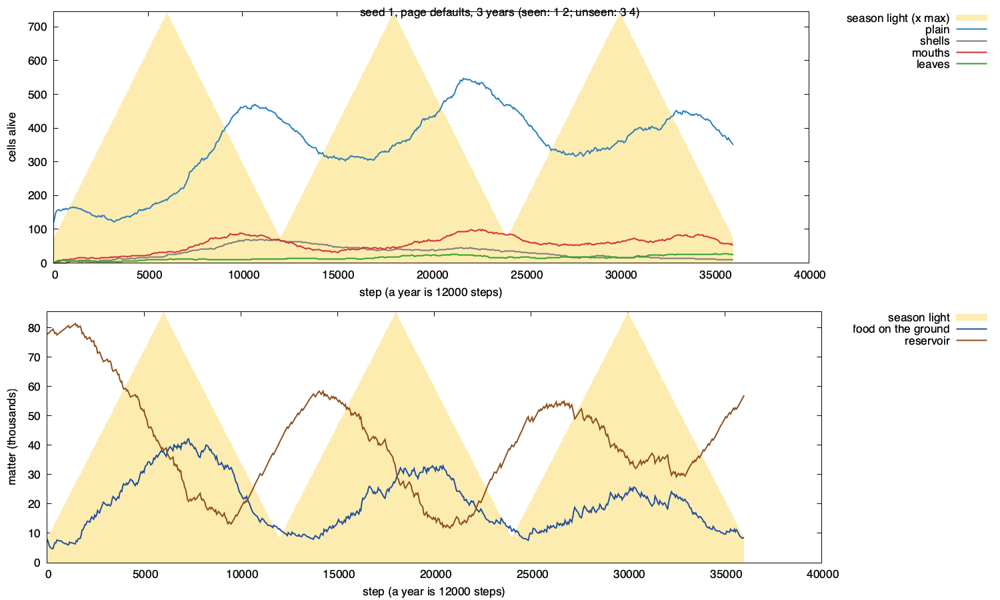

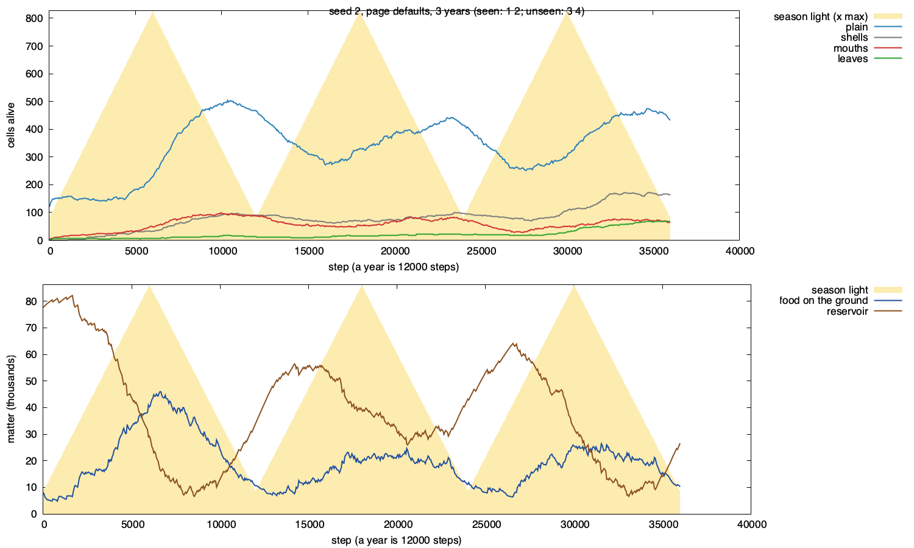

What the plots show. The year is clear in the plain cells and in the matter. On both seeds the cell count climbs through
the light half and peaks late in the year (about step 10,500 to 12,000 in year 1; peak steps by year on seed 1 were 10,650,
22,050 and 24,150), so cells lag the light by roughly a third of a year; they fall through the dark half to a trough near
step 15,000 and 27,000. Cells peak to trough by year (after step 1,500): seed 1 632/153, 709/397, 607/403; seed 2 710/172,
657/396, 787/373. The first year is a start-up (120 founders grow from nothing); the later years swing about 1.5 to 2 times.
The reservoir (matter held back for patches) fills in winter (to 55 to 60 thousand of 100 thousand) and drains in summer (to
7 to 16 thousand); food on the ground does the reverse (8 to 11 thousand in winter, 20 to 45 in summer). No kind dies out
in three years on either seed (smallest counts after step 3,000: seed 1 shells 8, mouths 16, leaves 4; seed 2 shells 13,
mouths 22, leaves 5), but the kinds other than plain do not swing with the year: shells on seed 1 slide from 83 to 10 over
three years, shells and leaves on seed 2 rise (leaves to 68, shells to 166), mouths drift. Leaf income totalled 48,969 matter
over three years on seed 1, about 1.4 a step; leaves were 5 percent or less of cells on seed 1 and 9 percent at the end on
seed 2.

### Pictures (my reading; your eye decides)

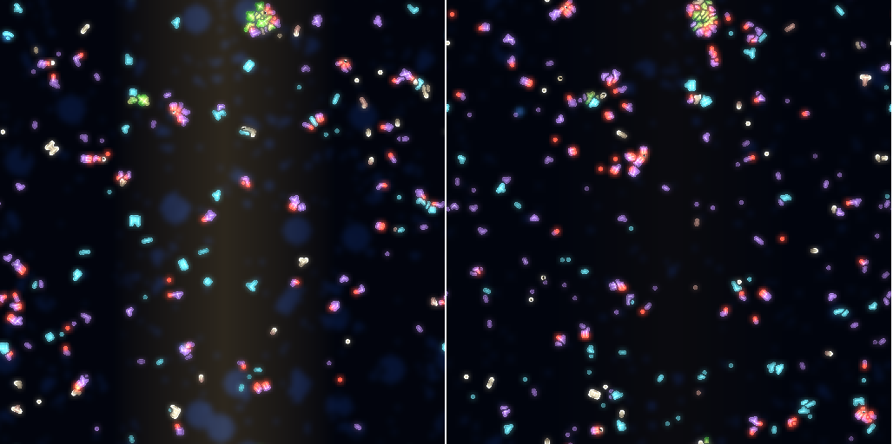

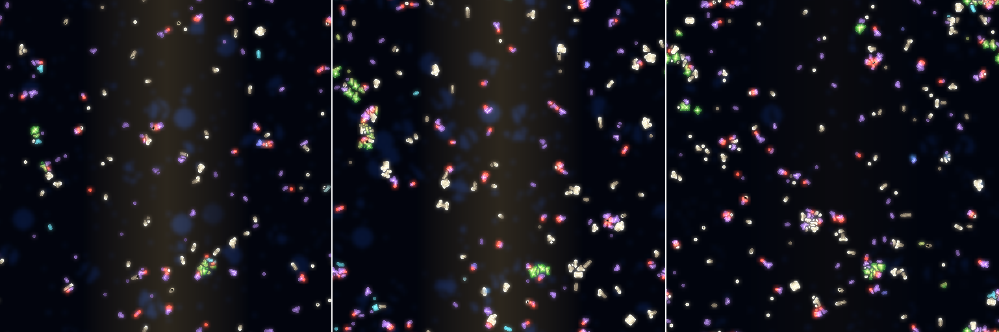

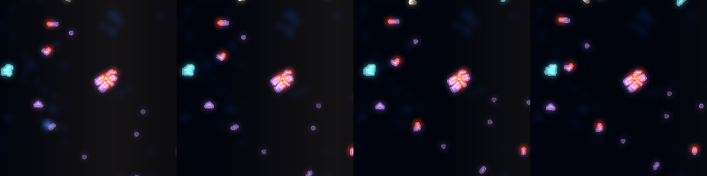

- The day band is plainly visible in the pictures where the year is bright: a soft warm vertical band, about half the
  world wide, with night on either side; ground is dark and cool at night and in winter. In the winter column (step 36,000,
  year share 0) the band is gone.
- Bodies are small. Seed 1 mostly shows violet and red clumps of 4 to 10 cells, one-cell crumbs (cyan, pale), and one or two
  clusters of green leaf cells with pink around them that stay put near the top. On seed 2 in year 3 there are many white
  armoured blocks (pale rims) among red hunters and violet plain bodies, and green leaf clumps with pink hunters beside them.
- Consecutive frames (I looked at the strip above, frames 40 steps apart, and at single frames): each body is a small
  deformation of the one before, nothing pops; a red mouthed body of about 8 cells turns slowly; crumbs drift. I did not see
  a hunter curve toward a particular prey, and no prey turning away. I did not watch the whole movies;
  `c2-final-s1/movie.mp4` and `c2-final-s2/movie.mp4` are the last 900 steps, one frame a step, 30 fps.
- I did not see green bodies swell and thin through the year; the leaf clusters look the same size in every column.

## Controls: seed 1, 36,000 steps, one thing off each

All with the page defaults except the one thing, seed 1, series only (runs in `runs/softroam/c2-ctl-<name>-s1/`).
What was passed: no sight `--off sight`; no fear `--off fear`; no truce `--off truce`; no jaws `--off jaws`; no release
cap `--off releaseMin,releaseGap` (neither key); leaf income 0 `--ov '{"leaf":0}'`; no year `--off year` (winter drops out
with it; the day, patchSun and leaves stay, so the season light is constant); patchSun off `--off patchSun`. Digests are
in each log. "Mean" is over the whole run (rows every 50 steps, year 1 included); "end" is at step 36,000. Largest body is
the biggest at any row (mean of rows in brackets). "In 10+" is the share of cells in bodies of 10 or more, mean over
years 2 and 3. Drained is matter taken by touch per 1,000 steps, mean over years 2 and 3. Hunting / targets is mouths
with a target over cells targeted, summed over years 2 and 3. Cycle is the cell count's maximum over minimum in year 3.

| control | plain mean/end | shells mean/end | mouths mean/end | leaves mean/end | largest | in 10+ | drained/k | hunt/targ | cycle |
|---|---|---|---|---|---|---|---|---|---|
| default | 348/350 | 31/10 | 56/54 | 15/24 | 12 (8.4) | 0.1% | 717 | 2.09 | 1.51 |
| no sight | 378/427 | 102/116 | 42/37 | 58/211 | 12 (9.6) | 1.6% | 320 | none (0 targets) | 1.54 |
| no fear | 328/318 | 9/0 | 76/105 | 7/6 | 11 (8.9) | 0.2% | 2493 | 2.15 | 1.36 |
| no truce | 350/397 | 117/186 | 47/28 | 38/107 | 12 (10.1) | 1.8% | 1025 | 1.67 | 1.75 |
| no jaws | 339/335 | 87/143 | 44/39 | 23/45 | 12 (9.4) | 1.4% | 754 | 1.73 | 1.49 |
| no release cap | 359/351 | 11/0 | 62/39 | 30/59 | 10 (8.0) | 0.1% | 526 | 2.10 | 1.88 |
| leaf income 0 | 326/333 | 51/30 | 43/36 | 0/0 | 12 (9.1) | 0.2% | 373 | 1.77 | 1.49 |
| no year | 432/344 | 80/43 | 50/27 | 112/214 | 12 (10.3) | 1.6% | 1862 | 1.61 | 1.13 |
| patchSun off | 672/752 | 119/75 | 110/104 | 18/23 | 12 (10.0) | 0.8% | 1433 | 2.17 | 1.08 |

Smallest counts after step 3,000 (extinction check): shells reach 0 with no fear and with no release cap; mouths and
leaves stay at 16 to 19 and 0 to 5 (leaves 0 only with leaf 0); nothing else dies out. One honest line for each, one seed,
histories diverge so differences between rows of a few tens of cells are within what a different seed does:

- **No sight:** predation falls to under half (drained 320 against 717) and shells and leaves do best (shells 102, leaves
  58 mean and 211 at the end, the bushes take over a share); no hunting is counted. Sight is what drives the hunt.
- **No fear:** drained about 3.5 times higher (2,493), shells fade to 0 by the end and hunters grow (105 mouths). Fear is
  the prey's defence and it works in the numbers.
- **No truce:** drained 1,025 against 717 and a bigger population of shells and leaves (that part I would not lean on),
  hunting / targets lower (1.67), not higher.
- **No jaws:** drained 754 against 717, little changed; hunting / targets 1.73.
- **No release cap:** bodies are no smaller than the default (0.1% in bodies of 10+ either way, largest 10 against 12),
  shells die out, and the year swings more (1.88). The
  cap held back 177,614 releases over the run in the default (counted per ready cell per step).
- **Leaf income 0:** leaves earn nothing and are gone by the first rows; shells and mouths are a little lower than default;
  the year still shows in the plain cells (1.49), so leaves are not what makes it.
- **No year (constant season):** the cell cycle is gone (1.13), the reservoir sits at about 0 from step 4,000, and leaves take
  over (214 of 628 cells at the end).
- **Patches not gated by the sun:** the cycle is gone (1.08), the reservoir is pinned near 0 from step 1,000, and cells settle
  at 700 to 750 plain with 100 mouths. The year's light is still there, but with this off nothing in the numbers follows it.

(Plots: only `c2-ctl-nopatchsun.png` and `c2-ctl-noyear.png` are kept beside this note. The other controls' series and
plots were made under `runs/softroam/c2-ctl-*-s1/`, which is not in the repository, so for those the numbers above are
the record.)

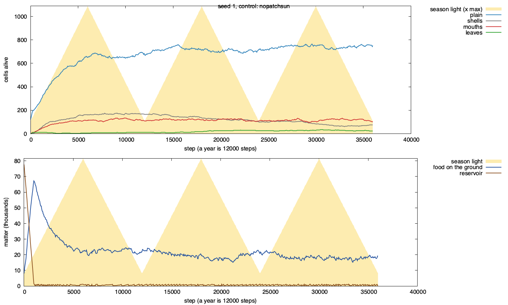

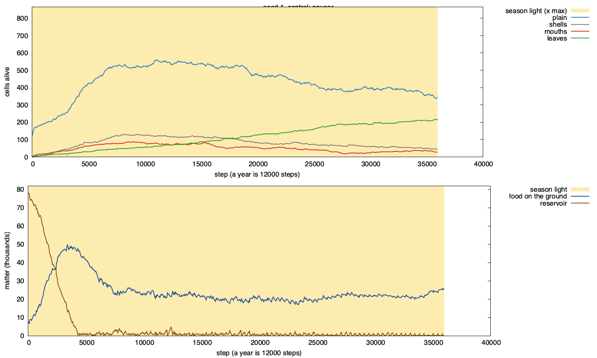

What each mechanism turned out to do, plainly:

- **The sun's gate on patches looks like what makes the year, from two one-factor controls.** Turn it off, or turn the year off, and the cycle disappears
  (cycle ratio 1.08 and 1.13) and the reservoir runs empty. With it on, patches land fewer in winter, so the reservoir
  fills; in summer they come faster and the reservoir drains. It works as a tuned buffer (see below), not as a general law.
- **Sight and fear are what drive predation.** Predation goes down by more than half without sight and up 3.5 times without
  fear. They do what they were meant to in the numbers; I did not see the curving or veering in pictures.
- **Truce and jaws do NOT shut predation off.** With both on, matter is still taken at 717 per 1,000 steps in years 2 and 3
  (about 650 over the whole run); with truce off it is 1,025 and with jaws off 754. By these seed 1 numbers truce cuts it by
  about a quarter and jaws by under 10 percent, and neither is large enough to tell from seed noise on one seed.
- **Target concentration does not show piling.** Hunting / targets is about 2.1 by default, 1.6 to 1.7 with truce, jaws or
  the year off. That is two mouths per target cell, which is what one two-mouthed hunter body does to a prey crumb. By a second count (mouths of other bodies within 1.5
  tiles of a non-mouth cell that has any) the mean is 1.2 to 1.35 in every control. But the targets are nearly all crumbs:
  only about 1 percent of target cells are in a body of 4 or more cells (default), so hunters are not hunting
  armoured bodies at all. The kernel's own old caution holds: this ratio is not a spacing measure (hunters could crowd one
  prey body while their mouths target different cells of it, and the ratio would not show it), and no rule here
  spreads hunters out. Earlier explorer runs on other settings saw 3 to 7 hunters on one grazer by eye; I did not look for
  that in the movies.
- **The release cap does not make bodies bigger** (cells in bodies of 10 or more: 0.1% with it, 0.1% without, largest 12
  against 10). What it changes on this seed is the shells, which die out without it.
- **Leaves earn a little and are fragile:** at leaf 1.3 they stay a few percent of cells on seed 1; take away sight or the
  year and they rise to 200 or more and the reservoir is drained. A knife edge, not a plateau.

## Seeds 3 and 4: run once at the defaults, never looked at before, reported as they came

Same length and settings, no retuning. Digests: seed 3 `8de489c2`, seed 4 `a798205e`. Alarms 0, residual 0.

| seed | cells at end | plain/shell/mouth/leaf (mean) | smallest after step 3,000 (shell/mouth/leaf) | cells peak/trough, years 1 to 3 | largest | drained/k | hunt/targ |
|---|---|---|---|---|---|---|---|
| 3 | 662 | 313/136/44/6 | 4/19/2 | 641/145, 762/413, 772/423 | 12 | 504 | 1.84 |
| 4 | 491 | 319/11/78/7 | 0/18/4 | 668/122, 633/379, 535/279 | 10 | 341 | 1.97 |

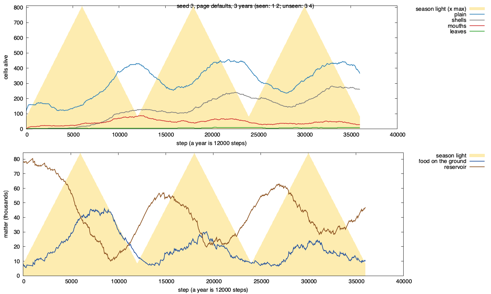

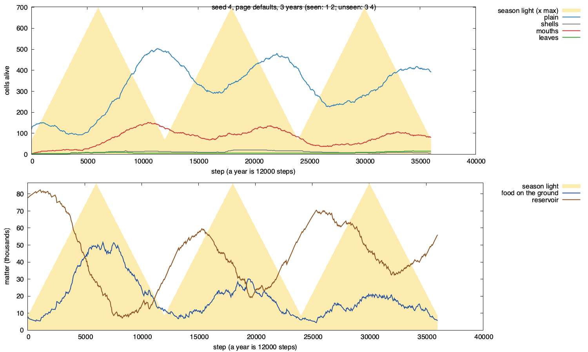

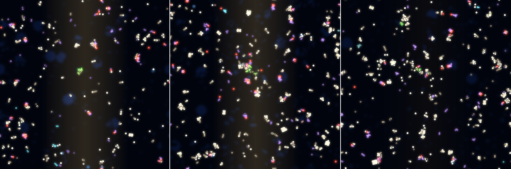

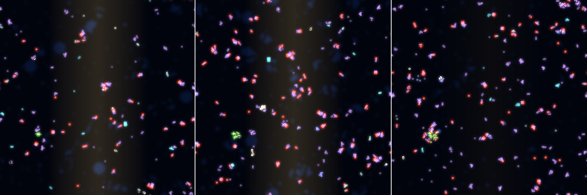

- Both show the same yearly swing in plain cells and in the reservoir and the ground food (cells up in the second half of
  the light, down in the dark half; the reservoir fills in winter), so the cycle holds on the two new seeds.
- Seed 3 is an armoured world: shells reach 260 (about 40 percent of cells at the end, white pale-rimmed blocks and
  specks fill the pictures), mouths fall to 27 and leaves stay at 2 to 10. Shells also swing with the year here (about 100
  to 240).
- Seed 4 is the opposite: mouths are 80 to 150 (up to a quarter of cells), shells are 5 to 20 and are about 0 for stretches
  and 5 at the end, leaves 4 to 16. A shell kind that is nearly gone but not at 0 after step 3,000 in the tables, 0 in the
  series at one point (smallest 0). The pictures are red hunters and violet bodies with a green clump.
- Neither seed produced a body past 12 cells (seed 4 never past 10) or any leaf share above 3 percent of cells.

## Tuned values and why

The seasons start (`SEASONS_DEFAULTS` and `SEASONS_ECONOMY` in `view.ts`; the garden start and `PAGE_WORLD` are untouched):
day 400, year 12,000, winter 0.1, patchSun on, leaf 1.3, sight 8, fear 4, truce on, jaws on, releaseMin 8, releaseGap 200;
the economy: birthStore 60, minStore 15, patchFood 1,000, patchEvery 12, leakSide 0.008, leakCell 0.004, crack 10,000.
Why, from the three explorers and the combined runs (six settings, A to F, both seeds, 36,000 steps):

- Without a changed economy the year does not show: cells settle at 340 to 400 by year 2 with 85 percent of matter in cells,
  and the reservoir sits at 2 to 5 thousand, because patches fire only when the reservoir reaches `patchFood`, so the long-run
  patch rate equals the inflow whatever the sun does. Cheap leaky cells (birthStore 60, minStore 15, leaks up) and small
  frequent patches (1,000 every 12) make the reservoir a buffer that fills in winter and drains in summer.
- A long year (12,000) with winter 0.1, because years of 3,000 or 6,000 gave only 5 to 15 percent wobbles: cells lag the
  light and need room inside the year.
- crack 10,000: at 300 shells wear away entirely within three to five years.
- Leaf 1.3: leaf 1 lets bushes die out on seed 2, leaf 2 or more lets one-cell leaf crumbs take over and pin the reservoir.
  Leaf 1.3 holds all kinds on seed 1 only just; I saw leaves swell on seed 2 to 68 (9 percent of cells) by year 3.
- Life stays 8,000: a life of 60,000 gave bodies of 4+ cells to 60 to 70 percent of cells but flattened the year.
- releaseMin 8: 12 gives harder shells but flattens the swing; 6 lost shells on seed 2; 8 kept the swing and every kind.
- Sight 8, fear 4: longer visible approaches and enough warning that fear 4 kept shells and grazers alive. Fear 1 or 2 wiped out
  shells and grazers on seed 2. Drain 2 to 4, grip 0 or 192, seal 50 and crack 100 changed nothing beyond seed noise.
- Truce and jaws are on because they do what they say (they stop self-feeding between founder families and feeding on
  hunter bodies); they are not on because they were shown to matter much (see the controls).

## What is NOT shown, and what is still wrong against the best case

- Seen seeds 1 and 2 are the ones tuned on; seeds 3 and 4 are one look each; one history per seed; nothing registered. The tables are whole-run means that include the start-up year.
- **Bodies of 20 or more cells of several kinds: not there.** The largest body is 12 on every seed and run (10 on seed 4),
  founder plans are 6 to 12 cells, and the share of cells in bodies of 10+ is 0.1 percent in the default. Bodies of several
  kinds appear only as small armoured blocks, rim-and-core bushes and mouthed hunters, 4 to 12 cells.
- **Hunters curving after prey and prey veering away: not seen.** The counts say hunting happens (20 to 60 mouths
  steering at 15 to 30 targets a step, 8 to 30 cells fleeing) and no-sight and no-fear change the numbers a lot, but in
  the strips I looked at I saw no curve and no veer, and almost every target is a one- to three-cell crumb (about 1 percent in
  bodies of 4 or more), not a body. A mouth's chase moves one of a body's cells, so a body barely bends.
- **Green bodies swell and thin with the light: not seen.** Leaves are 2 to 9 percent of cells and do not follow the year
  visibly; winter does not thin any body, it thins the number of bodies, by fewer births and more deaths.
- **Each kind rising and falling with the seasons: only the plain cells (and so the total) do.** Shells, mouths and leaves
  drift or rise slowly over three years (seed 1 shells fall from 83 to 10; seed 4 shells nearly go; seed 3 shells swing
  with the year). Seed 4 had no shells at all from step 3,050 to 3,250 (the kind came back by plan copy errors) and they stay
  near gone; seed 1 shells are heading the same way. No other kind reached 0 on any seed after step 3,000.
- The swing is carried by a tuned buffer (small frequent patches, leaky cells, a 12,000-step year, a reservoir that holds
  20 to 60 percent of the matter), is sensitive to it, and a year is 12,000 steps, which is minutes at the page's pace.
- The contract asked for one control with constant full light, ungated patches and leaves still earning. It was not run:
  the year and the patch gate were turned off in separate runs instead, and day and night stayed on in both. So neither run
  isolates the sun mechanism as a whole, and this note does not separate what comes from the sun from what comes from the year
  or the patch gate; that control is still owed.
- Known and left: at winter 0 in deepest winter the painter still draws a faint moving band on ground the kernel calls
  fully dark.
- The first year is a start-up, not a cycle: cells grow from 120 and the reservoir drains from about 80,000.
- The values were tuned with a 6-cell hunter plan; a review fix then grew it to 8 cells (at releaseMin 8 the 6-cell hunter
  could never release). Every run in this note is on the 8-cell plan, but the tuning was not repeated.
- The runs were made on the working tree before it was committed (view, dials, look and test edits plus the 5-line picture-only
  kernel change), not on 0a6736c2 alone.

## What of the owner's list this chunk leaves out

- Richer inner dynamics beyond one new kind (the leaf): nothing beyond leaf income and light; no flow between kinds, no
  division of labour inside a body.
- More kinds of cell: only plain, shell, mouth and leaf.
- Group benefits beyond truce and the leaf's shading rule: none are in; truce is by founder type, not by the bodies
  that actually cooperate.
- Anti-piling: not added, and piling is there. The two counts above do not show it, but frame 600 of the seed 1 movie
  (step 35,700) shows about ten red-mouthed bodies packed round one leaf cluster, and explorer runs on other settings saw
  crowds of 3 to 7 hunters on one prey. The counts miss it because each mouth has its own nearest target cell. No rule
  here spreads hunters out, and jaws barely moved feeding (754 against 717).
- Plans that grow to 20 cells or more, and bodies that regrow a missing cell.

## Rule changes the explorers asked for, not made (ranked)

1. Bigger founder plans (20 or more cells) or plans that regrow their own body, so that a multi-kind body of 20 can exist
   at all. Evidence: the largest body is 9 to 12 on all runs here and in every explorer run (60,000 steps included).
2. A body-level steering toward the mouth's target (or one target per body, or a flee that turns the heading), a prey size
   rule tied to mouths in contact so hunters can act on armoured bodies, and a crowd response. Evidence: targets are almost
   all crumbs; a one-mouth body barely bends.
3. A separate leaf pool (not the patch reservoir), or an income that falls with leaf density or rises with body size, to
   widen the knife edge at leaf 1.3 and let leaves be more than a few percent of cells.
4. A patch size or rate that scales with the season (for example `patchEvery / light`), so the year is a real forcing and
   not a tuned buffer; or a per-cell winter upkeep or a leaf that wilts in the dark, so that winter thins bodies.
5. A kernel fix for held releases: a cell in a release mode in a body smaller than `releaseMin` waits for ever and a body
   missing a cell never regrows it.
6. A look on the shell kind: shells drift out on seed 1 (83 to 10) and seed 4 and the default crack 10,000 is the only
   thing keeping them (at 300 they vanish by year 3 to 5).
7. Tooling: a `--off` option on `look.ts` (or treating null as absent in `softRoamConfig`), and a check that `planMut` in
   `--ov` does anything (two explorers saw identical series).
8. A shorter year without losing the swing (depends on 4).

## Files

Absolute paths, all under `/Users/nicholas/develop/browser-life-softroam/`:
`runs/softroam/c2-final-s1/`, `c2-final-s2/` (`sheet.png`, `series.tsv`, `series.png`, `rows.json`, `frames/`, `movie.mp4`
for seeds 1 and 2), `c2-final-s3/`, `c2-final-s4/` (sheet, series, plot, rows); logs `runs/softroam/c2-final-s*.log`;
controls `runs/softroam/c2-ctl-<default|nosight|nofear|notruce|nojaws|norelease|leaf0|noyear|nopatchsun>-s1/` with logs
beside them; tools `runs/softroam/c2-final/tools/` (`look-off.ts`, `plot.gp`, `stats.py`, `batch.sh`). Pictures beside this
note are named `c2-*.png`. The `runs/` folders are not in the repository.
