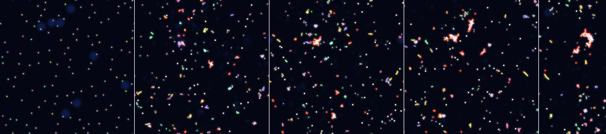
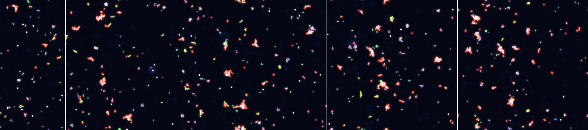
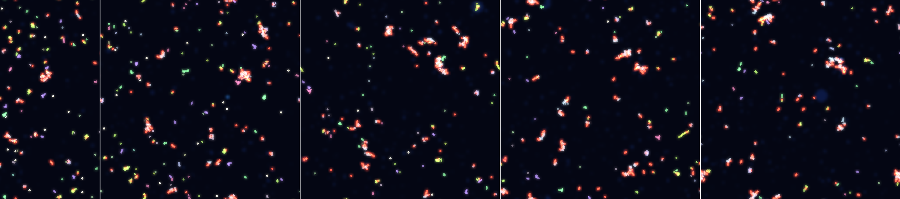
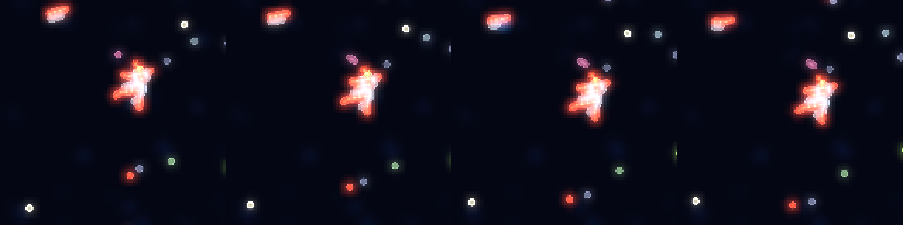
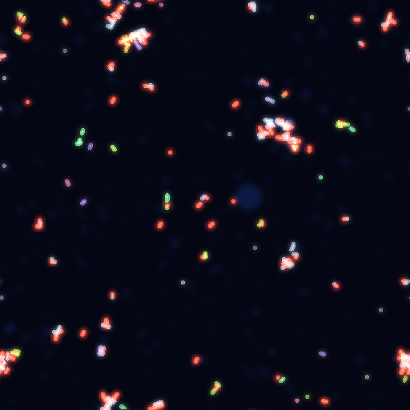

# Soft Roam: Roam's bodies off the grid (probe, 2026-11-25)

Exploratory, one day, seeds 1 and 2 only, nothing registered. Roam's bodies sat on tiles and moved a tile at a time.
This world keeps Roam's life rules and takes the bodies off the lattice, so they can slide, bend and turn.

Best case we are aiming at: soft glowing bodies of bonded cells glide, bend and turn through food haze, grow by their
plans, shed pieces that swim away, and red-mouthed hunters curve after pale-rimmed armoured bodies; every frame a small
deformation of the one before.

Code: `apps/lab/src/softroam/` (kernel, view, page, dials, worker), page `/softroam/` (dev server only), runner
`experiments/softroam/look.ts`, tests `apps/lab/test/softroam*.test.ts`. Contract: `CONTRACT.md` beside this note.

## What was moved off the grid, and how

**Motion.** A cell has an integer position (1,024 units to a tile, on a torus) and a velocity. Each step a cell is
pushed by its bond springs, pushed apart from cells it is not bonded to, and thrust along its body's heading (drive)
and up the food-scent slope (chase). A body's heading turns a little at a time, so it curves instead of jumping. The
part of a thrust that presses into another body is removed, so bodies slide past each other. A short glide is kept
from step to step. A new piece swims straight away from its parent at full thrust for a while.

**Shape.** A cell still carries Roam's plan (16 modes, where the daughter goes, kept or let go, kind). The plan's
lattice is now only the body's idea of itself: a daughter is born one cell-width from its mother along the mother's
physical facing, and gets springs to its mother, to neighbours at the plan's ideal offsets and to cells two steps away
(the one that resists bending). Rest lengths come from the plan lattice, never from where the cells happen to be, so a
bent body keeps its identity and does not count as a different shape. Bodies are still found by walking mother links.

**Touch.** Cells of different bodies within 1.25 cell-widths touch, at most four contacts per cell. A mouth of a body
at least twice the size of another takes matter from a plain or mouth cell. A mouth on a shell is one hit, and a shell
cracks to plain at a hit count. New pieces are exempt for a while. Optional grip pulls a mouth gently toward prey it
touches.

**What stayed exactly Roam's.** Per-cell stores, flow along mother links, death by starving and wear, compost, the 16-mode
plans and their copy errors, bodies never fusing, one reservoir dropping food patches, closed matter with residual
exactly 0, integer arithmetic, one seed gives one history. Soft Roam imports Roam's hash, plans and constants and
changes none of Roam. Shared-store Roam modes are not ported.

## How to open it and run it

Page: `cd apps/lab && pnpm vite` in this worktree (`export PATH=/Users/nicholas/.nvm/versions/node/v24.2.0/bin:$PATH`
first), then open `http://localhost:5173/softroam/`.

Look (headless, native WebGPU not needed): from the worktree root,

    deno run -A --no-lock experiments/softroam/look.ts --seed 1 --steps 20000 --report 2000 --frames 2500 \
      --movie 1 --movieFrom 19100 --out runs/softroam/m2-s1

It prints a row every `--report` steps and writes `sheet.png`, `rows.json` and, with `--movie`, `frames/`. The movie is
`ffmpeg -framerate 30 -i frames/f%05d.png -c:v libx264 -pix_fmt yuv420p movie.mp4`.

## The gate

    pnpm typecheck                       (tsc -p tsconfig.json, no errors printed)
    pnpm vitest run apps/lab/test/softroam    Test Files  7 passed (7) / Tests  145 passed (145)
    pnpm vitest run apps/lab/test/roam.test.ts  Test Files  1 passed (1) / Tests  47 passed (47)

Determinism: seed 1, 3,000 steps, run twice: digest `f285aca7` both times.

## What seeds 1 and 2 showed (page defaults, 128 x 128, 20,000 steps)

Defaults are the tuned setting below: 120 founders, six plan types planted evenly, matter 100,000, kinds, touch feeding,
shells, cracking. Alarms (stretched bonds, overlapping bodies, cells held at the speed clamp) stayed 0 on both seeds;
residual 0 at every report; worst single-step move of any cell 0.25 tile. Final digests: seed 1 `ca4158c5`, seed 2
`4a8822e`. Speed: about 700 steps a second with no painting (the determinism runs); about 475 steps a second in the
20,000-step runs, which paint sheet columns and 900 movie frames, with two running at once. The painter takes about 3.3
ms a frame at 4 pixels a tile.

Seed 1 (columns: step, bodies, one-cell bodies, cells, largest body, shells, mouths, matter taken by touch per 1,000
steps, travel in tiles over 200 steps, share of cells that moved 2 or more tiles):

| step | bodies | one | cells | big | shells | mouths | drained/k | travel | moved |
|---|---|---|---|---|---|---|---|---|---|
| 2000 | 183 | 115 | 327 | 9 | 41 | 37 | 2595 | 4.5 | 87% |
| 4000 | 198 | 124 | 370 | 11 | 57 | 57 | 6140 | 4.1 | 80% |
| 6000 | 187 | 112 | 380 | 18 | 53 | 72 | 9854 | 4.4 | 81% |
| 8000 | 173 | 110 | 379 | 25 | 47 | 84 | 10091 | 4.6 | 79% |
| 10000 | 154 | 94 | 369 | 44 | 35 | 93 | 10771 | 4.8 | 95% |
| 12000 | 127 | 60 | 352 | 19 | 21 | 106 | 9538 | 4.1 | 74% |
| 14000 | 122 | 54 | 356 | 24 | 20 | 120 | 9978 | 4.0 | 71% |
| 16000 | 120 | 50 | 362 | 30 | 19 | 126 | 11468 | 4.2 | 81% |
| 18000 | 114 | 45 | 367 | 25 | 14 | 131 | 10059 | 4.5 | 81% |
| 20000 | 118 | 47 | 372 | 25 | 7 | 147 | 11992 | 4.1 | 82% |

Seed 2:

| step | bodies | one | cells | big | shells | mouths | drained/k | travel | moved |
|---|---|---|---|---|---|---|---|---|---|
| 2000 | 197 | 137 | 351 | 11 | 39 | 44 | 3753 | 4.9 | 90% |
| 4000 | 204 | 128 | 374 | 12 | 52 | 52 | 4946 | 5.0 | 94% |
| 6000 | 193 | 118 | 371 | 16 | 45 | 62 | 6456 | 4.6 | 89% |
| 8000 | 177 | 95 | 370 | 15 | 40 | 69 | 7377 | 4.8 | 92% |
| 10000 | 169 | 77 | 389 | 12 | 24 | 96 | 7091 | 4.6 | 82% |
| 12000 | 160 | 72 | 393 | 15 | 18 | 113 | 10278 | 4.2 | 77% |
| 14000 | 119 | 48 | 367 | 28 | 9 | 129 | 12101 | 4.5 | 84% |
| 16000 | 114 | 40 | 360 | 26 | 3 | 148 | 10409 | 4.8 | 87% |
| 18000 | 99 | 27 | 360 | 22 | 0 | 158 | 10507 | 4.6 | 89% |
| 20000 | 96 | 24 | 349 | 25 | 0 | 149 | 12427 | 3.7 | 67% |

Plan families by cells at the start (20 each of lines, plates, crosses, blocks, specks, bushes) against step 20,000:
seed 1 lines 16, plates 79, crosses 23, blocks 27, specks 8, bushes 219; seed 2 lines 10, plates 21, crosses 21,
blocks 57, specks 1, bushes 239. The bush plan takes most cells on both seeds, which is Roam's result too.

### Pictures (my reading of frames; your eye decides)

- Early (step 2,500 to 5,000): the arena is scattered with small coloured bodies of two to ten cells, many one-cell
  crumbs, and white-rimmed armoured specks in the open water. Plan shapes show on the small ones: rods, crosses, plates.
  The two seeds look alike apart from where things are.
- Late (12,500 to 20,000): red glowing hunter bodies carry the picture, scattered across the arena as separate
  clumps, with pale and white lumps on them (shells and crumbs pressed to them). Coloured grazers become rarer. Seed 1
  keeps a few white armoured specks; on seed 2 they are gone by step 18,000 and nothing but plain bodies and hunters
  remain.
- Consecutive frames: I looked at runs of four frames one step apart and four frames 40 steps apart (not at the whole
  movies, `movie.mp4`, last 900 steps, one frame per step). Each body is a small deformation of the one before, with no
  jump or flicker in what I looked at. In the strip above one seed 1 hunter body (about 12 cells, red mouths round a
  white middle) moves some tiles in 100 steps, leans and changes its outline a little, while crumbs near it drift.
  Four frames one step apart look almost identical (not shown).
- Bodies bend a little as they slide: the strip shows an outline changing. I did not pick out a piece swimming off a
  parent in the frames I looked at.
- Food haze is faint in these pictures, nearly invisible after step 2,000: 13,000 to 18,000 of 100,000 matter lies on the
  ground, spread thin.

## Tuning: what three explorers found, what the default is

Three explorers each tuned one aspect on seeds 1 and 2, then one combined setting (B) was chosen from six combinations
(A to F, 12,000 steps each, both seeds, alarms 0 and residual 0 in every run).

- Explorer 1 (holding bodies together, about 40 settings): wear at life 8,000 instead of 2,000 removed two thirds of
  deaths; small leaks (0.001 a cell, 0.002 a side) let edge cells and single cells survive; birth store 150 with
  minimum store 30 gives fatter cells that divide less often; 120 founders crowd out shape-poor lines; matter 100,000
  gives about 350 cells, which crowd less than the roughly 1,000 at 240,000.
- Explorer 2 (motion): founders' chase gene (384) against drive (64) pins bodies to food patches; bodies of 10 or more cells
  moved a median 0.0 to 0.1 tile per 200 steps even with thrust 1,000. Weakening the pull (scent gain 1, the lowest
  legal value) gave 4 to 5 tiles a 200 steps, 80 to 88% of cells moving 2 or more tiles, against 35 to 44% before.
  Thrust above about 240 trips the speed-clamp alarm, so thrust stays 240.
- Explorer 3 (hunters and armour): shells almost never cracked at crack 2,000; 300 works, and the hit count (not the
  threshold) limits cracking. Shells must be cheap (shell leak 0.1, shell bite 1) or cracking wipes armour out. Seal 200
  lets new pieces swim off at full thrust and about doubles motion. Grip 96 moves cells from loose crumbs into hunter
  bodies (judgment call, thin margin).
- Chosen default (B): founders 120, matter 100,000, scent gain 1, move cost 0.01, life 8,000, leakCell 0.001, leakSide
  0.002, birthStore 150, minStore 30, bite 4, foodSpread 0.05, planMut 0.01, drain 1, seal 200, crack 300, grip 96,
  shellLeak 0.1, shellBite 1. Where explorers disagreed (drain 2 against 1) drain 1 won: drain 2 made jammed hunter heaps
  on both seeds. Of the others: C (more matter and founders) gave bodies of 36 to 39 cells but brought the heaps back; D
  (no grip) was more crumb-cluttered; E (scent gain 2) halved motion; F (life 5,000, bite 3) was no better.
- The kernel's own `defaultSoftRoamConfig` was left unchanged; the page line-up (`PAGE_WORLD`, `GARDEN_DEFAULTS` in
  `view.ts`) sits over it, because moving it broke nine kernel tests that assume the old defaults.
- The explorers' 12,000-step numbers (largest body 15 and 10, mouths 96 and 73) came from tuning runs; the table above
  is the 20,000-step rerun at defaults, and it moves on: by step 20,000 mouths are 147 and 149 of about 360 cells.

## What is NOT shown, and what is still wrong

- Seen seeds only, 1 and 2; nothing confirmed on unseen seeds; one history each; these rules are mine; not reviewed by
  Codex yet.
- The world is not stable late: hunters grow from 37 to 147 mouths on seed 1 and 44 to 149 on seed 2, so by step 20,000 more
  than a third of cells are mouths, and shells fade (7 left on seed 1, none on seed 2). It was still moving at the end of
  the run, so 20,000 steps do not say where it settles.
- Hunters do not curve after armoured bodies. I saw no case of a hunter turning toward prey and catching it. Mouths
  find prey only by bumping into it, and steer by the same food scent as grazers. Feeding happens where bodies already
  touch.
- Armoured bodies are single white specks, not multi-cell pale-rimmed bodies.
- Bodies stay small: largest 25 cells at the end on both seeds (peak 44 on seed 1 at step 10,000). Roughly a third to
  half of all bodies are single cells at any time (47 of 118 on seed 1, 24 of 96 on seed 2 at the end).
- Plan shapes are only clear on small bodies early; the late picture is hunter clumps.
- Food haze is barely visible.
- Movement is mostly drifting and sliding, with a short glide. I did not see bodies cross long stretches in a chosen
  direction at page scale; travel is 4 to 5 tiles in 200 steps.
- Thrust cannot go above about 240 without setting off the speed alarm.

## Rule changes the explorers asked for, not made

1. Prey sensing for mouths (a prey signal or a mouth chase term), so hunters can curve after prey. Ranked first.
2. A cap on release, or release only above a body size (mature plan tips shed a single cell each time they hold twice the
   birth store; this is roughly half of all divisions and most of the crumbs).
3. A personal-space or hunter-repulsion rule at crowded patches (hunters pile into motionless heaps when the defaults
   are loosened).
4. A mouth budget or a no-cannibalism rule (about 40% of drain victims in one explorer's runs were pieces of other hunter
   bodies).
5. Multi-cell armoured bodies (shell entries in kept plan modes), and a size-ratio dial or contact-count drain so
   plan-shaped prey can be caught.
6. A softer speed cap, and a start option for founder genes so homing can be kept without scent gain at its floor.
7. A food patch rate that does not depend on leaks (slow renewal from compost).
8. A hunter-free control: `kinds` false needs crack and drain absent, and `--ov` JSON cannot clear them.
9. Shells that inherit or evolve toughness (it never came into play), a dial for the share of hunter founders, a brighter
   haze in the painter (a view change, not a rule), and the share of cells in bodies of 4 or more in the look rows.

## Files

Sheets and movies are in `runs/softroam/m2-s1/` and `runs/softroam/m2-s2/` (`sheet.png`, `rows.json`, `movie.mp4`,
`frames/`), logs `runs/softroam/m2-s1.log` and `m2-s2.log`. Tuning runs are in `runs/softroam/m2-combined-*`. Not
committed.

## Addendum: the close-out commit shifts the histories

The tables, digests and pictures above are from commit `3d9ae060`. The close-out commit after it reads the scent slope
from the fine field, so a faint far gradient is no longer rounded away, and every run with a chaser moves slightly
differently. Rerun at the close-out commit, page defaults, 20,000 steps (`runs/softroam/final-s1`, `final-s2`):

| seed | bodies | single | cells | largest | shells | mouths | travel per 200 steps | alarms | residual | digest |
|---|---|---|---|---|---|---|---|---|---|---|
| 1 | 97 | 19 | 359 | 22 | 4 | 169 | 4.6 tiles | none | 0 | `99297a54` |
| 2 | 141 | 48 | 387 | 14 | 1 | 103 | 4.1 tiles | none | 0 | `647c14da` |

The reading does not change: smooth motion, small bodies, mouths take over and armour dies out, no pursuit. The food
haze is now drawn with a compressive tone, so thin food shows. Measured over all 901 consecutive movie frames of each
seed at `3d9ae060`, at most 0.07% of pixels change by more than 60 in one frame: nothing pops.

Two limits left as they are: the scent read can pass 31 bits at the widest dials (exact in JavaScript; a GPU port
must rescale it), and seal ages wrap after 2^32 steps.
