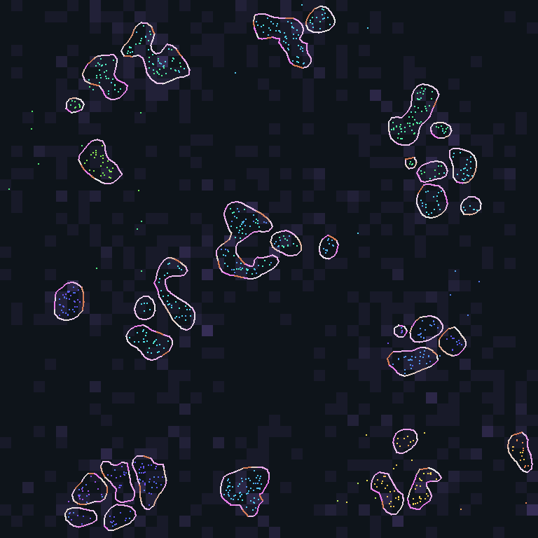
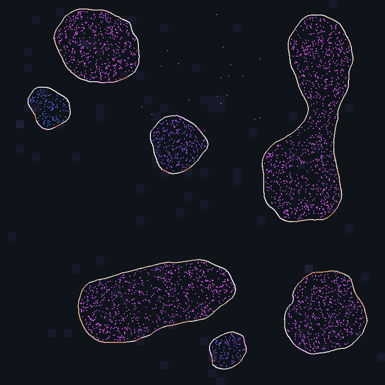

# Vesicle world: walls made of matter (2026-11-18)

A new sandbox, built after the bodies line ended with walls that froze. The idea, taken from how protocells
and wall-less bacteria behave: the wall is conserved material under tension, the contents push on it,
competition is for wall material, and division is a shape instability, not an instruction.

Rules in prose: [RULES.md](RULES.md). Code: `apps/lab/src/vesicle/`. Page (unlisted): `/vesicle/`.
Everything here is exploration on one machine. Nothing was fixed before the runs except the pass rules of
the three mechanics scenes, which are in `experiments/vesicle/scenes.ts`.

## What was built

- `model.ts`: the world. Bead rings for walls, solute particles for contents, grid counts for food, waste and
  free lipid. Matter is exact; a seed repeats bit for bit (checked in Node and Deno, which share an engine).
- `observe.ts`: finds rings, counts their contents, checks structure (links, orientation, bond crossings).
- `worlds.ts`: the garden and two mechanics demos. `page.ts`: the lab page, with tools to drop lipid, drop
  food, or burst a cell.
- `experiments/vesicle/scenes.ts` (rung 0), `run.ts` (gardens, census table, frames), `summarise.ts` (one
  line per run from the logs, and the within-run correlations quoted below).
- Tests: `apps/lab/test/vesicle-model.test.ts` (23 tests, one pinned digest), `tests/e2e/vesicle.spec.ts`.

## Kernel versions

Every number below is from the final kernel (2026-11-19). The kernel was reviewed by Codex (Sol 6.1, High)
six times; each round of fixes changed every trajectory, so the scenes and all the runs were run again each
time. Earlier runs are kept in `runs/vesicle/pre-review/` (before any review) and
`runs/vesicle/pre-review2/` (after the first round), and gave the same picture.

- Round 1 (five findings, no P1): walls could cross for a while after a pinch, after a bead left a corner,
  or by a bead sliding over a bond two places along its own ring; the "copy only in company" count went
  stale after a decay; direct lipid insertion missed walls in the next grid cell and bonds split earlier in
  the step.
- Round 2 (three findings, no P1), fixed on 2026-11-19: a particle in a slit thinner than about 0.35 could
  be pushed through the far wall, and one exactly on a wall felt no push (a particle's move is now refused
  if it would end on a wall or pass through one); the crossing check before a pinch looked in three hash
  cells, too few for a long bond (it now looks along the whole bond); lipid insertion followed at most
  eight splits of one bond per step (now any number).
- Found while fixing round 2, all closed: a particle exactly on a wall could still be pushed out through it;
  after a bead left, the shortcut bond could lie where the lookup did not search; a ring seeded at the dish
  edge could be snapped inward by more than a step.
- Found by the reruns, not by a review: one wounded garden made a wall crossing at step 19,916. In the step
  of a pinch, a bead 0.12 from one of the two new bonds got no push from it and moved through. The contact
  pass is now done again after each pinch. The review of that fix then showed that two crowded cells
  pressed together could be pushed through each other in one step; a bead in contact now moves at most a
  fraction of its gap (RULES.md, step 4), which rules that out.

Each fix has a test that fails on the kernel before it, with one exception: the check that the two new
bonds of a pinch do not cross each other has no test of its own. The last review found no P1 and one P2
(a ring seeded at the dish edge); the seeding check that closes it has a test but was not itself reviewed.
On the final kernel: six gardens checked at every one of 30,000 steps (`experiments/vesicle/crossings.ts`;
the script used at the time was a scratch copy of it), and 28 gardens checked at
every census (400,000 or 1,500,000 steps, eight of them wounded), showed no crossing and no change in matter.

Still open, and accepted: a moving wall can pass over a particle (a bead's own step, or the shortcut bond
when a bead leaves, is not checked against particles), and a bead exactly on a bond feels no push.

## Rung 0: mechanics only, eight seeds each

| Scene | Rule | Result |
|---|---|---|
| Inflate: one vesicle, 40 / 80 / 160 / 320 solute | one ring, each area at least 1.3 times the last, at least 97% of solute still inside | 8 of 8. Mean area 143 / 272 / 498 / 974 |
| Theft: two equal vesicles (240 and 60 solute), 62 lipid in total, none free | crowded one gains 6 beads or more, the other loses 6 or more, lipid total unchanged | 5 of 8. Crowded 31 to 36-39, slack 31 to 15-18; the three misses gained 5 |
| Pinch: one vesicle, 120 solute, then 400 lipid dropped in the water | at least one pinch, two or more daughters with 12 or more solute, 96 or more solute still inside rings | 8 of 8. First pinch at step 6,848 to 14,077; 2 to 6 rings at the end |

Theft passed 7 of 8 before the last round of fixes. In all eight worlds wall still moves from the slack
vesicle to the crowded one; three fall one bead short of the rule, which was not changed.

Two things changed after the first runs, both before these numbers. The inflate rule first demanded every
particle inside; the scene found a leak where a bead leaves at a corner (3 of 4,800 particles on the final
kernel too), so the rule allows 3% and the leak is listed in RULES.md. The stretch sensitivity of lipid exchange was 0.1 and is
now 0.04; at 0.1 walls stretched instead of recruiting beads and theft was too small to see.

A flood of lipid (1,200 units) shreds a vesicle into dozens of tiny rings with one to three particles each
(seen before the review fixes, not rerun). Division is clean only when the surplus is modest.

## Rung 1: metabolism, no selection

Six founder vesicles of 60 solute in a 192 by 192 dish, food 2 per grid cell.

- First settings starved the walls: all food became solute, four giant vesicles, no division.
- A diffusion bug (directions filled in a fixed order) drifted food and lipid into one corner and produced
  a false "tissue" there. Fixed; frames from before the fix are not kept.
- With lipid making at 0.02 and softer bending the garden is a steady ecology. Drift-only runs (bytes are
  copied and shifted, the rules read the founder value) over 400,000 steps, four seeds: 28 to 34 cells at
  the end, 735 to 832 divisions, 708 to 803 rings dissolved, 0 to 4 ruptures, 5 or 6 of 6 founder families
  left.

Most divisions are small buds that die: dissolved rings nearly equal divisions. Cells stay near where their
founder sat; nothing moves them except growth.



Drift-only garden, seed 1, step 400,000. Solute is coloured by the lipid-share byte, which the rules do not
read in this arm: each cluster of cells shares a colour because it shares ancestors.

## Rung 2: heredity

Each copy of a particle may shift its lipid share (how much of its effort makes lipid instead of copies)
and an idle marker byte, each with probability 0.1 by up to 16.

| Arm | Seeds | Lipid share at 400k (start 128) | Idle marker | Cells at 100k / 400k | Divisions |
|---|---|---|---|---|---|
| Drift only | 4 | 113, 145, 128, 129 | 128, 123, 121, 127 | 29-31 / 28-34 | 735-832 |
| Heredity | 4 | 5.6, 6.0, 5.2, 6.3 | 132, 139, 108, 142 | 12-19 / 1, 2, 4, 4 | 113-127, none after 300k |

With heredity the share falls in every seed while the marker only wanders, so this is selection, not drift.
It is selection for copying over wall making: division stops, cells swell with solute (median 902 to 2,512
particles per cell at the end against about 20 in the drift-only arm), walls rupture (8 to 14 per world)
and the population is down to one, two, four and four cells.



Heredity, seed 1, step 240,000: seven swollen cells that have all but stopped dividing. Violet means a low lipid share.

### How much private gain can the cells stand?

`tradeoff` scales how much faster a particle copies when it makes less lipid (1 = a pure copier copies twice
as fast as the founder; 0 = no gain at all). Three seeds each, 400,000 steps.

| Private gain | Lipid share at 400k | Cells at 400k |
|---|---|---|
| 1 (the table above) | 5.2 to 6.3 | 1, 2, 4, 4 |
| 0.3 | 36, 11, 18 | 9, 3, 2 |
| 0.1 | 49, 42, 30 | 12, 13, 7 |
| 0 | 62, 63, 60 | 14, 12, 17 |

Even with no private gain the share falls and the dish holds fewer, larger cells. A cell that spends less
food on wall holds more solute, and the mean is taken over particles, so part of this fall is big cells
counting for more: counting every cell once, the share at 400,000 is 73, 68, 70 with no gain, 67, 58, 51
at 0.1 and 58, 22, 28 at 0.3.

### Long runs with no private gain

Three seeds, 1,500,000 steps, `tradeoff` 0.

| Seed | Lipid share every 300k | Cells every 300k | Fewest cells | Divisions in the last 500k | Ruptures |
|---|---|---|---|---|---|
| 1 | 72, 47, 40, 58, 52 | 19, 16, 10, 15, 10 | 9 | 33 | 27 |
| 2 | 62, 50, 42, 33, 44 | 21, 13, 11, 4, 15 | 3 | 36 | 39 |
| 3 | 76, 56, 44, 60, 53 | 17, 10, 12, 9, 10 | 8 | 55 | 29 |

All three worlds are alive and still dividing at the end. The share stops falling and moves between about
30 and 60.

The table's share is a mean over particles, so a swollen cell counts for more. Counting every cell once
instead, the share every 300k is 89, 75, 64, 67, 60 for seed 1; 82, 60, 48, 37, 54 for seed 2; 85, 72, 63,
71, 64 for seed 3, ranging over 33 to 88 after step 500,000. So the typical cell keeps more of its wall
making than the particle mean suggests, and the fall is partly big cells counting for more.

Within each run, samples with a higher share tend to have more cells: over the 25 samples from step
300,000 on, the correlation with the per-cell share is 0.25, 0.78, 0.64 and with the particle mean 0.74,
0.72, 0.57 (`summarise.ts --corr-after 300000`; the samples are not independent). Seed 2 fell to 3 cells
and came back to 15. That is consistent with selection among cells pushing back: where wall making gets
too low, cells rupture, and the cells that still divide refill the space. It is three runs and a
description, not a test, and the per-cell correlation is weak in one of the three.

### Bursting cells to open space

No private gain, one ring chosen at random is burst every 2,000 steps, eight seeds, 400,000 steps. Seven
worlds lived, with 14 to 27 cells at the end and a per-cell share of 99, 112, 105, 99, 128, 100 and 107
(particle mean 90 to 124), against 68 to 73 (60 to 63) in the three worlds without bursting. The eighth
world died out between steps 345,000 and 350,000. Bursting holds the share higher in every world that
lives. It also kills worlds. (Before the last fixes this arm had three seeds: two lived, one died.)

### Levers tried on an earlier kernel (before any review fix, two seeds each, 300k; not rerun)

| Change | Outcome |
|---|---|
| Lipid always to the water (`rIns` 0), 4 seeds | share 5 to 13, three worlds empty, one with 5 cells |
| Rupture at 12% stretch instead of 25% | both empty by 150k |
| Rupture at 8% | founders rupture at once |
| Mutation rate 0.02 | slower fall (share 56 and 66), division almost stopped |
| Rupture 12% with mutation 0.02 | one world kept dividing (share 107, 5 cells), one empty |
| Solute five times longer lived | cells swell and rupture, no division |

## Reading

- The physics does what was asked of it. Walls, pressure, theft of wall material and division come out of
  one mechanism, with no body ids and no instruction to divide, and they give a population with births and
  deaths that holds for 400,000 steps.
- Give each particle a private reason to copy instead of build, and it takes it: the cells die. This is the
  free-replicator problem, and the walls here do not solve it. A full private gain beats the cells in every
  seed; a gain of 0.3 nearly does.
- Take the private gain away and the cells hold on for 1.5 million steps with the trait moving up and down
  as cells fail and are replaced. That is consistent with selection among cells, and if so it is weak.
- Opening space by bursting cells keeps wall making higher (seven of eight worlds), which points the same
  way: when there is room to divide into, the cells that still divide do better.
- The open problem has moved. It is no longer how walls form and stay unfrozen. It is what makes dividing
  pay: space to move into, a way to disperse, or copying that is tied to the cell (one linked genome copied
  once per division) so that no part of a cell can out-copy the rest. Rung 3 tries a version of the last:
  `docs/vesicle-wall-genes-2026-11-19/README.md`.

## Limits of these runs

- One machine, three or four seeds per arm, exploration. No pass rule was fixed ahead for rungs 1 and 2.
- The lipid-share mean is over particles, so a swollen cell counts for more than a small one. The logs
  carry a per-cell mean as well (`geneCell`); the tables say which is which.
- Garden parameters were tuned by eye on seed 1 and then run on other seeds; they are not a search result.
- Chemistry visits particles in storage order, which can correlate with family (RULES.md). The drift-only
  arm has the same order and shows no directed change.
- Two known gaps in the mechanics are open and accepted (see Kernel versions).

## Commands

```bash
export PATH=/Users/nicholas/.nvm/versions/node/v24.2.0/bin:$PATH
node experiments/vesicle/scenes.ts --seeds 1,2,3,4,5,6,7,8 --out docs/vesicle-2026-11-18
node experiments/vesicle/run.ts --out runs/vesicle/r7/neutral --seed 1 --steps 400000 --every 20000 --frames --colour gene --heredity --neutral
node experiments/vesicle/run.ts --out runs/vesicle/r7/evolve  --seed 1 --steps 400000 --every 20000 --frames --colour gene --heredity
node experiments/vesicle/run.ts --seed 1 --steps 400000 --every 20000 --heredity --params '{"tradeoff":0}' [--wound-every 2000]
node experiments/vesicle/summarise.ts runs/vesicle/r7/long-*.log --corr-after 300000
pnpm vitest run apps/lab/test/vesicle-model.test.ts
BL_E2E_PORT=5263 npx playwright test tests/e2e/vesicle.spec.ts
```

The full list of commands is `runs/vesicle/r7/jobs.txt`. Logs and frames are in `runs/vesicle/` (gitignored):
`r7` everything quoted here, `r7-crossing` the rerun that stopped on the crossing, `pre-review2/` the runs
after the first review, `pre-review/` everything from before any review.
