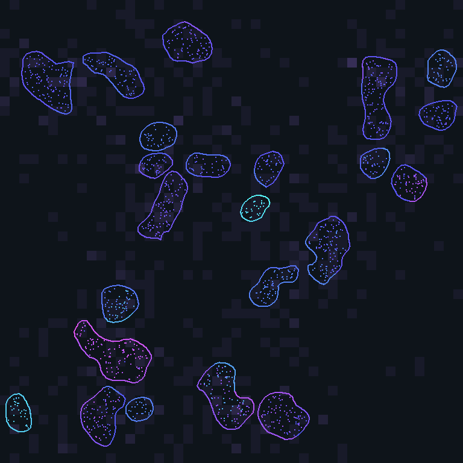
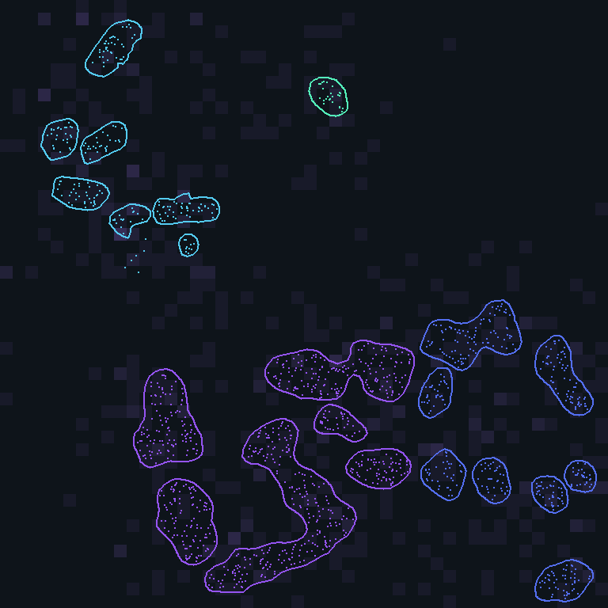

# Vesicle world, rung 3: heredity in the wall (2026-11-19)

Rung 2 (`docs/vesicle-2026-11-18/README.md`) put the heritable bytes on solute particles that copy
themselves. A particle that made less lipid copied faster, took over its cell, and the cells stopped
dividing and died in four of four worlds.

This rung moves the bytes into the wall. Rules added (`wallGenes` on; off by default, and with it off the
kernel's pinned state is unchanged):

- Every wall bead carries the two bytes (lipid share, idle marker). A new bead copies them from one end of
  the bond it joins, picked evenly, each byte shifted with probability `mut` by up to `mutStep`.
- Solute is only made against the inner face of a wall: a particle that is due to copy does so only if a wall
  bond is within `rIns` and the particle is on its interior side. The copy takes the bytes of the nearest
  bead of that bond, unshifted. Solute keeps that stamp for life and has no heredity of its own.
- Everything else is as before. A particle's stamp sets how much lipid it makes and, with `tradeoff` 1, how
  fast it copies (a low share copies up to twice as fast).

So the wall is the genome, and a pinch hands each daughter the stretch of wall it keeps. Nothing says
"reproduce" and no cell has an id. The wall is not copied once per division, though: walls trade beads
with the water all the time (about 23,000 beads joined and 22,800 left a garden of 300 beads in 6,000
steps), so a bead is replaced roughly every hundred steps and every replacement is a copy. For that reason
the shift rate per copy here is 0.01, a tenth of rung 2's.

## What would count, written before the long runs

Seen before writing this: two seeds of the selection and drift-only arms to step 80,000 to 100,000, on an
earlier build (shift rate 0.1, and with a fault that let solute copy just outside a wall corner). Cells
lived in both; the share was falling in the selection arm. A Codex review (Sol 6.1, High; no P1) then
pointed out that a fall can come from inside one wall as well as from contests between cells, which is why
arms 3 and 4 exist and why rule 4 reads as it does.

All arms use `tradeoff` 1 (a low share copies up to twice as fast), four seeds.

- **Selection**: wall genes on, shifts 0.01 by up to 16, 400,000 steps.
- **Drift only**: the same, but the rules read 128 for every particle.
- **Whole cells** (shifts off, 300,000 steps): six founders with wall shares 32, 64, 96, 128, 160, 192,
  rotated by seed. Every wall keeps its founder's byte, so the only contest is between whole cells.
- **Chimeras** (shifts off, 100,000 steps): all six founders alike, each with half its wall at one
  share and half at another: 64 and 192 in one set of four seeds, 96 and 160 in another. At the start there
  is nothing for cells to compete over, so an early move in the bead count is a gain inside one wall.
- **Rung 2 reference**: bytes on self-copying solute (final kernel: 1, 2, 4, 4 cells at 400,000, no
  division after 300,000).

Rules:

1. **Cells hold** if, in at least three of four selection worlds, there are 10 or more living cells at
   400,000 and at least one division after 300,000. If this fails the rung has failed.
2. **Selected, not drift** if the per-cell wall share at 400,000 lies outside the range of the four
   drift-only worlds in at least three of four selection worlds.
3. **Which way whole cells pull**: the share that holds the most living cells at 300,000 in the most
   whole-cell worlds. Read as "low" (32 to 96), "middle" (128) or "high" (160, 192).
4. **Which way a wall pulls on itself**: in each chimera world, the low share's fraction of all wall beads
   at step 20,000. "Low gains" if it is above 0.6 in at least three of four worlds of a set, "high gains"
   if below 0.4, otherwise "no clear gain".
5. **Evolution follows the cells** only if the selection arm moved from 128 toward the side named in 3, in
   at least three of four worlds, AND rule 4 does not name the same side in either chimera set. If rule 4
   names the same side, the result is **confounded**: the move could be the wall's private gain. If the
   selection arm moved against the side named in 3, the wall's private gain beat the cells.

## Known ways a wall bead can gain privately

Three, none removed. The chimera arm measures their sum.
- Lipid made near a wall goes straight into the nearest bond. Solute stamped by a high-share stretch of
  wall starts life next to it, so that stretch gets more of the lipid and is copied more. (The review rates
  this stronger than "a little".)
- Solute stamped by a low-share stretch copies faster and starts life next to it. More solute there can
  make more lipid in total next to that stretch even though each particle makes less. (Found by the review:
  with walls frozen and food plentiful, a 64 stretch outgrew a 128 stretch 5,472 beads to 2,027.)
- More solute next to a stretch also means more local push, more stretch, and stretched bonds take up lipid
  more readily.
Solute moves across a cell in about 1,200 steps and lives about 2,000, so all three are diluted, not absent.

## Results (2026-11-19)

Runs: `runs/vesicle/w2` (the five arms above) and `runs/vesicle/w3` (follow-ups), gitignored; commands in
each folder's `jobs.txt`. No run made a wall crossing or changed the matter total.

| Rule | Result |
|---|---|
| 1. Cells hold | **Yes, 4 of 4.** 23, 21, 21, 20 living cells at 400,000; 9, 11, 14, 5 divisions after 300,000. Rung 2 reference: 1, 2, 4, 4 cells, no divisions. |
| 2. Selected, not drift | **Yes, 4 of 4.** Per-cell wall share 58, 63, 60, 51 against 161, 103, 109, 107 in the drift-only worlds. The idle marker ends at 129 to 163 in the selection worlds and 87 to 163 in the drift-only ones. |
| 3. Which way whole cells pull | **Low.** Share 64 held the most cells in 4 of 4 worlds (30 of 31, 26 of 31, 15 of 27, 23 of 30 cells). It beat 96 and 128 everywhere and beat 32 in the two worlds where 32 survived the start. 160 and 192 were gone by step 20,000. |
| 4. Which way a wall pulls on itself | **Low gains, by the rule as written**: the low share held 94 to 100% of beads at step 20,000 in all eight chimera worlds. |
| 5. Evolution follows the cells | **Confounded**, because 3 and 4 name the same side. |

Selection arm, seed 1, step 400,000. Walls and solute are coloured by lipid share (violet and blue are
low). Each cell's wall is close to one colour and cells differ from each other.

Whole-cell contest, seed 3, step 100,000: three shares left, each in its own patch of pure cells.

### Rule 4 measured the wrong moment

By step 20,000 the chimeras had already sorted into pure cells (0 to 2 mixed cells left among 14 or more) and
those cells had competed as whole cells, so rule 4 as written measured rule 3 again. The rule stays as
stated and so does the label. The following was run afterwards to look at the first few thousand steps.

Chimeras again, eight seeds per set, a census every 500 steps, counting beads only in rings whose wall is
still mixed. Low share's fraction of those beads:

| Set | Step 1,000 | 2,000 | 4,000 | Mixed rings at 4,000 |
|---|---|---|---|---|
| 64 and 192 | 0.38 to 0.62, mean 0.49 | 0.42 to 0.61, mean 0.53 | 0.47 to 0.69, mean 0.55 | 4 to 13 |
| 96 and 160 | 0.41 to 0.68, mean 0.51 | 0.33 to 0.64, mean 0.49 | 0.51 to 0.64, mean 0.56 | 6 to 12 |

In rings that are still mixed the low share's fraction has moved little by step 4,000 (a mean of 0.55 or
0.56 from a start of 0.50, with single worlds on both sides of a half), while between whole cells the low
share ends with 56 to 97% of the cells. This does not settle the question. The count leaves out every
ring that has already become pure (by step 4,000 one world had 23 divisions and 12 pure cells), so beads
that won inside a wall and then left the mixed set are not seen, and it weights rings by size. It is also
a measure chosen after seeing the first result.

### Single rings followed from the start

To remove that objection each founder's wall was given its own marker, so a founder can be followed while
it is still one ring: until its first division there are no descendants to leave out and no other cell of
its kind to compete with. Sixteen seeds per pair of shares, 96 founders per pair, a census every 250 steps
(`runs/vesicle/w4`).

Low share's fraction of a founder's wall, over founders that have not yet divided:

| Pair | Step 500 | Step 750 | Step 1,000 | Wall by step 1,000 |
|---|---|---|---|---|
| 64 and 192 | 0.504 (se 0.013), all 96 | 0.498 (0.015), 94 | 0.502 (0.017), 89 | 42 beads (median), from 25 |
| 96 and 160 | 0.507 (se 0.013), all 96 | 0.501 (0.016), 94 | 0.497 (0.018), 93 | 42 beads (median), from 25 |

Over the first 1,000 steps, with nearly every founder still whole, the wall grows by two thirds, each bead
has been replaced roughly ten times over, and the low share's part of the wall shows no net shift: within
0.01 of a half, give or take 0.02 to 0.04.

Later than that the picture cannot be read cleanly, because which founders are still whole depends on
their makeup. At the census before each founder's first observed division (median step 1,750, wall about
57 beads) the fraction averages 0.506 (se 0.021; 52 founders above a half, 43 below) for 64 and 192, and
0.478 (se 0.020; 40 above, 54 below) for 96 and 160. But in the 64 and 192 pair, founders that divided
before step 2,500 average 0.46 and those that divided later 0.62, and three founders never divided in
6,000 steps and ended entirely at the low share. A wall that happens to go low divides later, or a gain
for the low share builds up with time; these runs cannot tell which.

So: no net shift inside a wall over the first 1,000 steps for these two pairs, and no clean reading
after that. The same shares, as whole cells, sort decisively (rule 3). This measure was also chosen after
the first results, so the label under rule 5 stays as it is.

### Where the share settles

A finer whole-cell contest (shares 40, 52, 64, 76, 88, 100; shifts off; four seeds; 300,000 steps) has no
single winner: the most cells went to 64, 52, 100 and 52, and 52 to 76 together held 23 of 31, 16 of 26,
18 of 30 and 26 of 32 cells. 40 died out in two worlds and held 3 and 4 cells in the others. Whole cells
do best somewhere around 52 to 76 and worse on both sides.

The selection worlds went from 128 to 51 to 63 and stayed in 38 to 71 for the second half of the run.
They did not carry on down, as rung 2's free copiers did (to 6, with the cells dying). That is what
selection among cells would do; it does not rule out a gain inside the wall that happens to weaken at low
shares.

Three selection worlds run to 1,500,000 steps (`runs/vesicle/w3`) stay there:

| Seed | Per-cell wall share every 300k | Cells every 300k | Fewest cells | Range of the share after 300k | Divisions in the last 500k |
|---|---|---|---|---|---|
| 1 | 58, 58, 61, 50, 61 | 20, 18, 13, 18, 20 | 13 | 48 to 70 | 55 |
| 2 | 64, 63, 56, 64, 51 | 20, 23, 20, 22, 18 | 13 | 40 to 69 | 62 |
| 3 | 54, 50, 63, 66, 53 | 16, 20, 19, 21, 17 | 14 | 47 to 73 | 39 |

Rung 2's no-private-gain worlds, the only ones there that lived this long, fell to 3 to 9 cells at their
lowest census; these, with the full private incentive, are never below 13 at a census (every 50,000 steps,
after the six founders have multiplied).

### What it costs

The selection worlds divide a quarter as often as the drift-only ones (211 to 258 divisions in 400,000
steps against 956 to 1,034) and hold larger cells (median 50 to 71 solute against 12 to 17). The share
that wins contests between cells is one that makes cells bigger and slower, not one that makes more cells.

## Reading

- With heredity in the wall and the same private incentive to copy instead of build, the cells stay alive
  and keep dividing in every world, for 1.5 million steps in the three run that long. Rung 2's cells died.
  But this rung did not show that the wall's heredity is why: a control added afterwards (last section)
  keeps rung 2's self-copying solute, adds only the rule that solute is made at the wall, and at the same
  slow shift rate keeps three worlds of four alive and dividing over the same span (two of them in the
  same share band, one shrinking, one collapsing).
- The share moves, it is not drift, and it stops in the range where whole cells win contests. By the rules
  written beforehand the cause is confounded. Followed afterwards as single rings, a wall shows no net
  shift toward either share over its first 1,000 steps (96 founders per pair), while whole cells with
  those shares sort decisively. That points toward selection among cells. It rests on a measure chosen
  after the fact, and a gain inside the wall that builds up later is not excluded.
- What is selected is not "divide more". Cells that make less wall hold more solute and crowd out their
  neighbours.

## Limits

- One machine, four seeds per arm (eight for the early chimera look), exploration.
- Rule 4 was badly timed, and the two measures that replaced it were chosen after seeing results.
- The private gains listed above are real mechanisms. Their net effect was measured only for two pairs of shares
  and only over a founder's first 1,000 steps; later, and in smaller or larger cells, it is not known.
- Chimera founders are not quite identical: a founder has 25 beads, so the halves are 12 and 13 and
  alternate, giving founder means of 125.4 and 130.6 in the 64 and 192 set.
- Walls are copied by turnover far more than by growth, so this is not "one genome copied once per
  division". A wall is a population of about 20 to 30 beads that drifts to one value quickly (spread
  inside a cell about 6 to 9, between cells about 18 to 26).
- Garden parameters are those of rung 1, tuned by eye there. The shift rate was lowered once, before the
  long runs, for the reason given above.

## A missing control, added afterwards: is it the wall's heredity or the wall's gate?

The selection arm differs from the rung 2 reference in two ways, not one. The bytes moved into the wall,
and solute can only copy within `rIns` of a wall's inner face. The second alone might keep cells alive: a
swollen cell has less of its solute near its wall, so the gate throttles exactly the runaway that killed
rung 2. (The shift rate differs too: 0.1 there, 0.01 here.)

Control (`wallGate`): solute copies only against the inner face of a wall, as in rung 3, but each copy
takes its parent's bytes, shifted, as in rung 2. `tradeoff` 1, four seeds, 400,000 steps, at shift rate
0.1 (rung 2's) and again at 0.01 (rung 3's).

Written before these runs:
- If the control fails rule 1 (fewer than three of four worlds with 10 or more cells at 400,000 and a
  division after 300,000) at both shift rates, the gate does not save the cells, and what does is rung
  3's way of carrying heredity taken as a whole: bytes in the wall, copied at every bead that joins, with
  solute stamped and not copied. It would not single out where the bytes are stored, because the two arms
  also differ in how often a copy (and so a shift) happens.
- If the control passes rule 1 at either rate, cells can persist without heredity in the wall, and the
  first line of "Reading" above is wrong as written: it has to say that rung 3 did not show heredity in
  the wall to be the cause. A pass would not show how the gate helps, and at the slow shift rate it might
  only mean the share has not had time to fall.
- In either case the lipid share at the end is reported next to the selection arm's 51 to 63.

### Result of the control (`runs/vesicle/w5`)

| Control arm | Cells at 400,000 | Per-cell share at 400,000 | Divisions after 300,000 | Rule 1 |
|---|---|---|---|---|
| Gate only, shift rate 0.1 | 9, 8, 5, 9 | 6, 22, 7, 10 | 0, 2, 0, 0 | fails (no world has 10 cells) |
| Gate only, shift rate 0.01 | 33, 35, 33, 29 | 81, 85, 73, 83 | 27, 47, 17, 59 | passes, 4 of 4 |

By the reading written beforehand, the control passes at one rate, so **rung 3 did not show heredity in
the wall to be the cause** of the cells holding. At rung 2's shift rate the gate alone does not save the
cells; at rung 3's it keeps them alive to 400,000 steps.

At 400,000 the share in the slow control was still falling, so its four worlds were run to 1,500,000
steps, the length of the wall-heredity long runs (this run was decided after seeing the table above):

| Seed | Per-cell share every 300k | Cells every 300k | Divisions in each 300k | Median solute per cell at the end |
|---|---|---|---|---|
| 1 | 96, 68, 48, 30, 20 | 35, 29, 23, 8, 4 | 532, 44, 9, 0, 9 | 390 |
| 2 | 94, 68, 59, 42, 44 | 35, 32, 26, 18, 12 | 540, 83, 11, 6, 9 | 100 |
| 3 | 82, 61, 50, 38, 54 | 31, 29, 24, 19, 24 | 384, 29, 6, 3, 18 | 50 |
| 4 | 105, 60, 55, 62, 60 | 32, 21, 17, 25, 24 | 653, 97, 21, 43, 22 | 42 |

Held to the standard of rule 1 (10 or more cells at the end and still dividing), three of the four
control worlds pass at 1,500,000 and one fails (seed 1: 4 swollen cells, share 20). Looked at more
closely, which is a judgement made after the fact: seed 2 is shrinking (35 cells down to 12, share 44),
and two worlds hold at 24 cells with the share at 54 and 60, the band the wall-heredity worlds sit in.
The three wall-heredity worlds run to the same length all pass (13 to 23 cells at the listed checkpoints,
share 50 to 61 at the end, none shrinking). Three of three against three of four, or against two of four
on the closer look, is a hint at most.

What the control does show:
- Where solute can be made matters. Rung 2 with free copying anywhere inside a cell and shift rate 0.1
  ended at 1, 2, 4, 4 cells; the same with copying only at the wall ends at 9, 8, 5, 9.
- How fast the share can shift matters a great deal. With the gate, a tenth of the rate turns collapse
  by 400,000 steps into three worlds of four still alive and dividing at 1,500,000.
- With slow shifts the share can stop falling even when the bytes ride on self-copying solute: two worlds
  end where whole cells do best, and one of them (seed 3) fell to 38 and came back to 54. That is
  consistent with contests between cells holding it up; these runs do not show that it is the reason.
