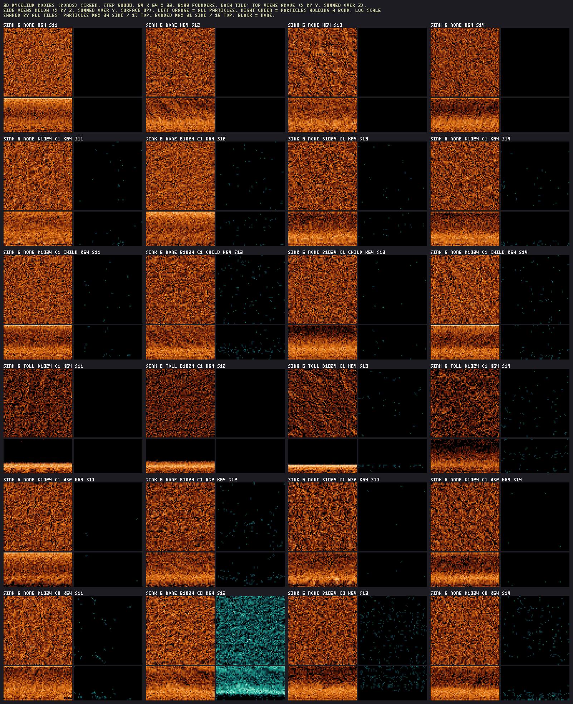

# 3D mycelium: bodies that bond (16 Nov 2026)

**EXPLORATION.** Follows the trail screen (`experiments/mycelium3d/trail-screen-2026-11-15.md`) and the owner / dark-floor screen (`owner-darkfloor-screen-2026-11-16.md`). Neither found network-like structure, and the plan's risk table (`docs/3d-expansion-plan-2026-11-15.md`) says to try bodies that bond next. There is no pre-registration, no gate and no label. Runs are judged by eye and by descriptive numbers. The screen uses four fresh seeds per arm; a pattern seen in one seed only is marked as such.

**Bottom line.**

- **With the small upkeep (cost 1), multi-particle bodies form at first, then mostly vanish, in all four arms and all 16 runs.**
  - At step 2,000, 4% to 76% of particles are bonded (runs range), in bodies of up to 41.
  - By step 20,000, 0.1% to 13% are bonded, below 2.5% in 15 of 16 runs.
  - In the late window (steps 25,000 to 50,000), 0% to 2.5% are bonded (seed range).
  - Bodies are mostly pairs: mean size 2.0 to 2.5 where bodies exist, largest at most 4.3 on average, at most 7 in any late read-back, and none of 8 or more.
  - Most bonds do not outlast one 20-step read interval: 19% to 60% of bonds whose two ends lived are still there 20 steps later (seed range, children arm aside).
  - The share of particles whose BOND output is positive falls from 0.05–0.83 at step 2,000 to 0.00–0.12 late.
- **Children bonded at birth do not build chains.**
  - The arm holds about as many bonds as bonds alone (43 against 38), but they turn over faster: 7% survive a 20-step interval (3% to 17% by seed), against 38% without `bondChild`.
  - Mean body size is 2.04; no body of 8+ in any late read.
  - This fits many short parent–child bonds: `bondChild` bonds a child whatever its BOND, and the bond is released as soon as either end's BOND is negative. The screen does not separate newborn bonds from others, so that reading is not measured.
- **Without the upkeep (diagnostic arm), one seed of four kept bodies for the whole run.**
  - Seed 12: 72% of particles bonded late (63% to 92% at every readout from 2,000 to 50,000), 1,709 bodies, mean size 4.8, a largest body of 35 on average (42 at most), 465 closed rings and about 44 bodies of 16 or more. 95% of its bonds are still there 20 steps later.
  - The other three seeds lost bonding: 0.5%, 4.2% and 2.9% bonded late.
  - So bodies can persist in this rule, but persistence was the exception even at zero cost.
- **By depth.**
  - With the upkeep, the few bodies left sit more in the deep groups than at the surface in 2 of 4 seeds (bonded share 0.019 and 0.048 in G8 against 0.000 in G1).
  - In cost-0 seed 12, bodies hold 72% to 93% of the particles in G1 to G6 and only 11% in the floor group G8 (the floor layer is dark in the bonded side view).
  - Nothing else in the readouts shows bodies doing something different by depth.
  - In that seed, the population, the surface count and the upward transport of matter by particles sit inside the bonds-off arm's four-seed range.
  - Births (4.84 per 1,000 particle-steps against 1.57–4.28), the floor group's count (1,667 against 1,162–1,528) and trail (6,721 against 0–3,486) sit just above it. With four seeds per arm, that is not evidence of an effect.
- **Bonds with the toll, and with the dark floor (`wasteShade` 2), look like bonds alone.**
  - The toll keeps its trail (517k P). Its population (5,177) is about half the bonds-off arm's, as the toll without bonds was in screen 2 (5,021). Bonding vanished entirely on two seeds (0 bonds from step 32,000).
  - In screen 2 the toll kept surface trail on seeds 13 and 14. Here only seed 14 keeps particles through the column, and seeds 11 to 13 are floor beds. One seed changed state with bonds on; four seeds cannot say whether the bonds did it.
  - `wasteShade` 2 darkens the floor (12/256 against 45 to 49) as in screen 2, with the same scarce pairs.

## The rule

Written into `tools/mycelium3d/RULES.md` ("Bonds") before the code. Three optional keys, all absent from `defaultConfig()`:

- `bondBreak` R (1..1024 position units, 256 per cell) turns bonds on, and is the distance past which a bond breaks;
- `bondCost` u (0..4096, absent means 0) is the energy each partner pays per bond per step, booked as heat;
- `bondChild` (`true`): a child is born bonded to its parent when the parent has a free slot.

**What a bond is.**
- Each particle has two bond slots, each holding a partner id or `NONE` (0xffffffff), in canonical order: one bond sits in slot 0, two sit in increasing id order.
- Bonds are symmetric, never to oneself, never twice to one partner, and always to a live particle. `validateState` checks all four.
- Degree at most 2, so a body (a connected component of the bond graph) is a chain or a ring.
- Why two:
  - one bond gives only pairs;
  - two is the least that lets a body grow without limit, and with `bondChild` a chain grows at its ends by division;
  - more than two would let a hub be pulled several ways by the move rule.

**The control.** Output 5, BOND, which was reserved, is read only with `bondBreak`. BOND > 0 means "wants a bond", BOND < 0 means "lets go", 0 means neither. A lifted 2D genome is still copied exactly. Its column 5 was never selected in 2D, so in a lifted world with bonds on, those weights drive bonding.

**No new inputs.** "Bonded or not" and "partner's energy" were left out:
- Two inputs need 16 more weight bytes, and the record has 3 bytes of padding.
- Growing the record would move the mutation slots (`% 193`), the founder draws and every digest of the rule without bonds. Making its size depend on the config would double the controller paths in the CPU, the WGSL, the lift and the page.
- So a particle feels a bond only through its effects: the shared move, the upkeep, and crowding (partners usually share a cell).

**Where it runs in a step**, on the start-of-step slots, after phase 5 has decided who lives:

1. **Live.** The cost gains `u ·` (bonds held at the start of the step). The move is held back.
2. **Release.** A survivor drops a bond if its partner died this step, or if either end's BOND is negative.
3. **Propose.** A survivor with BOND > 0 and a free slot proposes to its nearest eligible particle. Eligible means:
   - it survived, has BOND > 0 and a free slot;
   - it is not already a partner;
   - its start-of-step cell is the proposer's own cell or one of its six face neighbours.

   "Nearest" is the smallest `(d², id)` over start-of-step positions (x and y wrapped), so ties go to the smaller id.
4. **Accept.** A bond forms exactly when the proposals are mutual. Each particle proposes once, so the mutual pairs are a matching: no particle forms two bonds in one step, and no conflict needs a further pass. This narrows the brief's "nearest unbonded particle": the target must also want a bond, and "unbonded" means "has a free slot".
5. **Move.** On each axis a particle moves by `divi(own + Σ partners' intended displacement, 1 + bonds)` (truncation toward zero). Then x and y wrap and z is clamped.
   - A bonded pair moves as one (until a wall clamps one end).
   - A chain is not rigid: its ends average over two particles and its middles over three.
6. **Stretch.** A bond breaks when, after the move and clamp, `|dx|`, `|dy|` or `|dz| > R`, or `d² > R²`. The per-axis test comes first, so the squares stay below 2^22.
7. **Children** (only with `bondChild`). An accepted child is bonded to its parent exactly when the parent holds fewer than 2 bonds after step 6. A mid-chain parent's child is born free, so chains grow at their tips.

**Ledger.** No matter moves and no draw is taken. The upkeep is paid as heat inside the existing cost, and `totals` keeps its seven counters. Every run below has both ledger residuals exactly 0 at every read-back (every 20 steps).

**GPU.**
- `gpu.ts` builds per-cell particle lists with `atomicExchange` (in any order) and runs the five passes as separate dispatches, since each pass reads what its partners wrote in the pass before.
- Partners are found by binary search over the start-of-step ids.
- The proposal is a minimum over a total order, so the visiting order does not matter.
- `k_compact` carries the bond slots, and the bond to a newborn. `k_trim` gives the parent its old bonds back when the genotype-id limit cuts its child.

## Code and checks

- **Files.**
  - `tools/mycelium3d/world.ts`: the keys, `bondPhase`, the bond slots in the state and the checkpoint (two u32 per live particle, appended only with `bondBreak`), `validateState` on the graph, `slotOfId`, and the CPU-only per-step `StepStats.bonds`.
  - `tools/mycelium3d/gpu.ts`: the WGSL twin.
  - `tools/mycelium3d/RULES.md`: the rule.
  - `tools/mycelium3d/observe-screen.ts`: bond readouts and the two new grids.
  - `tools/mycelium3d/screen.ts`: bond survival, the tables and the bodies contact sheet.
- **Absent keys change nothing.**
  - All 79 parity cases that existed before the change have the same digests as in a run taken just before the edit.
  - Four CPU digests pinned before the edit are now unit tests, among them `defaultConfig()` at step 0 and step 300, and the sinking + waste shading + toll + owner world.
- **Parity.** `tests/deno/mycelium3d_gpu.ts` now has 102 cases, all bit for bit. The 23 new ones are:
  - shapes 8×8×4, 16×16×8, 13×9×5 and D = 1, the default 32×32×16, and 32×32×16 with sinking;
  - bonds with sinking, waste shading and the toll, and with the owner gate and conduit;
  - the largest upkeep, and a break distance of 1;
  - "BOND always negative equals the keyless world" (`same: true`);
  - 600 particles contesting in four cells (duplicated positions, for the id tie-break);
  - a moving contested crowd;
  - bonded partners dying one by one;
  - frozen splitters building chains (with refusals);
  - children bonded at birth at the particle cap, at the particle-id limit and at the genotype-id limit (the `k_trim` path);
  - three per-step cases;
  - two resume variants.

  Each bond case must show the bond events it names in the CPU run (proposals, formed, partner died, let go, stretched, children bonded), so none passes vacuously. Each lever case is also checked against its keyless baseline.
- **CPU unit tests** (`tools/test/mycelium3d.test.ts`, 56; 13 new):
  - ledgers exact on every step over 3,000 steps for two bond lever sets;
  - resume equals the continuous run with bonds;
  - the pinned digests;
  - mutual-nearest forming (pair, then chain, then ring of three; never across a diagonal);
  - the id tie-break, and "only wanting particles with a free slot";
  - the pair and chain moves to the unit;
  - breaking by stretch, by letting go and by a partner's death;
  - the upkeep to the unit;
  - children bonded only to a parent with a free slot;
  - "never wanting equals keyless";
  - key and graph validation, and the checkpoint round trip.
- **Screen tests** (`tools/test/mycelium3d-screen.test.ts`, 22; 4 new): the arms, the body readout on a hand-made graph, bond survival, and a real bonded world.

## Pilots: sizing the break and the cost (seeds 21, 22, 20,000 steps, sink 6, `lightK` 64)

**Selection rule**, stated before the pilots ran: the non-child (break, cost) with the most bonded particles in the late window (readouts after step 10,000, seed mean); ties within 10% go to the smaller break, then the lower cost. The screen's child arm uses the same values.

| setting | bonded particles, late | largest body, late | share wanting a bond, late | particles |
|---|---|---|---|---|
| break 256, cost 1 | 57 (31 / 83) | 2.8 | 0.021 | 12,022 |
| break 256, cost 4 | 58 (53 / 62) | 3.0 | 0.026 | 12,463 |
| break 512, cost 1 | 117 (95 / 139) | 3.9 | 0.033 | 12,350 |
| break 512, cost 4 | 62 (23 / 100) | 2.9 | 0.037 | 11,617 |
| **break 1024, cost 1** | **233 (259 / 206)** | 4.9 | 0.048 | 11,719 |
| break 1024, cost 4 | 50 (87 / 13) | 3.1 | 0.014 | 12,071 |
| break 256, cost 1, children | 159 (130 / 188) | 3.4 | 0.030 | 11,071 |
| break 512, cost 1, children | 326 (473 / 179) | 4.5 | 0.050 | 12,070 |
| break 1024, cost 1, children | 203 (214 / 191) | 4.1 | 0.023 | 11,486 |
| *break 512, no upkeep (diagnostic)* | *3,139 (5,187 / 1,091)* | *21.1* | *0.284* | *12,132* |
| *break 512, no upkeep, children (diagnostic)* | *807 (965 / 648)* | *6.9* | *0.097* | *11,845* |

- **Choice.** Break 1024 at cost 1. No other setting is within 10% of its 233 bonded particles.
- **Bonding is purged at every setting with an upkeep** (trajectories from the readouts every 2,000 steps, all 18 runs):
  - at step 2,000, the cost-1 runs have 2,270 to 9,450 of about 14,000 particles bonded, and 0.26 to 0.69 of particles want a bond. The cost-4 runs already have only 150 to 340 bonded, and 0.02 to 0.04 want one;
  - at step 6,000, 60 to 1,070 are bonded across all 18 runs;
  - at step 18,000, 8 to 460 of about 12,000 are bonded, and 0.00 to 0.08 want a bond ("want" is the share whose BOND output is positive, from `probe`);
  - founder weights are drawn symmetric about 0, so a share that falls toward 0 in every run fits selection against wanting a bond. The pilots do not test that directly.
- **The diagnostic** was added after the first 18 pilots, once all of them had purged bonding. Without the upkeep, more bonding remains at 20,000 steps:
  - 3,139 bonded on average and a largest body of 21;
  - seed 21 alone holds 5,187 bonded, 925 bodies and a largest body of 29 at the end;
  - seed 22 holds 1,091.

  The bodies screen carries this as a sixth, diagnostic arm at the chosen break. There, three of four seeds lost bonding even without the upkeep (below), so the upkeep is not the whole story.

## The screen

64 × 64 × 32, 8,192 founders, sinking 6, `lightK` 64, seeds 11 to 14, 50,000 steps:
- a readout every 2,000 steps;
- a full read-back every 20 steps, checking both ledger residuals (2,500 per run, all exactly 0) and taking the bond survival.

Arms:
1. bonds off;
2. bonds on (break 1024, cost 1);
3. bonds on + children bonded;
4. bonds + the toll (`moveCost` 12, discount 64, toll mode);
5. bonds + `wasteShade` 2;
6. a diagnostic: bonds without the upkeep (break 1024, cost 0).

`tools/mycelium3d/screen.ts --grid bodies --out runs/mycelium3d-bodies --steps 50000 --every 2000 --move-every 20 --jobs 2`.

**Timing.**
- Sizing run: one 50k run of the cost-0 arm (seed 11), timed alone at 200 s.
- That projected the other 23 runs at about 80 minutes at two jobs.
- The screen took 51 minutes of wall time (07:51 to 08:42 UTC, sizing run included), 146 to 458 s per run, on a heavily loaded machine.
- The pilots before it took about 30 minutes.

### Table (late window: readouts in (25,000, 50,000]; each cell "mean (s11 / s12 / s13 / s14)")

| readout | bonds off | bonds, cost 1 | + children | + toll | + `wasteShade` 2 | no upkeep (diagnostic) |
|---|---|---|---|---|---|---|
| particles | 10,408 (11,773 / 10,524 / 10,192 / 9,145) | 10,913 (11,363 / 11,635 / 9,872 / 10,781) | 10,383 (10,718 / 10,162 / 9,614 / 11,039) | 5,177 (5,225 / 5,158 / 5,392 / 4,932) | 9,240 (10,122 / 9,267 / 8,608 / 8,962) | 10,579 (11,188 / 11,514 / 9,453 / 10,160) |
| in G1 (surface) | 1,657 | 2,035 | 1,674 | 70 | 1,591 | 1,329 |
| in G8 (floor) | 1,387 | 1,298 | 1,441 | 1,053 | 603 | 1,550 |
| trail P | 910 | 12,411 (192 / 49,450 / 0 / 0) | 64 | 516,537 | 70 | 1,691 |
| light floor layer /256 | 48.7 | 45.2 | 50.3 | 28.1 | 11.9 | 52.5 |
| births /1k particle-steps | 2.94 (2.01 / 3.90 / 4.28 / 1.57) | 2.74 | 2.44 | 4.13 | 3.66 | 3.01 (3.80 / 4.84 / 1.54 / 1.85) |
| net matter lifted by particles /1k steps | −40k (1.6M / −167k / −219k / −1.4M) | 372k | −60k | 1.25M | 20k | −394k (25k / 265k / −476k / −1.4M) |
| genotypes (final) | 4,852 | 4,918 | 4,751 | 2,221 | 4,426 | 4,811 |
| bonds | – | 38 (22 / 62 / 16 / 52) | 43 (23 / 71 / 8 / 68) | 23 (0 / 0 / 21 / 69) | 36 (3 / 101 / 8 / 33) | 1,863 (39 / 7,002 / 233 / 177) |
| share of particles bonded | – | 0.006 (0.003 / 0.010 / 0.003 / 0.008) | 0.008 (0.004 / 0.014 / 0.002 / 0.012) | 0.008 (0 / 0 / 0.007 / 0.025) | 0.007 (0.001 / 0.019 / 0.002 / 0.006) | 0.198 (0.005 / 0.716 / 0.042 / 0.029) |
| bodies (2+) | – | 32 | 40 | 19 | 30 | 508 (23 / 1,709 / 174 / 127) |
| largest body | – | 3.4 | 3.0 | 2.0 | 3.1 | 13.0 (6.1 / 34.9 / 5.4 / 5.7) |
| largest body, max over late reads | – | 5 (5 / 5 / 4 / 6) | 4 (5 / 5 / 2 / 5) | 5 (3 / 3 / 5 / 7) | 4 (3 / 5 / 4 / 5) | 17 (11 / 42 / 7 / 9) |
| mean body size | – | 2.15 | 2.04 | 2.27 (2.20 / 2.50 / 2.22 / 2.14)* | 2.15 | 3.00 (2.57 / 4.83 / 2.30 / 2.31) |
| bodies of 2 / 3 / 4–7 / 8–15 / 16+ | – | 27.9 / 3.4 / 0.7 / 0 / 0 | 38.1 / 1.5 / 0.3 / 0 / 0 | 16.1 / 2.2 / 0.4 / 0 / 0 | 25.6 / 3.6 / 0.7 / 0 / 0 | 172 / 132 / 134 / 59 / 11 (seed 12: 443 / 467 / 518 / 237 / 44) |
| closed rings | – | 1.1 | 0.5 | 0.8 | 1.1 | 121 (3.7 / 465 / 7.3 / 9.2) |
| bond kept over 20 steps (both ends alive) | – | 0.380 | 0.073 | 0.454 | 0.368 | 0.634 (0.574 / 0.949 / 0.610 / 0.402) |
| share wanting a bond (BOND > 0) | – | 0.022 | 0.013 | 0.025 | 0.024 | 0.245 (0.007 / 0.802 / 0.108 / 0.063) |
| mean age, bonded / free | – | 843 / 1,012 | 357 / 1,346 | 155 / 263 | 865 / 606 | 814 / 994 |
| bodies with mean layer in G1 / G8 | – | 2.9 / 12.2 | 3.8 / 8.5 | 2.3 / 3.4 | 1.1 / 3.0 | 70.9 / 37.6 |

\* Mean size and bonded age are over the late readouts that have bodies; seeds 11 and 12 of the toll arm have none after step 32,000.

The screen's table also prints an "implied bond life", `20 / (1 − kept)`. It cannot fall below the 20-step interval, so for the arms with upkeep (22 to 38) it says only that most bonds last less than about one interval. It is left out here.

"Net matter lifted" is the matched particles' matter times the layers risen, between read-backs 20 steps apart (`addTransport`). Its seed values span 1 to 3 million in every arm. The full tables, including by-depth groups (particles, matter, A, C, P, light, particles in bodies, bodies and mean body size per group), come from `screen.ts --grid bodies --out runs/mycelium3d-bodies --table`.

**Bonded share by depth group**, readouts after step 25,000 (particles in bodies over particles in the group):

| run | G1 | G2 | G3 | G4 | G5 | G6 | G7 | G8 |
|---|---|---|---|---|---|---|---|---|
| no upkeep, seed 12 | 0.717 | 0.767 | 0.823 | 0.880 | 0.908 | 0.926 | 0.693 | 0.108 |
| cost 1, seed 11 | 0.000 | 0.000 | 0.000 | 0.000 | 0.001 | 0.002 | 0.004 | 0.019 |
| cost 1, seed 12 | 0.004 | 0.020 | 0.022 | 0.014 | 0.005 | 0.001 | 0.002 | 0.021 |
| cost 1, seed 13 | 0.006 | 0.010 | 0.006 | 0.005 | 0.005 | 0.002 | 0.000 | 0.000 |
| cost 1, seed 14 | 0.000 | 0.000 | 0.001 | 0.001 | 0.000 | 0.002 | 0.008 | 0.048 |

**Trajectories** (bonded / particles; readouts every 6,000 steps from 2,000):
- **Cost 1** (seeds 11–14):
  - 6,520, 8,699, 8,453 and 1,144 bonded at step 2,000;
  - 35, 462, 62 and 744 at 8,000;
  - 36, 62, 34 and 50 at 50,000.
- **No upkeep**:
  - seed 12: 12,077 / 13,142 at 2,000, then 7,218 to 9,547 at every readout through 50,000;
  - seed 11: 11,357 at 2,000 and 339 at 8,000;
  - seed 13: 10,787 at 2,000 and 4,282 at 8,000, falling to 311;
  - seed 14: 8,937 at 2,000 and 946 at 8,000, falling to 216.
- **Toll**: seeds 11 and 12 have 0 bonds from step 32,000.

### Contact sheets

- `experiments/mycelium3d/bonds-screen-2026-11-16-contact-sheet.png`: the usual tiles (particles in orange | trail in green; top views above, side views below, surface up; log scale shared by all tiles).
- `experiments/mycelium3d/bonds-screen-2026-11-16-contact-sheet-bodies.png`: the same tiles with the trail panels replaced by particles holding a bond.

One row per arm, in the table's order; one column per seed (11 to 14).

By eye (bodies sheet):
- **Arms with the upkeep.** The bonded panels are near black with scattered single specks, in the top and the side view alike. Nothing clusters, and nothing marks a shape the particle panel lacks.
- **The toll row.** The side view shows particles packed into a floor band on seeds 11 to 13, while seed 14 keeps particles through the column (in screen 2, seed 13 did too).
- **Cost-0 seed 12.** The bonded panel is lit almost everywhere the particle panel is: an even carpet through the water column, darker in the bottom rows (the floor), with no visible grouping beyond the particle density itself. At this scale a body of 35 spans a few pixels at most, so the sheet shows where bonded particles are, not body shapes.

## Reading

**Do multi-particle bodies form?**
- They form readily at the start in most runs. Mutual-nearest pairing joins particles that want a bond, and at step 2,000, 4% to 92% of particles are bonded (the 20 bond runs), in bodies of up to 74 particles.
- With an upkeep of 1 per bond per step they do not last. That is the smallest positive integer cost, but not negligible: it is a sixth of the base upkeep of 6, and a particle in a chain pays 2. By step 20,000, bonded particles are below 2.5% in 15 of 16 upkeep runs (13% in the sixteenth). What remains late is about 1% of particles, mostly in pairs. How long individual bonds last was not measured: the readout compares interval endpoints, leaves out pairs where a partner died, and would count a bond that broke and re-formed as kept.
- The share wanting a bond falls to a few per cent. That fits selection against bonding under this rule, though the screen does not test the cause.

**Do they persist?**
- Only once: cost 0, seed 12, where 63% to 92% of particles stayed bonded at every readout from step 2,000 to 50,000, in bodies of mean size 4.8 (up to 42, with hundreds of closed rings). 95% of its bonds survive each 20-step interval.
- That seed is one of four at cost 0. The other three lost bonding at about the cost-1 rate, slower on seed 13.
- So "bodies persist" is a single-seed observation, with the upkeep removed.

**Do they do anything different by depth?**
- **Where bodies sit.** In the persistent seed, bodies hold most particles through the water column and few on the floor (11% bonded in G8 against 72% to 93% above). With the upkeep, the few pairs left lean toward the floor on two seeds.
- **Particle readouts.** In the persistent seed, the population, the surface count and the upward transport of matter fall inside the bonds-off arm's four-seed range. Births, the floor count and trail fall just above it, which four seeds cannot separate from noise.
- **No body behaviour measured.** Nothing here shows bodies lifting matter, holding a place or using the light differently.

**Children bonded at birth** give bonds that turn over faster, not growing chains, at this upkeep.

**What this does not show.**
- That bonding cannot be useful in this world. One parameter pair was screened (break 1024, cost 1, chosen by the pilot rule), plus a cost-0 diagnostic at the same break.
- Why seed 12 kept its bodies: one seed, unexplained.
- Whether any of this holds without sinking or at other `lightK`.

## Next steps

1. **Seed 12 at cost 0**: look before generalising.
   - Replay it with the controller probe on bonded and free particles.
   - Check whether one clade carries the bonds (genotype ids of bonded particles over time), and whether its bodies differ in energy or depth from free particles of the same clade.
   - A lineage readout of bonded share per founder lineage would say whether persistence is one lucky family.
2. **More seeds at cost 0**, and a cost sweep below 1, to see how often bodies persist.
   - The cost is an integer, so the next step down is 0. A fractional upkeep, for example "u per bond per 2^k steps" by a draw, would need a rule change.
3. **Give bonds a use.** As written, a bond only costs: shared moves, upkeep, no sensing. Candidates, each a rule change behind its own key:
   - the two inputs left out ("bonded", "partner's energy");
   - energy sharing along bonds (an exact integer transfer, still inside the ledger);
   - a bonded body that shades or eats as one.

   Without a benefit, selection here pushes BOND below zero.
4. **`bondChild` only when the child wants a bond.** Today it bonds every child, and the bond is released as soon as either end's BOND is negative. Measuring the age of each bond would show how many are newborn ones.
5. **The `/mycelium3d/` page.** A "Bonds" option and links between partners in the renderer was not done (below).

## Not done

- **The `/mycelium3d/` page option** (`apps/lab/src/mycelium3d/settings.ts`) and drawing bonds as links. These need a page control, the URL key, a new link pass in the renderer and an e2e run. The GPU was booked by the screen, and with bodies purged under upkeep there would be little to see. The world and GPU twin support it: `GpuMycelium3d.view.bonds` exposes the bond-slot planes for a renderer. It is left as a follow-up.

