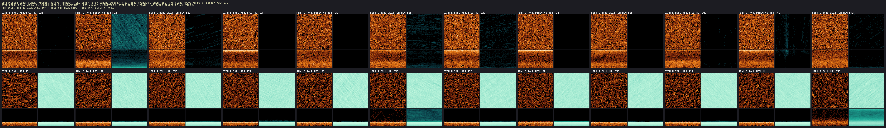

# 3D mycelium: the two lone-seed leads on fresh seeds (16 Nov 2026)

**EXPLORATION.** Follows the owner / dark-floor screen (`owner-darkfloor-screen-2026-11-16.md`) and the bodies screen (`bonds-screen-2026-11-16.md`). Each left one pattern seen on a minority of four seeds. This screen reruns those two arms, unchanged, on twelve fresh seeds to see how often each pattern occurs. There is no pre-registration and no gate; the bars below were written before any run started, so that "how often" has a fixed meaning.

## Stated before the runs

**Arms** (64 × 64 × 32, 8,192 founders, sinking 6, `lightK` 64, 50,000 steps, a readout every 2,000 steps, a full read-back every 20 steps; grid `leads` in `tools/mycelium3d/observe-screen.ts`):

1. **Bonds without the upkeep** (`bondBreak` 1024, no `bondCost`): the bodies screen's diagnostic arm, where seed 12 of seeds 11 to 14 kept bodies for the whole run.
2. **The toll alone** (`moveCost` 12, discount 64, toll mode): screen 2's toll arm, where a trail component ran from the surface group to the floor group late on seeds 13 and 14 of 11 to 14.

**Seeds.** 31 to 42, twelve per arm. Seeds 1, 2, 11 to 14, 21 and 22 were used before and are not rerun here.

**Late window.** Readouts after step 25,000 through 50,000 (13 readouts), as in both earlier screens.

**Bars** (`LEADS_BARS`):

- **A seed keeps bodies** when at least 25% of its particles are bonded at *every* late readout. On the earlier seeds this separates cleanly: seed 12 had 63% to 92% at every readout, the other three ended at 0.5%, 4.2% and 2.9% (late means).
- **A seed spans** when a 6-connected trail component (cells with P ≥ 1) has a cell in the surface group G1 and a cell in the floor group G8 in at least half of the late readouts (7 of 13). On the earlier seeds: 13 of 13 on seed 13, 8 of 13 on seed 14, none late on seeds 11 and 12.

**How the count will be worded.** Out of the twelve fresh seeds: 0 is "not seen again", 1 or 2 is "rare", 3 or more is "recurring". The earlier four seeds are reported beside the fresh twelve, never pooled into the count, because they are the seeds the leads were picked on.

**What the count cannot say.** Why a seed does it, or whether the bodies or the spanning trail do anything. Those need their own readouts.

## Results

**Bottom line.**

- **Bodies without upkeep: not seen again.** 0 of the 12 fresh seeds kept bodies by the bar (1 of 4 on the earlier seeds, seed 12).
  - Two fresh seeds came close without meeting it. Seed 40 had 38% of its particles bonded on average over the late window (20% to 66% across readouts, about 1,220 bodies, 300 closed rings, a largest body of 30). Seed 32 had 18% (13% to 27%).
  - Three more held bodies of 15 to 46 particles at some late readout while 4% to 12% of particles were bonded (seeds 34, 37, 38).
  - Four seeds held under 1% bonded on average (31, 33, 36, 41), and seed 42 had no bond at all in the late window.
  - So at zero cost the outcome is spread out rather than two-state: most worlds purge bonding, a few keep a sizeable minority of particles in bodies, and seed 12's 65% to 75% at every late readout remains the only case of a world mostly made of bodies, 1 in 16.
- **The toll's surface-to-floor trail: rare.** 1 of the 12 fresh seeds spans by the bar: seed 42, in 13 of 13 late readouts (2 of 4 on the earlier seeds, 13 and 14).
  - Seeds 34 and 36 had such a component in 2 and 3 of 13 late readouts, below the bar. The other nine had none.
  - Seed 42 repeats what went with spanning on seeds 13 and 14: fewer particles (4,670 against 5,167 to 5,442 on the other eleven), and by far the largest net lift of matter by particles (2.4M matter-layers per 1,000 steps, against −1.3M to 0.9M). Seeds 13 and 14 had 2.3M and 2.1M. That is three spanning runs out of sixteen showing the same pair of signs, which is a pattern worth a readout of its own, not a measured effect.
  - Every one of the twelve kept its trail (505k to 543k P), as before.
- **Counting all sixteen seeds per arm** (for scale only; the first four are the seeds the leads were picked on): bodies kept in 1 of 16, toll spanning in 3 of 16.
- All 24 runs: both ledger residuals exactly 0 at every one of the 2,500 read-backs.

**Run.** `tools/mycelium3d/screen.ts --grid leads --out runs/mycelium3d-leads --steps 50000 --every 2000 --move-every 20 --jobs 2`, 24 runs, 117 to 137 s each. The tally is `screen.ts --out <dir> --leads [--grid <name>]`, which applies `LEADS_BARS` per seed and refuses a run whose late window is incomplete. Run on the two earlier screens' directories, it reproduces the leads as first reported: seed 12 keeps bodies (lowest late share 0.65) and seeds 11, 13 and 14 do not (highest 0.008, 0.067, 0.039); the toll spans in 13 of 13 late readouts on seed 13 and 8 of 13 on seed 14, and in none on seeds 11 and 12.

### Bonds without the upkeep (`sink6.none.bonds.b1024.c0.k64`), late window

| seed | particles | bonded share min / mean / max | keeps bodies | largest body (max) | bodies 2+ | closed rings | trail P |
|---|---|---|---|---|---|---|---|
| 31 | 10,710 | 0.0002 / 0.0017 / 0.0035 | no | 7 | 7.8 | 0.3 | 31 |
| 32 | 9,588 | 0.1307 / 0.1829 / 0.2667 | no | 17 | 603.8 | 103.5 | 25,766 |
| 33 | 11,356 | 0.0000 / 0.0012 / 0.0035 | no | 5 | 6.1 | 0.3 | 1,069 |
| 34 | 11,164 | 0.0225 / 0.0365 / 0.0650 | no | 15 | 174.1 | 9.4 | 0 |
| 35 | 9,966 | 0.0316 / 0.0502 / 0.0819 | no | 10 | 193.5 | 27.4 | 0 |
| 36 | 11,005 | 0.0060 / 0.0074 / 0.0096 | no | 5 | 38.3 | 1.5 | 1,155 |
| 37 | 11,959 | 0.0159 / 0.0595 / 0.1141 | no | 27 | 191.0 | 59.7 | 617 |
| 38 | 11,102 | 0.0171 / 0.1177 / 0.1571 | no | 46 | 227.8 | 70.3 | 2 |
| 39 | 10,703 | 0.0000 / 0.0242 / 0.0766 | no | 25 | 66.1 | 15.2 | 131 |
| 40 | 11,290 | 0.1982 / 0.3819 / 0.6550 | no | 30 | 1,219.8 | 303.5 | 2,225 |
| 41 | 11,252 | 0.0002 / 0.0010 / 0.0019 | no | 3 | 5.6 | 0.2 | 566 |
| 42 | 10,536 | 0.0000 / 0.0000 / 0.0000 | no | 0 | 0.0 | 0.0 | 1,174 |
| *11* | *11,188* | *0.0033 / 0.0052 / 0.0081* | *no* | *11* | *22.7* | *3.7* | *44* |
| *12* | *11,514* | *0.6536 / 0.7162 / 0.7525* | *yes* | *42* | *1,709.5* | *465.3* | *6,721* |
| *13* | *9,453* | *0.0277 / 0.0421 / 0.0666* | *no* | *7* | *174.2* | *7.3* | *0* |
| *14* | *10,160* | *0.0207 / 0.0288 / 0.0388* | *no* | *9* | *126.8* | *9.2* | *0* |

Rows in italics are the earlier seeds (the bodies screen), re-tallied by the same code and not counted. No run in this arm had a surface-to-floor trail component in any late readout.

### The toll alone (`sink6.toll.k64`), late window

| seed | particles | late readouts with a G1-to-G8 trail component | spans | trail P | net matter lifted by particles /1k steps |
|---|---|---|---|---|---|
| 31 | 5,442 | 0 of 13 | no | 535,379 | −142,616 |
| 32 | 5,390 | 0 of 13 | no | 531,404 | 326,149 |
| 33 | 5,347 | 0 of 13 | no | 534,221 | 56,492 |
| 34 | 5,333 | 2 of 13 | no | 523,300 | −1,264,178 |
| 35 | 5,382 | 0 of 13 | no | 541,301 | 116,118 |
| 36 | 5,167 | 3 of 13 | no | 519,613 | 859,339 |
| 37 | 5,306 | 0 of 13 | no | 528,773 | −120,431 |
| 38 | 5,373 | 0 of 13 | no | 528,393 | 339,922 |
| 39 | 5,354 | 0 of 13 | no | 529,290 | −159,222 |
| 40 | 5,305 | 0 of 13 | no | 543,354 | −451,261 |
| 41 | 5,368 | 0 of 13 | no | 530,512 | 54,557 |
| 42 | 4,670 | 13 of 13 | yes | 505,026 | 2,436,914 |
| *11* | *5,339* | *0 of 13* | *no* | *537,837* | *75,692* |
| *12* | *5,034* | *0 of 13* | *no* | *592,277* | *277,672* |
| *13* | *4,724* | *13 of 13* | *yes* | *509,436* | *2,323,309* |
| *14* | *4,987* | *8 of 13* | *yes* | *500,652* | *2,124,129* |

Rows in italics are the earlier seeds (screen 2), re-tallied and not counted.

The same tally on the bodies screen's toll-with-bonds arm (upkeep 1, seeds 11 to 14) reads 7 of 13 on seed 11 and 13 of 13 on seed 14, and none on 12 and 13. With bonds on, the spanning seeds were 11 and 14 rather than 13 and 14, so which seeds span is not fixed by the seed alone; a change of rule that alters every draw moves it.

### Contact sheets

- `leads-screen-2026-11-16-contact-sheet.png`: particles in orange, trail in green; top views above, side views below, surface up. Row 1 is bonds without upkeep, row 2 the toll; one column per seed, 31 to 42.
- `leads-screen-2026-11-16-contact-sheet-bodies.png`: the same with the trail panels replaced by particles holding a bond.

## Reading

- **Bodies.** "A world of bodies" at zero upkeep is a 1-in-16 event on these seeds, and the bar that defined it was not met again. What the fresh seeds add is the middle ground: in seven of the twelve bonding is not purged to nothing but settles between 2% and two fifths of the particles, with bodies of tens of particles and hundreds of rings. With an upkeep of 1 none of that survives (the bodies screen). So the bond rule as written is at best neutral, and the lead is not a basis for a rung. The step that could change this is still a use for bonds (the bodies screen's next step 3), not more seeds.
- **Spanning trail.** Under the toll a surface-to-floor trail is uncommon (3 of 16) but it is the same thing each time it happens: it holds for most or all of the late window, with fewer particles and strong upward transport of matter by particles. This is the one place in the 3D world where trail and vertical transport occur together, which is what the 3D world was built to look for. It is still a correlation across three runs. Nothing here says the trail causes the lift, or that particles use it.
- **Next, if this is followed.** For the spanning state: when it starts (the readouts every 2,000 steps can date it), whether it is reached from the floor-bed state or only from the start, and a lesion: remove the column's trail and see whether the lift falls. That needs a trail-removing stroke, which the 3D world does not have yet (the page's wound removes particles and leaves trail, and feed turns waste into food; the flat world's scrape is the model). A larger count would need about 50 seeds to put a useful interval on a rate near 1 in 5.
